# EMQX

> **Warning:**
>
> #### Workshop - EMQX (delivery-truck telemetry)
>
> A predictive-maintenance use case for logistics: each delivery truck publishes its sensor telemetry to an MQTT topic, **EMQX** is the broker, and Pentaho Data Integration subscribes and turns the readings into alerts. You finish a producer transformation that simulates a truck, a consumer that subscribes to its topic, and the child transformation that writes minor and major alerts to files.
>
> **What you'll do**
>
> * Publish truck telemetry to EMQX with the **MQTT producer** step
> * Subscribe to the topic with the **MQTT consumer** step
> * Make the producer's message format match what the child expects
> * Filter, count and enrich minor and major alerts in the child transformation
> * Append the alerts to two output files
>
> **Prerequisites:**
>
> * EMQX running: `C:\Streaming\run-podman-streaming.ps1` starts it on `localhost:1884`, beside HiveMQ on `1883`
> * The [HiveMQ](../03-mqtt-hivemq/guide.md) workshop: this lab works in its folder, `C:\Workshop-SD-Specialty\03-mqtt\03-mqtt-hivemq`
>
> **Estimated time:** 35 minutes

<div align="center">
<figure>
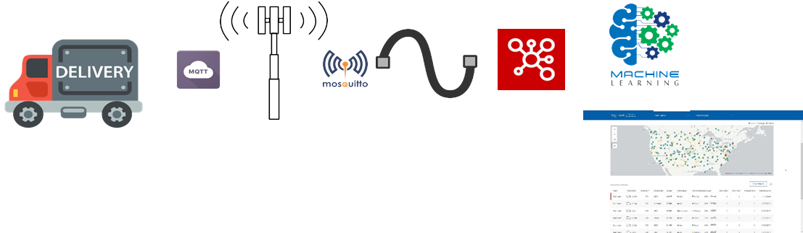
<figcaption>From the truck to the dashboard (the broker in this lab is EMQX)</figcaption>
</figure>
</div>

This workshop's pipeline: the producer publishes each sensor reading to EMQX as one line of text, the consumer collects the lines into batches, and each batch runs the child once, which writes the alerts to two files:

<div align="center">
<figure>

<figcaption>The pipeline: producer, EMQX, consumer, and the child that writes the alerts</figcaption>
</figure>
</div>

:::: tabs

### 1. Sign In to EMQX

> **Note:**
>
> #### The EMQX Dashboard
>
> EMQX 6.3.3 runs here as one node under its **Community License**: free for any non-production use, and for a single-node production deployment that is not offered as a hosted service or embedded in a product you sell. A cluster of two or more nodes needs a commercial license.

1. Open `http://localhost:18083` in a browser, enter these, and select **Login**. The page says EMQX Enterprise; the Community License (next step) sets what this single node may do:

| | |
| --- | --- |
| Username | `admin` |
| Password | `public` |

<div align="center">
<figure>
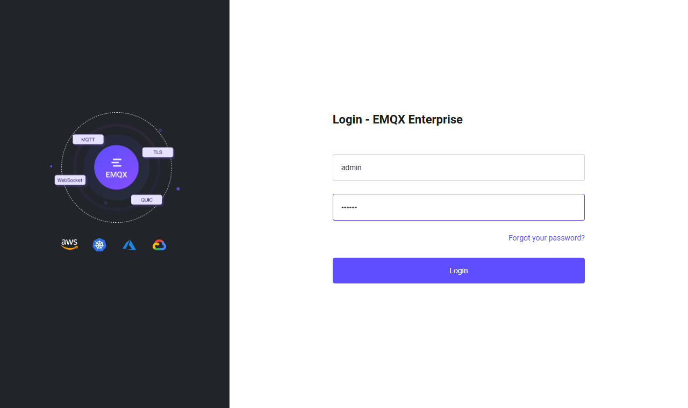
<figcaption>The EMQX Dashboard's sign-in page</figcaption>
</figure>
</div>

2. The first sign-in asks you to change the default password. Select **Skip**: in this lab, the broker keeps the stock login. On any machine reachable beyond your own, set a password of 8 to 64 characters instead, and select **Confirm**.

<div align="center">
<figure>
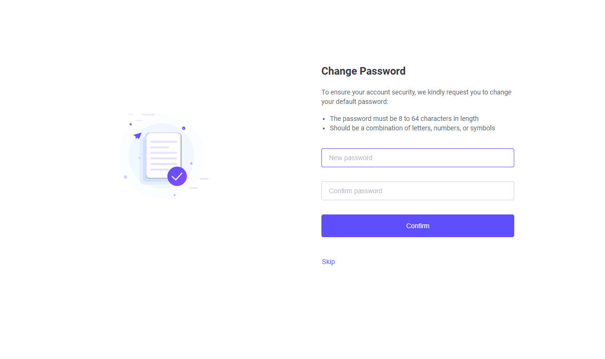
<figcaption>The first sign-in: change the default password, or Skip</figcaption>
</figure>
</div>

3. A dialog about the **Community License** opens. Select **Acknowledge**.

<div align="center">
<figure>
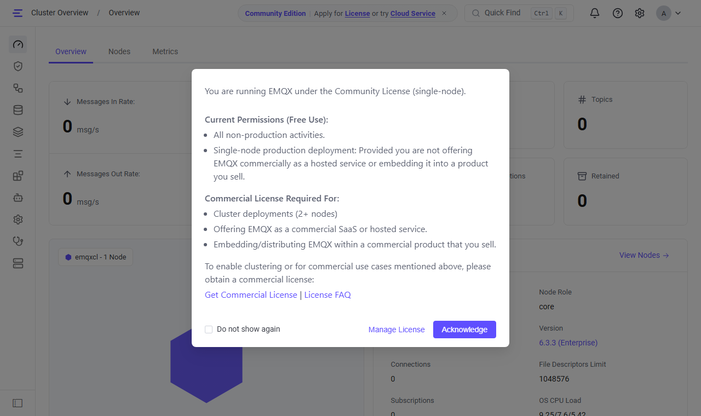
<figcaption>The Community License: one node, free</figcaption>
</figure>
</div>

> **Success:** Checkpoint: the **Cluster Overview** opens, with **Live Sessions** at `0` and one node.

### 2. Prepare the Producer

> **Note:**
>
> #### MQTT producer
>
> `tr_mqtt_producer.ktr` ships with the truck already simulated. **gr-IoT_gateway** makes one row every 5 seconds for vehicle `111`, six JavaScript steps play its sensors, and **cf-concat_message_field** joins each reading into one `;`-separated line, which **sv-message** renames `message`. The last step is a placeholder, **Replace Me..!**, where the **MQTT producer** goes.
>
> <div align="center">
> <figure>
> 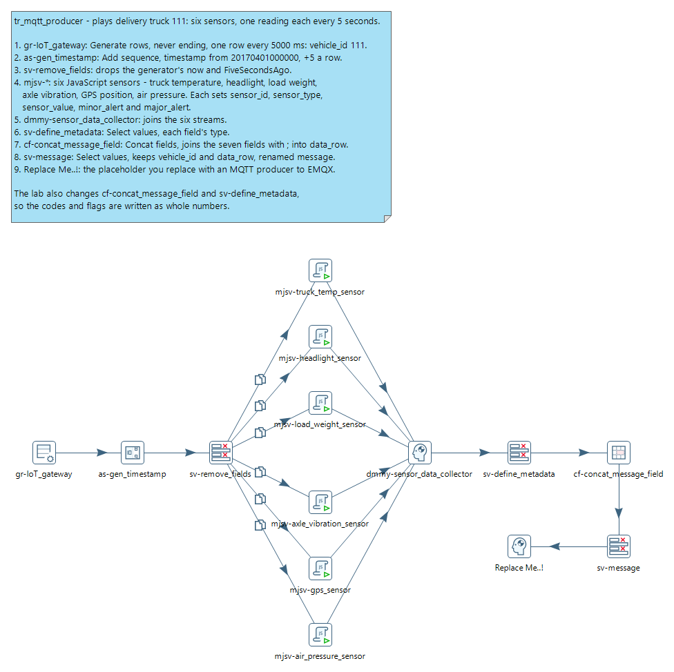
> <figcaption>The producer as it ships: the last step is a placeholder</figcaption>
> </figure>
> </div>

1. Start Spoon with the **Start Pentaho Data Integration** button below, or from PowerShell:

```powershell
Set-Location C:\Pentaho\design-tools\data-integration
.\spoon.bat
```

<button data-launch="spoon" data-path="">Start Pentaho Data Integration</button>

2. Select **File > Open** (`Ctrl+O`) and open `C:\Workshop-SD-Specialty\03-mqtt\03-mqtt-hivemq\tr_mqtt_producer.ktr`.
3. Double-click **cf-concat_message_field**. On the **Fields** tab, set **Type** to `Number` and **Format** to `#` in four rows, so the sensor codes and alert flags are written as whole numbers:

| Name | Type | Format |
| --- | --- | --- |
| `sensor_id` | **Number** | **`#`** |
| `sensor_type` | **Number** | **`#`** |
| `minor_alert` | **Number** | **`#`** |
| `major_alert` | **Number** | **`#`** |

Leave `vehicle_id` and `timestamp` as Integer and `sensor_value` as String.

<div align="center">
<figure>
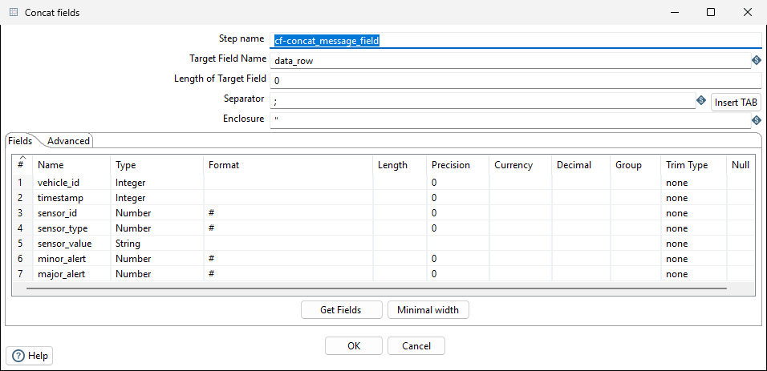
<figcaption>cf-concat_message_field: the codes and flags as whole numbers</figcaption>
</figure>
</div>

4. Select **OK**.
5. Double-click **sv-define_metadata**. On the **Meta-data** tab, clear the **Length** and **Precision** cells of `sensor_id`, `sensor_type`, `minor_alert` and `major_alert`, and the **Length** cell of `sensor_value`. Keep each row's **Type**.

<div align="center">
<figure>
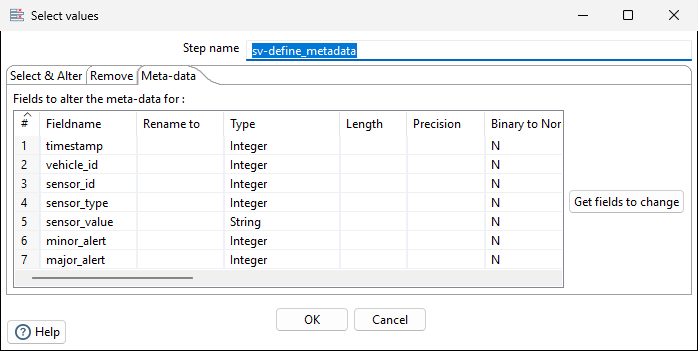
<figcaption>sv-define_metadata: types only, no lengths</figcaption>
</figure>
</div>

6. Select **OK**, and save the transformation (`Ctrl+S`).

### 3. MQTT Producer

> **Note:**
>
> #### Publish to EMQX
>
> **MQTT producer** sends each row's `message` field to a topic. Port `1884` is EMQX; `1883` is HiveMQ.
>
> <div align="center">
> <figure>
> 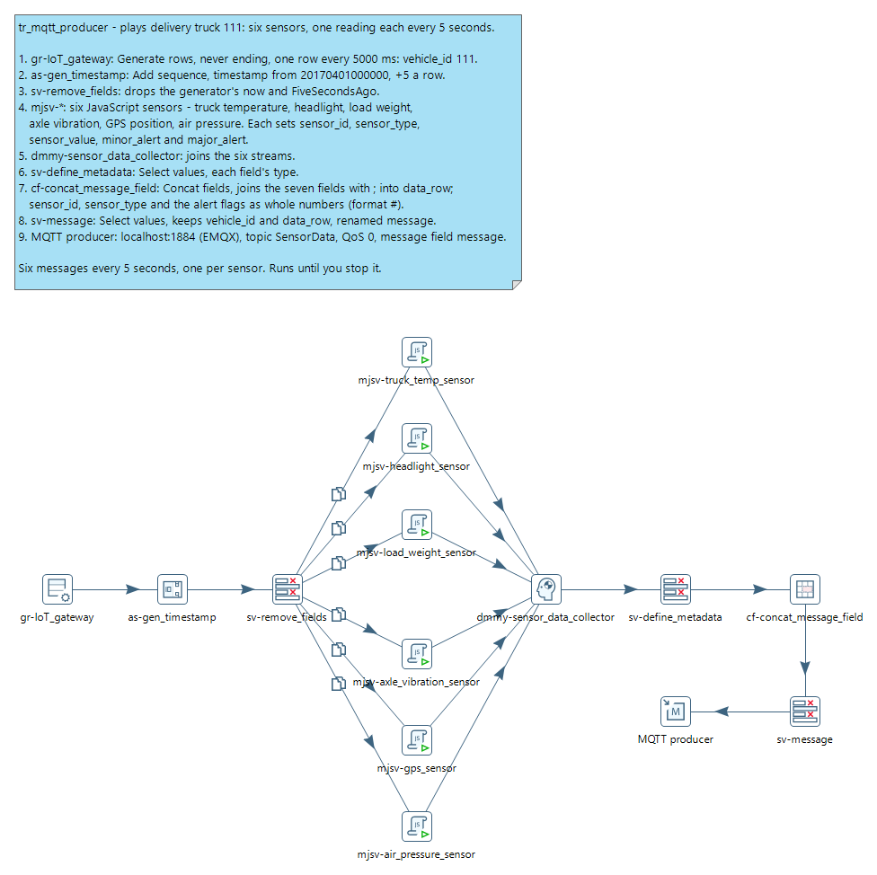
> <figcaption>What you build: tr_mqtt_producer</figcaption>
> </figure>
> </div>

1. Select **Replace Me..!** on the canvas and press `Delete`.
2. On the **Design** tab, open the **Streaming** folder and drag **MQTT producer** onto the canvas.
3. Create a hop from **sv-message** to **MQTT producer**: hold `Shift` and drag from one step to the other.
4. Double-click **MQTT producer**. Keep its step name, `MQTT producer`, and on the **Setup** tab set:

| Setting | Value |
| --- | --- |
| **Connection** | `localhost:1884` |
| **Client ID** | empty |
| **Topic** | **Specify topic**, with **Topic name** `SensorData` |
| **Quality of Service** | `0` |
| **Message field** | `message` |

<div align="center">
<figure>
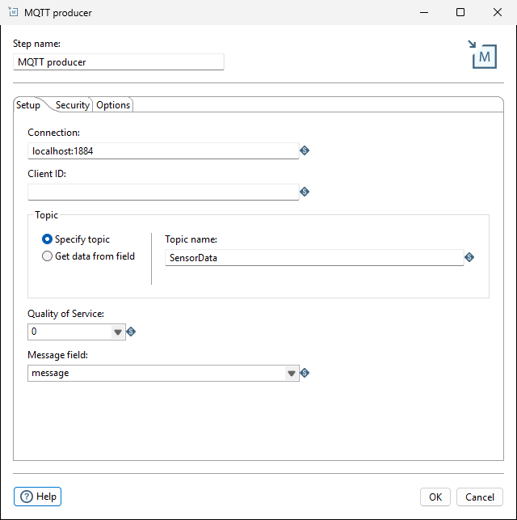
<figcaption>MQTT producer: SensorData on EMQX</figcaption>
</figure>
</div>

QoS and session settings, for reference:

* **QoS** `0` (at most once) has the lowest latency, and messages can be lost; `1` (at least once) can deliver duplicates; `2` (exactly once) has the highest overhead.
* **Clean Session**, on the **Options** tab: `true` means the broker keeps no state for the client; `false` means it keeps the client's subscriptions and queues QoS 1 and 2 messages while it is offline.

5. Select **OK**, and save the transformation (`Ctrl+S`).
6. Press `F9` (**Action > Run**), and select **Run** in the **Run Options** dialog.
7. In **Execution Results**, open the **Step Metrics** tab.

> **Success:** Checkpoint: the transformation keeps running. Every 5 seconds **gr-IoT_gateway** writes one more row, and **dmmy-sensor_data_collector** and **MQTT producer** each take 6 more, one per sensor.

8. Leave the producer running. In the EMQX Dashboard, open **Clients** from the Dashboard's left menu (hover over the icons, or expand the menu with the toggle at its bottom left).

> **Success:** Checkpoint: one client is **Connected**, the producer. Its messages go nowhere yet: no client subscribes to `SensorData`, so EMQX drops them. The consumer in the next tab is the first subscriber.

### 4. MQTT Consumer

> **Note:**
>
> #### MQTT consumer
>
> `tr_mqtt_consumer.ktr` ships with a placeholder, **Replace Me.. !**. Replace it with an **MQTT consumer** that subscribes to the producer's topic and runs the child transformation for each batch.
>
> <div align="center">
> <figure>
> 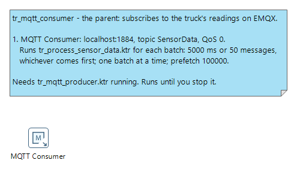
> <figcaption>What you build: tr_mqtt_consumer</figcaption>
> </figure>
> </div>

1. Select **File > Open** (`Ctrl+O`) and open `C:\Workshop-SD-Specialty\03-mqtt\03-mqtt-hivemq\tr_mqtt_consumer.ktr`.
2. Select **Replace Me.. !** on the canvas and press `Delete`.
3. On the **Design** tab, open the **Streaming** folder and drag **MQTT consumer** onto the canvas.
4. Double-click **MQTT consumer**. Set **Step name** to `MQTT Consumer`.
5. Set **Transformation** to `${Internal.Entry.Current.Directory}/tr_process_sensor_data.ktr`.
6. On the **Setup** tab, set **Connection** to `localhost:1884`, enter `SensorData` in the first row of the **Topics** grid, and set **Quality of Service** to `0`. Leave **Client ID** empty.

<div align="center">
<figure>
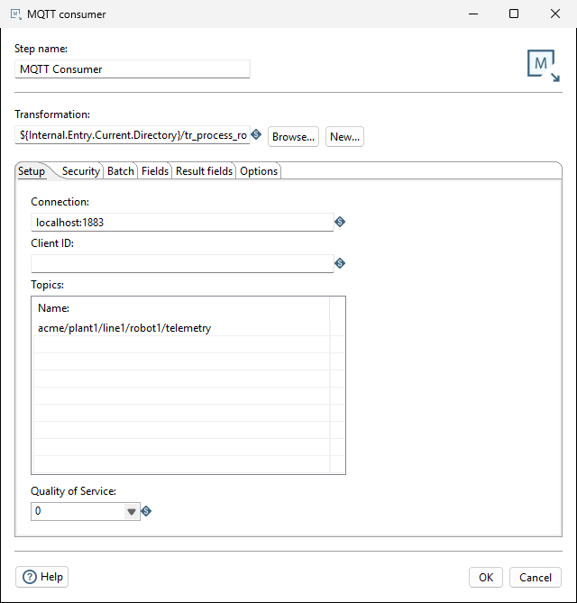
<figcaption>MQTT consumer, Setup tab: subscribed to SensorData</figcaption>
</figure>
</div>

7. Open the **Batch** tab and set:

| Setting | Value |
| --- | --- |
| **Duration (ms)** | `5000` |
| **Number of records** | `50` |
| **Maximum concurrent batches** | `1` |
| **Message prefetch limit** | `100000` |

<div align="center">
<figure>
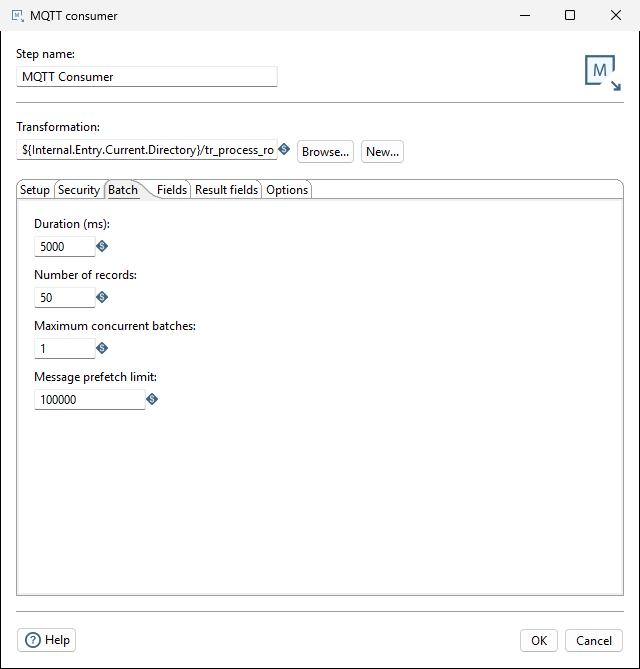
<figcaption>MQTT consumer, Batch tab</figcaption>
</figure>
</div>

Pentaho Data Integration runs the child when either threshold is met: **Duration (ms)**, a time window, or **Number of records**, a message count. Two settings control back pressure: **Message prefetch limit** caps how many messages Pentaho Data Integration queues in memory, and **Maximum concurrent batches** lets several batches run at once, for more throughput at the cost of more resources.

8. Select **OK**, and save the transformation (`Ctrl+S`).

> **Success:** Checkpoint: the canvas holds one step, **MQTT Consumer**, under the blue note.

### 5. Child Transformation

> **Note:**
>
> #### Process the telemetry
>
> `tr_process_sensor_data.ktr` ships built. It splits each message, looks up the sensor's name, keeps the minor and major alerts, counts them, adds the truck's owner and appends the results to two files. It compares the sensor codes and alert flags as text, so its values must match what the producer now writes: `1`, not `1.0`.
>
> <div align="center">
> <figure>
> 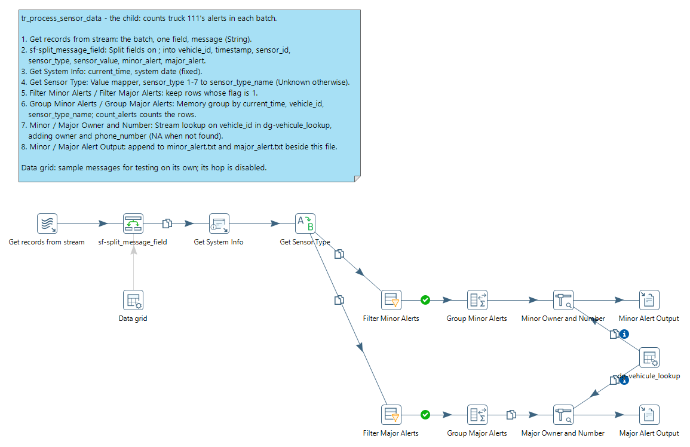
> <figcaption>The child: one branch for minor alerts, one for major</figcaption>
> </figure>
> </div>

1. Select **File > Open** (`Ctrl+O`) and open `C:\Workshop-SD-Specialty\03-mqtt\03-mqtt-hivemq\tr_process_sensor_data.ktr`.
2. Double-click **Get Sensor Type**. In the **Field values** grid, change each **Source value** to a whole number, so the grid matches this table:

| Source value | Target value |
| --- | --- |
| **`1`** | `Temperature` |
| **`2`** | `Headlight` |
| **`3`** | `Load_Weight` |
| **`4`** | `Vibration` |
| **`5`** | `Count` |
| **`6`** | `Pressure` |
| **`7`** | `Position` |

<div align="center">
<figure>
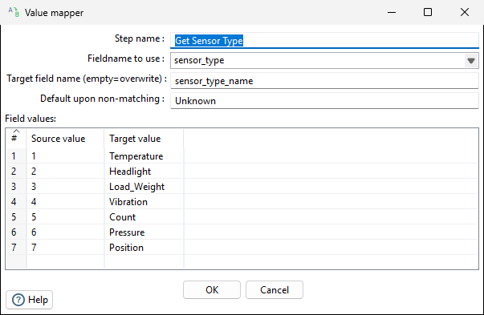
<figcaption>Get Sensor Type: whole-number source values</figcaption>
</figure>
</div>

3. Select **OK**.
4. Double-click **Filter Minor Alerts**. In **The condition**, select the condition on `minor_alert` to edit it, then select its value, `1.0`. In the **Enter value** dialog, set **Value** to `1` and select **OK**. Select **OK** again to close the step.

<div align="center">
<figure>
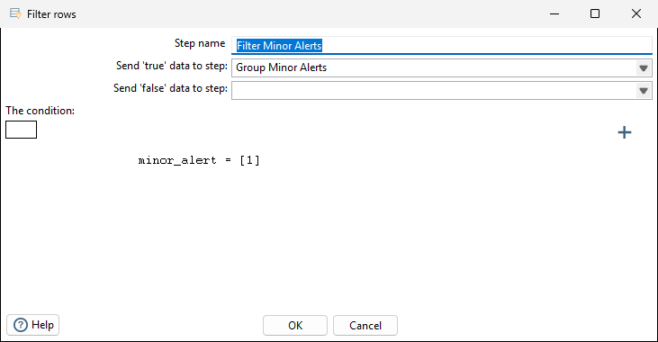
<figcaption>Filter Minor Alerts: minor_alert = 1</figcaption>
</figure>
</div>

5. Double-click **Filter Major Alerts** and make the same change: its condition compares `major_alert` with `1`.
6. Save the transformation (`Ctrl+S`).

The rest of the child ships as the solution has it:

| Step | What it does |
| --- | --- |
| **Get records from stream** | Receives each batch as rows with one field, `message` (String) |
| **sf-split_message_field** | **Split fields** on `;` into seven String fields: `vehicle_id`, `timestamp`, `sensor_id`, `sensor_type`, `sensor_value`, `minor_alert`, `major_alert` |
| **Get System Info** | Adds `current_time`, of type `system date (fixed)` |
| **Get Sensor Type** | **Value mapper** from `sensor_type` to a new field, `sensor_type_name`; `Unknown` when no value matches |
| **Filter Minor Alerts**, **Filter Major Alerts** | Keep the rows whose `minor_alert`, or `major_alert`, is `1` |
| **Group Minor Alerts**, **Group Major Alerts** | **Memory group by** `current_time`, `vehicle_id` and `sensor_type_name`, with `count_alerts` counting the rows of each group |
| **Minor Owner and Number**, **Major Owner and Number** | **Stream lookup** on `vehicle_id` in **dg-vehicule_lookup**, adding `owner` and `phone_number` (`NA` when not found) |
| **dg-vehicule_lookup** | **Data grid**: vehicle `111` is Peter Smith, `+44 728 55 55`; vehicle `112` is Steve Brown, `+44 781 85 55` |
| **Minor Alert Output**, **Major Alert Output** | **Text file output** to `${Internal.Transformation.Filename.Directory}/minor_alert` and `/major_alert`, extension `txt`: tab-separated, no header, **Append** selected |
| **Data grid** | Sample messages for testing the child on its own; its hop to **sf-split_message_field** is disabled. The starter's samples still use `1.0`; the solution's use whole numbers |

### 6. Run

> **Note:**
>
> #### Run producer and consumer together
>
> The producer and the consumer run side by side in Spoon, each in its own tab. The consumer runs the child for every batch.

1. Select the **tr_mqtt_producer** tab. If the producer is not running, press `F9` (**Action > Run**), and select **Run** in the **Run Options** dialog.
2. Select the **tr_mqtt_consumer** tab, press `F9` (**Action > Run**), and select **Run** in the **Run Options** dialog.
3. In the EMQX Dashboard, open **Clients** from the Dashboard's left menu (hover over the icons, or expand the menu with the toggle at its bottom left).

<div align="center">
<figure>
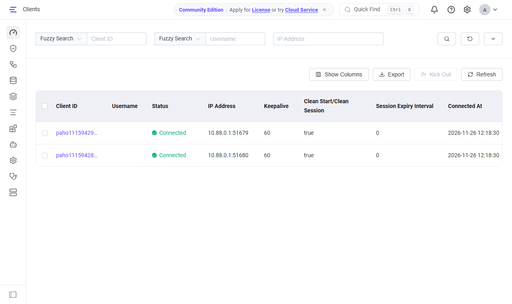
<figcaption>Two clients: the producer and the consumer</figcaption>
</figure>
</div>

> **Success:** Checkpoint: two clients are **Connected**: the producer and the consumer. Both IDs start with `paho`, the MQTT client library inside Pentaho Data Integration, which generates an ID when **Client ID** is empty.

4. Open **Subscriptions** from the Dashboard's left menu (hover over the icons, or expand the menu with the toggle at its bottom left).

<div align="center">
<figure>
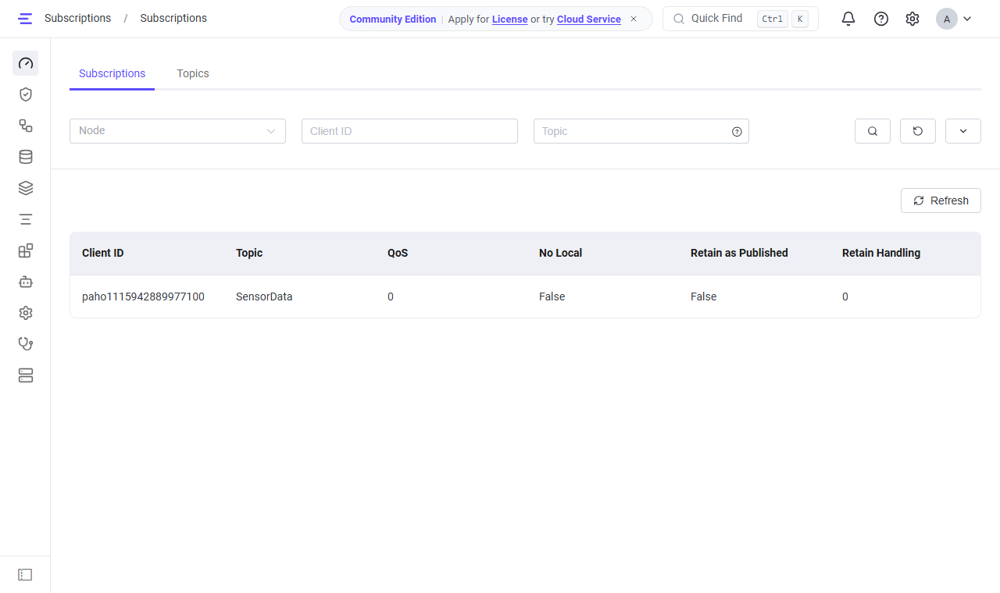
<figcaption>The consumer's subscription to SensorData</figcaption>
</figure>
</div>

> **Success:** Checkpoint: the consumer is subscribed to `SensorData`, with QoS `0`.

5. After 15 seconds, open `C:\Workshop-SD-Specialty\03-mqtt\03-mqtt-hivemq\major_alert.txt` in a text editor. Its first lines look like these, from a run of this workshop:

```text
2026/11/26 12:11:32.868	111	Position   	2	Peter Smith	+44 728 55 55
2026/11/26 12:11:32.868	111	Headlight  	1	Peter Smith	+44 728 55 55
2026/11/26 12:11:37.781	111	Position   	1	Peter Smith	+44 728 55 55
2026/11/26 12:11:37.781	111	Headlight  	1	Peter Smith	+44 728 55 55
2026/11/26 12:11:37.781	111	Vibration  	1	Peter Smith	+44 728 55 55
2026/11/26 12:11:42.794	111	Position   	1	Peter Smith	+44 728 55 55
```

> **Success:** Checkpoint: new lines arrive every 5 seconds, tab-separated: the time, `111`, the sensor type, the count, `Peter Smith` and `+44 728 55 55`. Every batch has a `Position` line, because the GPS sensor always raises a major alert; `Vibration` and `Headlight` lines come and go. The first batch can count `2`: it can collect two rounds of readings.

6. Open `minor_alert.txt` in the same folder.

> **Success:** Checkpoint: every batch has a `Vibration` line: the vibration sensor reads 80 to 99, always above its minor threshold of 75. `Temperature`, `Headlight`, `Load_Weight` and `Pressure` lines come and go.

7. Stop both transformations: on each tab, select **Stop** in the canvas toolbar.

> **Under the hood:**
>
> #### The message is text from end to end
>
> **cf-concat_message_field** turns each reading into one line of text,
> such as `111;20170401000000;7;7;40.73447:-74.00232;0;1`. MQTT carries
> it as bytes, and the child's **sf-split_message_field** splits it on `;`
> into seven String fields. **Get Sensor Type** and the two filters then
> compare text, so `1.0` and `1` are different values. The `#` format on
> the producer side and the whole numbers on the child side make the two
> ends agree. **Get System Info**, with `system date (fixed)`, stamps every
> row of a batch with the time that run of the child started, so **Group
> Minor Alerts** and **Group Major Alerts** count each sensor's alerts per
> batch.
>
> **Why it matters:** a message is a contract between a producer and a
> consumer that never see each other's transformations. A format change on
> one side raises no error on the other: the filters stop matching, and the
> alerts silently stop.

::::

## Troubleshooting <!-- no-step -->

<details>
<summary>The consumer runs, but no alert file appears</summary>

Check these first:

* the producer and the consumer use the same topic, `SensorData`;
* both connect to `localhost:1884`, and EMQX shows both clients as connected;
* the consumer's batch has **Duration (ms)** or **Number of records** above `0`;
* the child starts with **Get records from stream**;
* **Get Sensor Type** and the two filters compare with `1`, not `1.0`.

</details>

<details>
<summary>EMQX does not answer on 1884</summary>

Run `C:\Streaming\run-podman-streaming.ps1 -Status`. If `pcm-emqx` is stopped or missing, run `C:\Streaming\run-podman-streaming.ps1 -Broker emqx`.

</details>

<details>
<summary>The Dashboard sign-in fails after you changed the password</summary>

The new password lives in the broker's container. `C:\Streaming\run-podman-streaming.ps1 -Broker emqx -Reset` creates EMQX again with the stock `admin` / `public`.

</details>

## Lab Files

_No bundled files for this lab._ It works in the [HiveMQ](../03-mqtt-hivemq/guide.md) lab's folder, `C:\Workshop-SD-Specialty\03-mqtt\03-mqtt-hivemq`, where you open the three starter transformations. The HiveMQ lab's **Lab Files** list them, with buttons to open each one in Pentaho Data Integration.

### Solution <!-- no-step -->

The finished producer, consumer and child are in `C:\Workshop-SD-Specialty\03-mqtt\03-mqtt-hivemq\solution`, and under **Solution** in the [HiveMQ lab's Lab Files](../03-mqtt-hivemq/guide.md#lab-files). Open them alongside your own to compare.

---

> **Tip:** Next, a second protocol: queues and exchanges with AMQP. Start with the AMQP [Overview](../05-amqp/guide.md).
