# HiveMQ

> **Warning:**
>
> #### Workshop - HiveMQ (industrial robot sensors)
>
> Plants collect readings from many industrial sensors through Supervisory Control and Data Acquisition (SCADA) systems, and Message Queuing Telemetry Transport (MQTT) is a common protocol for moving those readings. In this workshop you run a HiveMQ MQTT broker, publish simulated robot-sensor readings to it, and consume the live stream in Pentaho Data Integration with an **MQTT consumer** that runs a child transformation for each batch.
>
> **What you'll do**
>
> * Start a HiveMQ broker with Podman and sign in to its Control Center
> * Publish simulated robot-sensor readings to the `acme/plant1/line1/robot1/telemetry` topic with a Python script
> * Build a child transformation that timestamps each reading, parses it and appends it to a file
> * Build a parent transformation whose **MQTT consumer** step runs the child for each batch
> * Watch a Last Will and Testament (LWT) message report the sensor offline
>
> **Prerequisites:**
>
> * The brokers and Python from [Before You Start](../00-before-you-start/guide.md)
> * The parent/child pattern, from the Streaming Data [Overview](../01-overview/guide.md)
> * The MQTT essentials (QoS, retained messages, LWT), from the MQTT [Overview](../02-mqtt/guide.md)
> * The [EMQX](../03-mqtt-emqx/guide.md) workshop: the **MQTT consumer** and its **Batch** tab, which this lab builds from scratch
>
> **Estimated time:** 30 minutes

<div align="center">
<figure>
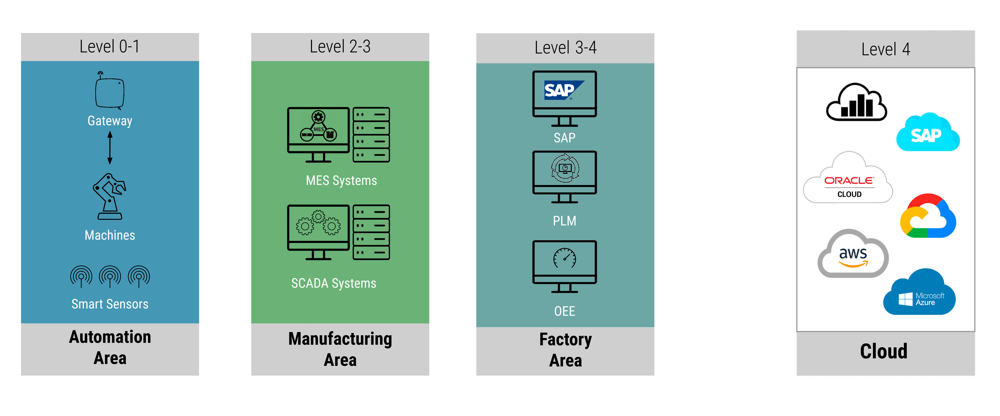
<figcaption>Where SCADA sits, between the machines and the factory systems</figcaption>
</figure>
</div>

> **Note:** Two challenges a SCADA project often meets:
>
> * **Data silos:** brownfield factories run equipment and back-end systems from many vendors, each with its own data format. Those formats keep data apart and make analysis across the whole factory hard.
> * **IT/OT priorities:** a modernization project needs experts from both the operations side (OT) and the enterprise IT side (IT).

This workshop's pipeline: `sensor.py` publishes to HiveMQ, the parent's **MQTT Consumer** collects the readings into batches, and each batch runs the child once, which appends the readings to `robot_sensor.txt`:

<div align="center">
<figure>
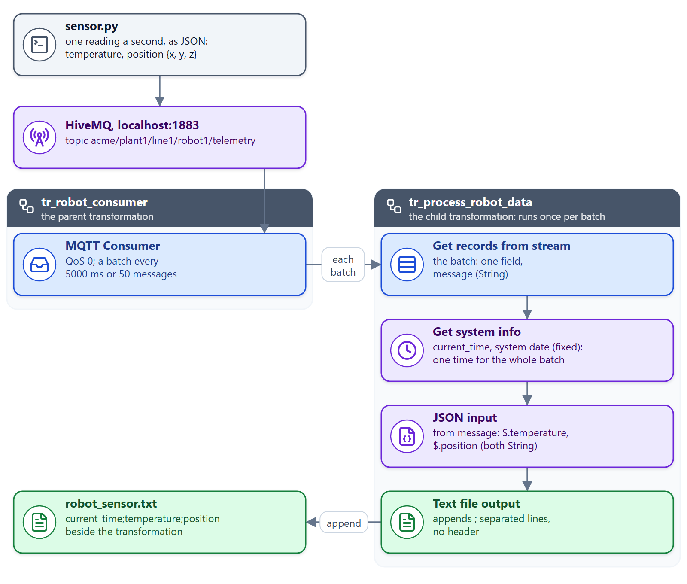
<figcaption>The pipeline: tr_robot_consumer hands each batch to tr_process_robot_data</figcaption>
</figure>
</div>

:::: tabs

### 1. Start HiveMQ

> **Note:**
>
> #### Start HiveMQ
>
> HiveMQ runs as a container under **Podman**. The course's Streaming kit, `C:\Streaming\run-podman-streaming.ps1`, starts it from one pinned image, HiveMQ 4.57.0, alongside the other brokers, each on its own ports, so no workshop has to stop another's broker.
>
> HiveMQ runs here without a license file, as a trial limited to 25 connections, and accepts any MQTT client without a username or password. For production, apply a license, configure your own credentials, and remove the `hivemq-allow-all` extension.

1. Start the brokers. In PowerShell, run:

```powershell
C:\Streaming\run-podman-streaming.ps1
```

It starts HiveMQ, EMQX, RabbitMQ and Kafka, and waits until each one answers its own clients. The first run downloads the images: give it a few minutes.

> **Success:** Checkpoint: the script ends with `The brokers are up.` and lists HiveMQ on these ports:
>
> | Port | What it is |
> | --- | --- |
> | `1883` | MQTT listener: what your transformations connect to |
> | `9090` | HiveMQ Control Center (container port 8080) |
> | `9081` | HiveMQ websocket listener (container port 8000) |

If the script stops with `These containers already publish a port a broker needs`, an older broker from another workshop, such as a Mosquitto container on `1883`, still runs. Stop it with the `podman stop` command the script prints, and run the script again.

2. Open `http://localhost:9090` in a browser, and sign in to the HiveMQ Control Center:

| | |
| --- | --- |
| Username | `admin` |
| Password | `hivemq` |

<div align="center">
<figure>
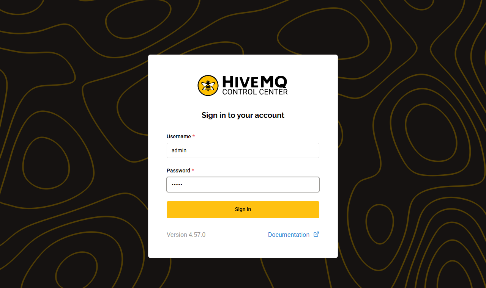
<figcaption>The Control Center's sign-in page</figcaption>
</figure>
</div>

3. The first sign-in opens a **Welcome to Your HiveMQ Control Center** dialog. Select **Get Started**. Select the **X** on the orange **Security Warning** to close it: in this lab the default credentials stay as they are.

<div align="center">
<figure>
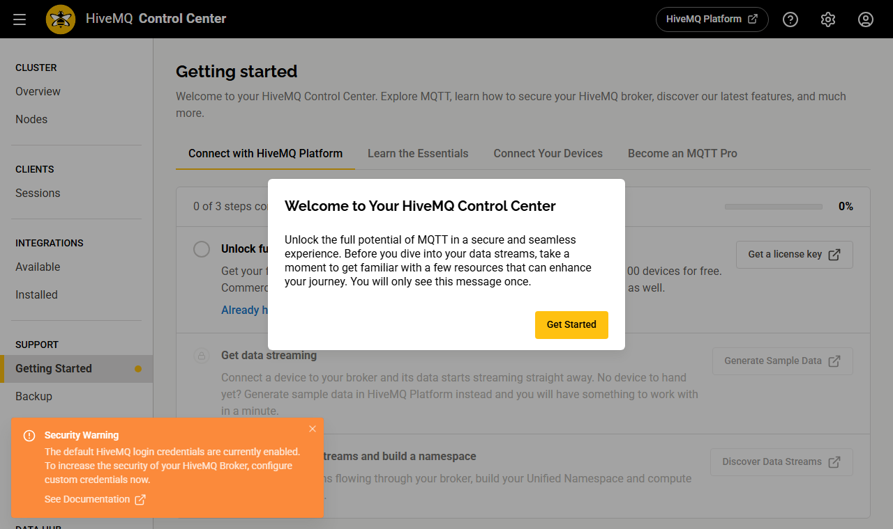
<figcaption>The first sign-in: the Welcome dialog and the default-credentials warning</figcaption>
</figure>
</div>

4. Under **CLUSTER** in the menu on the left, select **Overview**.

<div align="center">
<figure>
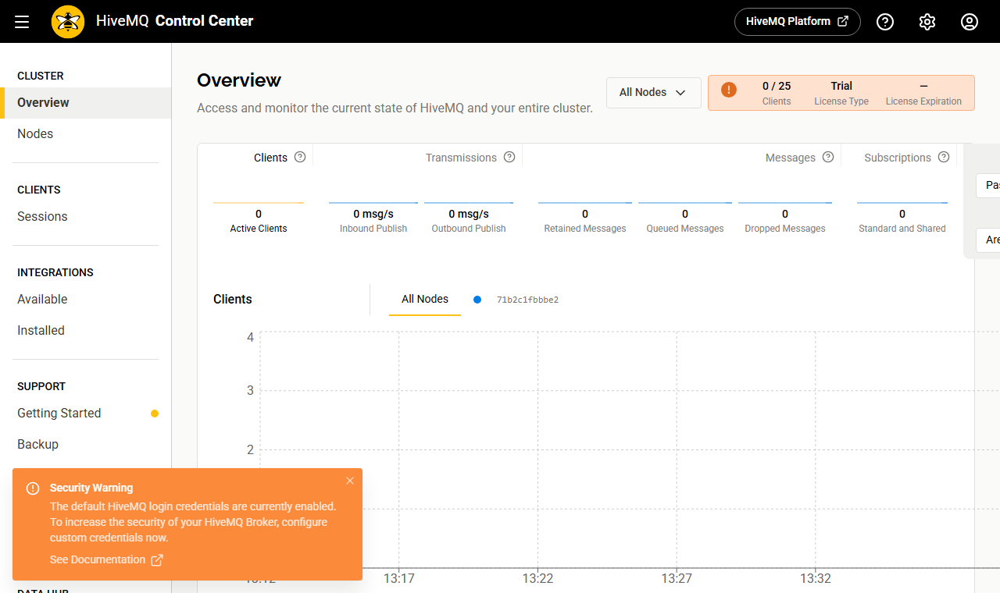
<figcaption>Cluster Overview: the Clients box reads 0 / 25 and the license is Trial</figcaption>
</figure>
</div>

> **Success:** Checkpoint: **Clients** shows `0 / 25`, the trial's limit, and **License Type** shows `Trial`.

### 2. Publish Sensor Data

> **Note:**
>
> #### Publish robot-sensor readings
>
> `sensor.py` plays the robot. Once a second it publishes a JSON message, a temperature and an x/y/z position, to the `acme/plant1/line1/robot1/telemetry` topic on `localhost:1883`.
>
> The topic is a path in the plant's *Unified Namespace*: enterprise `acme`, site `plant1`, line `line1`, device `robot1`, and what the message is, `telemetry`. Every device on the line publishes to its own path in the same tree, so a consumer can take one robot, or every device on the line with a wildcard. The MQTT [Overview](../02-mqtt/guide.md#unified-namespace-and-sparkplug) explains the idea.

1. Install the script's one dependency, the Paho MQTT client. In PowerShell, run:

```powershell
Set-Location C:\Workshop-SD-Specialty\03-mqtt\04-mqtt-hivemq
pip install -r requirements.txt
```

2. Review the publisher, `sensor.py`. These are the lines that matter:

```python
broker = 'localhost'
port = int(sys.argv[1]) if len(sys.argv) > 1 else 1883
topic = "acme/plant1/line1/robot1/telemetry"

def publish(client):
    while True:
        temperature = random.uniform(20.0, 100.0)
        position = {'x': random.uniform(-10.0, 10.0),
                    'y': random.uniform(-10.0, 10.0),
                    'z': random.uniform(-10.0, 10.0)}
        message = json.dumps({'temperature': temperature, 'position': position})
        result = client.publish(topic, message)
        ...
        time.sleep(1)
```

The script creates its client with `callback_api_version=CallbackAPIVersion.VERSION2`, the callback signatures of the Paho client since [release 2.0.0](https://github.com/eclipse/paho.mqtt.python/releases/tag/v2.0.0): its `on_connect` receives a `reason_code` and the connection's `properties`. Paho 2.x warns that the old version 1 form is deprecated.

3. Start the publisher, and leave it running in its own PowerShell window:

```powershell
python sensor.py
```

> **Success:** Checkpoint: the script prints `Connected to MQTT Broker!`, then one line a second that starts with `Sent` and ends with the topic, `acme/plant1/line1/robot1/telemetry`.

4. In the Control Center, open **Overview** again.

> **Success:** Checkpoint: **Active Clients** shows `1`, the publisher, and **Inbound Publish** shows `1 msg/s`.

5. Leave the publisher running. To stop it later, press `Ctrl+C` in its window.

### 3. Get Records and System Info

> **Note:**
>
> #### The child: one batch at a time
>
> The child transformation handles one batch of messages. **Get records from stream** hands it the batch as rows; from there the steps treat them like any other stream. Build the child first, so the parent has a file to point to. This is the child you build in this tab and the next two:
>
> <div align="center">
> <figure>
> 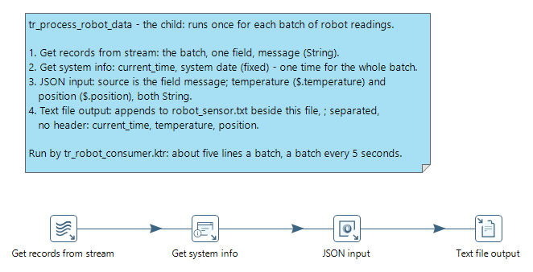
> <figcaption>What you build: tr_process_robot_data</figcaption>
> </figure>
> </div>

1. Start Spoon with the **Start Pentaho Data Integration** button below, or from PowerShell:

```powershell
Set-Location C:\Pentaho\design-tools\data-integration
.\spoon.bat
```

<button data-launch="spoon" data-path="">Start Pentaho Data Integration</button>

2. Select **File > New > Transformation** (`Ctrl+N`).
3. Select **File > Save as** and save it as `tr_process_robot_data.ktr` in `C:\Workshop-SD-Specialty\03-mqtt\04-mqtt-hivemq`.
4. On the **Design** tab, open the **Streaming** folder and drag **Get records from stream** onto the canvas.
5. Double-click **Get records from stream**. Fill the **Fields** grid with one row, the message text:

| Fieldname | Type |
| --- | --- |
| `message` | String |

<div align="center">
<figure>
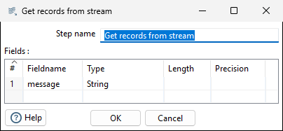
<figcaption>Get records from stream: the batch arrives as one field, message</figcaption>
</figure>
</div>

6. Select **OK**.
7. On the **Design** tab, open the **Input** folder and drag **Get system info** onto the canvas, to the right of **Get records from stream**.
8. Create a hop from **Get records from stream** to **Get system info**: hold `Shift` and drag from one step to the other.
9. Double-click **Get system info**. Fill the **Fields** grid with one row: set **Name** to `current_time`, select the **Type** cell and select `system date (fixed)` in the **Select info type** list.

| Name | Type |
| --- | --- |
| `current_time` | `system date (fixed)` |

<div align="center">
<figure>
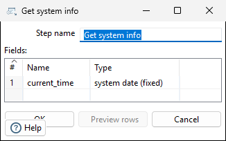
<figcaption>Get system info: one time for the whole batch</figcaption>
</figure>
</div>

10. Select **OK**, and save the transformation (`Ctrl+S`).

### 4. JSON Input

> **Note:**
>
> #### Parse each reading
>
> **JSON input** usually reads files. Here it reads a field of the incoming rows, `message`, and turns each JSON reading into fields.

1. From the **Input** folder, drag **JSON input** onto the canvas, and create a hop from **Get system info** to **JSON input**.
2. Double-click **JSON input**. On the **File** tab, select **Source is from a previous step**, and set **Select field** to `message`.

<div align="center">
<figure>
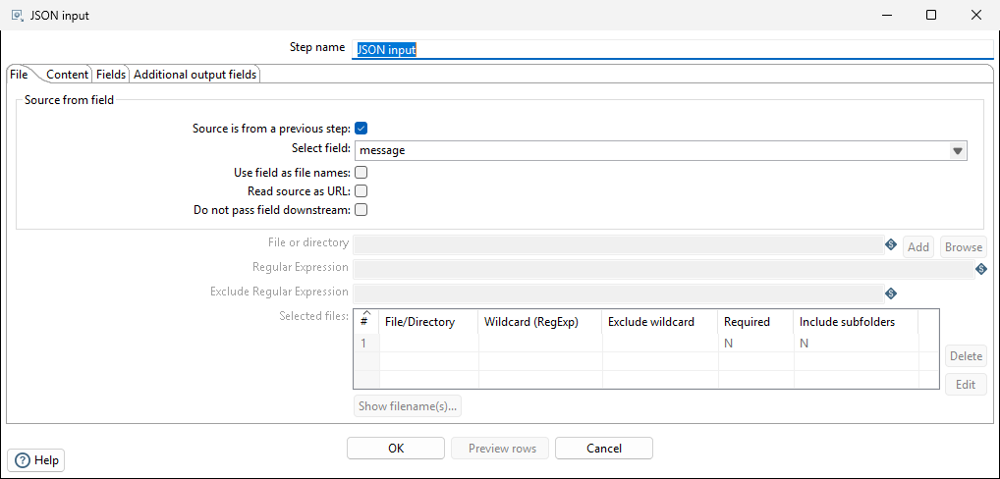
<figcaption>JSON input, File tab: the source is the field message</figcaption>
</figure>
</div>

3. Open the **Content** tab and check that **Ignore missing path** and **Default path leaf to null** are selected.

<div align="center">
<figure>
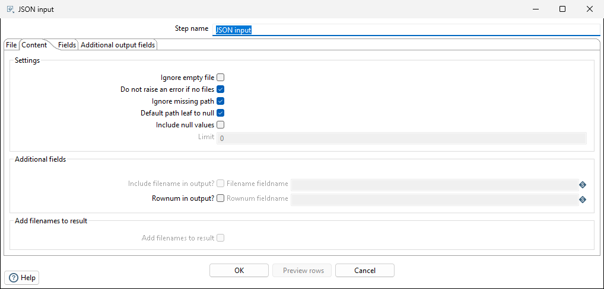
<figcaption>JSON input, Content tab</figcaption>
</figure>
</div>

4. Open the **Fields** tab and fill the grid:

| Name | Path | Type |
| --- | --- | --- |
| `temperature` | `$.temperature` | String |
| `position` | `$.position` | String |

<div align="center">
<figure>
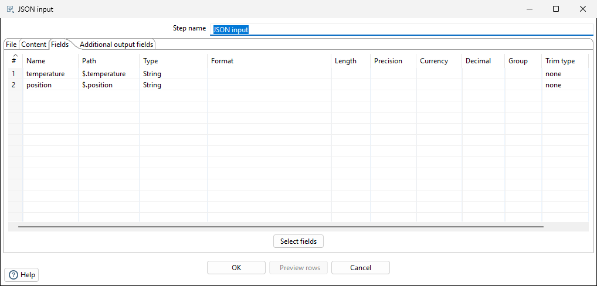
<figcaption>JSON input, Fields tab: two paths into each reading</figcaption>
</figure>
</div>

`position` is a JSON object, so the field holds the object as JSON text: `{"x":...,"y":...,"z":...}`.

5. Select **OK**, and save the transformation (`Ctrl+S`).

### 5. Text File Output

> **Note:**
>
> #### Append each batch to a file
>
> Each batch is a new run of the child, so the output must add to the file, never replace it.

1. From the **Output** folder, drag **Text file output** onto the canvas, and create a hop from **JSON input** to **Text file output**.
2. Double-click **Text file output**. On the **File** tab, set:

| Setting | Value |
| --- | --- |
| **Filename** | `${Internal.Transformation.Filename.Directory}/robot_sensor` |
| **Create Parent folder** | selected |
| **Do not create file at start** | selected |
| **Extension** | `txt` |

<div align="center">
<figure>
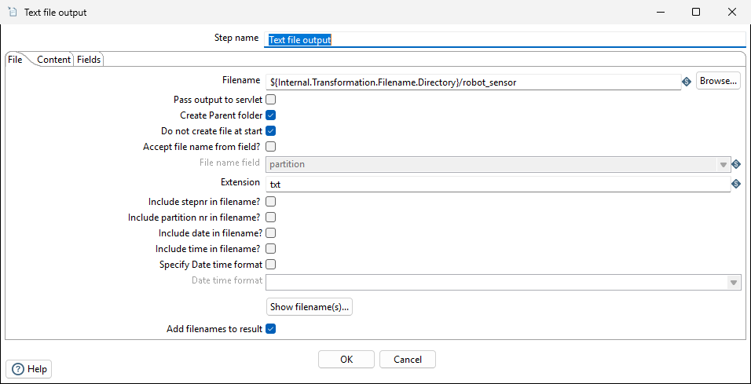
<figcaption>Text file output, File tab: robot_sensor.txt beside the transformation</figcaption>
</figure>
</div>

3. Open the **Content** tab. Select **Append**, set **Separator** to `;`, clear **Header**, set **Format** to `LF terminated (Unix)`, and set **Encoding** to `UTF-8`.

<div align="center">
<figure>
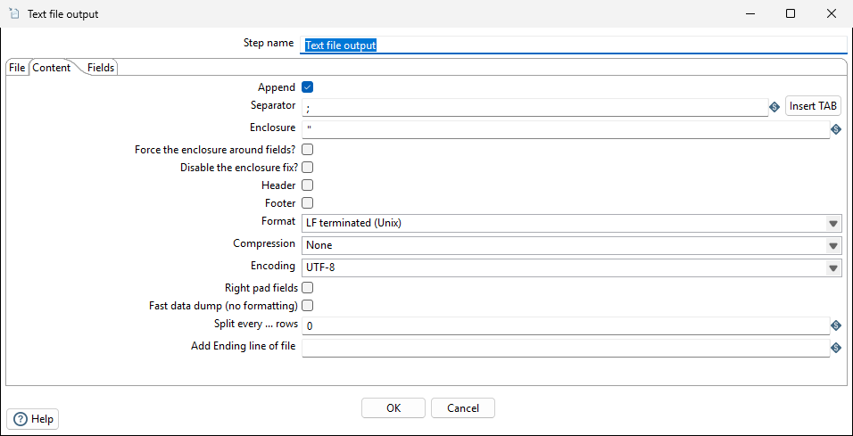
<figcaption>Text file output, Content tab: Append, ; and no header</figcaption>
</figure>
</div>

4. Open the **Fields** tab and select **Get Fields**. Right-click the `message` row and select **Delete selected lines**, so the grid lists three fields:

| Name | Type |
| --- | --- |
| `current_time` | Date |
| `temperature` | String |
| `position` | String |

<div align="center">
<figure>
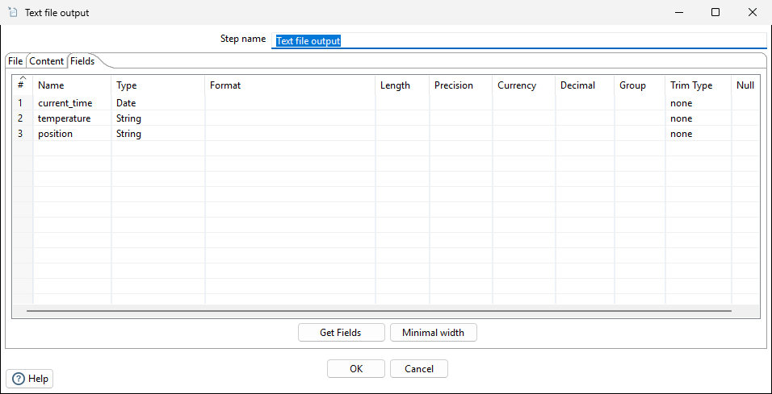
<figcaption>Text file output, Fields tab: three fields, message removed</figcaption>
</figure>
</div>

5. Select **OK**, and save the transformation (`Ctrl+S`).

> **Success:** Checkpoint: four steps in a row, **Get records from stream** to **Get system info** to **JSON input** to **Text file output**.

### 6. MQTT Consumer

> **Note:**
>
> #### The parent: subscribe with MQTT consumer
>
> The parent holds one step, **MQTT consumer**. It subscribes to the topic, collects messages into batches, and runs the child for each batch.
>
> <div align="center">
> <figure>
> 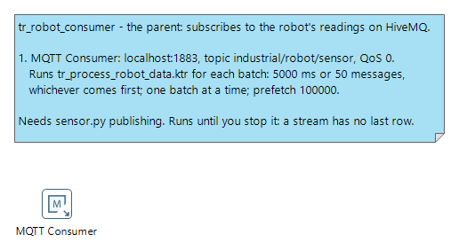
> <figcaption>What you build: tr_robot_consumer</figcaption>
> </figure>
> </div>

1. Select **File > New > Transformation** (`Ctrl+N`).
2. Select **File > Save as** and save it as `tr_robot_consumer.ktr` in `C:\Workshop-SD-Specialty\03-mqtt\04-mqtt-hivemq`, next to the child.
3. On the **Design** tab, open the **Streaming** folder and drag **MQTT consumer** onto the canvas.
4. Double-click **MQTT consumer**. Set **Step name** to `MQTT Consumer`.
5. Set **Transformation** to `${Internal.Entry.Current.Directory}/tr_process_robot_data.ktr`.
6. On the **Setup** tab, set **Connection** to `localhost:1883`, enter `acme/plant1/line1/robot1/telemetry` in the first row of the **Topics** grid, and set **Quality of Service** to `0`. Leave **Client ID** empty.

<div align="center">
<figure>
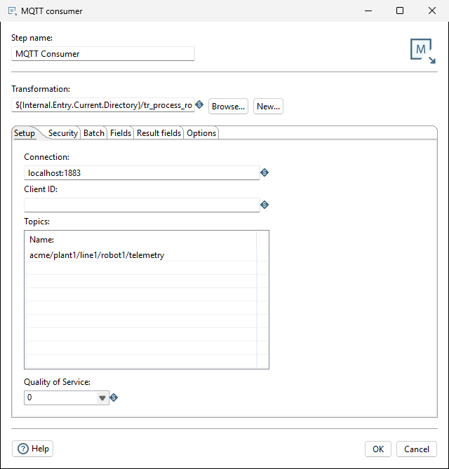
<figcaption>MQTT consumer, Setup tab: subscribed to acme/plant1/line1/robot1/telemetry</figcaption>
</figure>
</div>

A `+` or `#` wildcard in the topic would let one consumer cover several sensors. QoS `0` suits a reading every second: an occasional lost reading does no harm. Use `1` if every reading must arrive.

7. Open the **Batch** tab and set:

| Setting | Value |
| --- | --- |
| **Duration (ms)** | `5000` |
| **Number of records** | `50` |
| **Maximum concurrent batches** | `1` |
| **Message prefetch limit** | `100000` |

<div align="center">
<figure>

<figcaption>MQTT consumer, Batch tab: a batch every 5 seconds or 50 messages</figcaption>
</figure>
</div>

A batch goes to the child after 5,000 ms or 50 messages, whichever comes first.

8. Open the **Fields** tab. Leave it as it is.

<div align="center">
<figure>
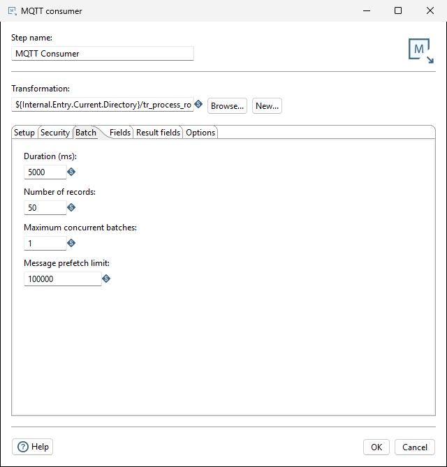
<figcaption>MQTT consumer, Fields tab: what each row of a batch carries</figcaption>
</figure>
</div>

> **Under the hood:**
>
> #### The child finds the batch's fields by name
>
> Each row the consumer hands over carries the message and its topic, named `Message` and `Topic` in the **Output Name** column of this tab. The child's steps look fields up by name, and Pentaho Data Integration matches field names without regard to case, so the child's `message` finds `Message`. A child that named the field anything else would stop at its first batch with `Could not find field ... in row!`.
>
> **Why it matters:** a child you reuse under several parents only works if each parent's **Output Name** matches the names the child expects. Rename a field here and you must rename it in the child too.

9. Select **OK**, and save the transformation (`Ctrl+S`).

### 7. Run the Pipeline

> **Note:**
>
> #### Run the parent
>
> A streaming consumer has no last row: the parent keeps running, and runs the child for every batch, until you stop it.

1. With `tr_robot_consumer` the active tab in Spoon and `sensor.py` still publishing, press `F9` (**Action > Run**), and select **Run** in the **Run Options** dialog.
2. In the Control Center, under **CLIENTS**, select **Sessions**.

<div align="center">
<figure>
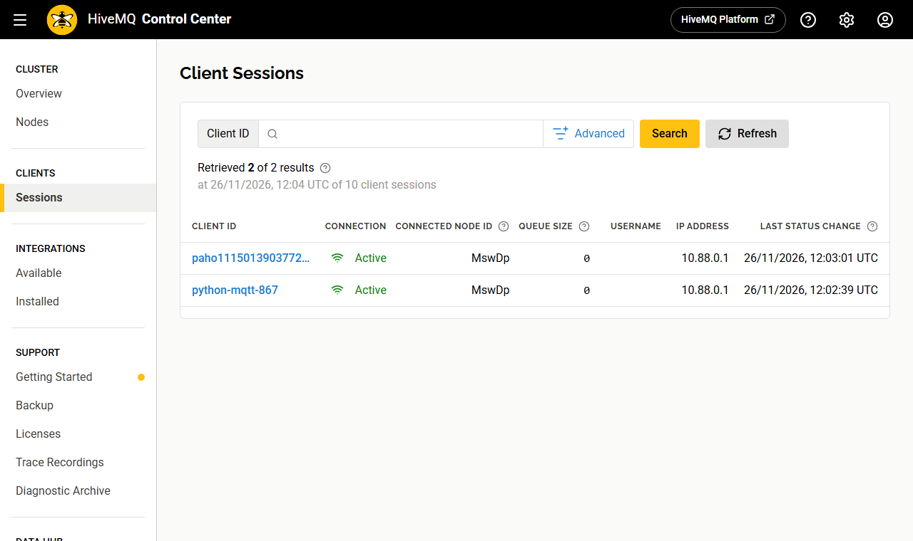
<figcaption>Two clients: the MQTT consumer (paho...) and sensor.py (python-mqtt-...)</figcaption>
</figure>
</div>

> **Success:** Checkpoint: two **Active** sessions: `python-mqtt-` followed by a number is `sensor.py`, and the ID that starts with `paho` is the **MQTT consumer**, which generates its own ID when **Client ID** is empty.

3. After 15 seconds, open `C:\Workshop-SD-Specialty\03-mqtt\04-mqtt-hivemq\robot_sensor.txt` in a text editor. Its first lines look like these, from a run of this workshop:

```text
2026/11/26 12:00:31.930;40.90783740037229;"{""x"":-5.2304745285768295,""y"":-2.184530866144055,""z"":-0.4331001192966042}"
2026/11/26 12:00:31.930;91.34354295071401;"{""x"":-7.575710096226578,""y"":-7.986659787742283,""z"":-2.372046393625218}"
2026/11/26 12:00:31.930;47.550507035001;"{""x"":8.198041544845857,""y"":6.829502280079602,""z"":-7.723702177883192}"
2026/11/26 12:00:31.930;73.28252672534344;"{""x"":-0.9537999112099911,""y"":-0.6056742568941686,""z"":-8.2618846108764}"
2026/11/26 12:00:31.930;96.63786977464778;"{""x"":-2.58160280659191,""y"":-8.630093682141428,""z"":7.404938232810242}"
2026/11/26 12:00:36.885;27.174690474317202;"{""x"":-9.328549225086869,""y"":-6.406786003086086,""z"":-5.532863594411266}"
```

> **Success:** Checkpoint: each line holds a time, a temperature and the position, separated by `;`. The lines come in groups of five that share one time, and each group's time is about 5 seconds after the one before. The position is in double quotes, with its own quotes doubled: **Text file output** encloses a value that contains its enclosure character.

4. Close the file. Leave the transformation and `sensor.py` running.

> **Under the hood:**
>
> #### The child ran once per batch, and fixed its clock each time
>
> The MQTT consumer collected messages until 5,000 ms had passed or 50 had
> arrived, then ran `tr_process_robot_data.ktr` with that batch. **Get system
> info** with `system date (fixed)` returns the time that run of the child
> started, so every row of a batch carries the same `current_time`: at one
> message a second, five rows a time. Each batch is a new run of the
> child, which is why **Append** is selected: without it, every run would
> replace the file.
>
> **Why it matters:** the child is an ordinary transformation, tested and
> debugged like any other, and the batch settings decide how fresh the file
> is against how often the child starts.

### 8. Last Will and Testament

> **Note:**
>
> #### Last Will and Testament
>
> A client can leave a *will* with the broker when it connects: a message the broker publishes for it if the connection drops without a clean disconnect. On a *retained* status topic, the will tells any subscriber, even one that connects later, whether the device is alive. The bundled `sensor.py` sets no will, so you add one, and watch the status topic with the bundled `status.py`.

1. Stop the publisher: press `Ctrl+C` in its window.
2. Open `sensor.py` in a text editor. Replace the whole `connect_mqtt` function with this version. The block starts with a new `status_topic` line, which goes above the function. The new function adds a will and an `online` message on connect:

```python
status_topic = "acme/plant1/line1/robot1/state"


def connect_mqtt():
    def on_connect(client, userdata, flags, reason_code, properties):
        if reason_code == 0:
            print("Connected to MQTT Broker!")
            # Announce we're alive. Retained, so a subscriber that connects
            # later still sees the current status.
            client.publish(status_topic, "online", qos=1, retain=True)
        else:
            print(f"Failed to connect: {reason_code}")

    client = mqtt_client.Client(callback_api_version=mqtt_client.CallbackAPIVersion.VERSION2,
                                client_id=client_id)
    # Last Will and Testament: the broker publishes this for us if we drop
    # unexpectedly (crash, network loss, missed keep-alive).
    client.will_set(status_topic, "offline", qos=1, retain=True)
    client.on_connect = on_connect
    client.connect(broker, port)
    return client
```

3. Save `sensor.py`, and start it again:

```powershell
python sensor.py
```

4. Open a second PowerShell window, and start the status watcher in the same folder:

```powershell
Set-Location C:\Workshop-SD-Specialty\03-mqtt\04-mqtt-hivemq
python status.py
```

> **Success:** Checkpoint: `status.py` prints `Subscribed to acme/plant1/line1/robot1/state`, then the time, `online` and `(retained)`: the broker handed it the topic's last value as it subscribed.

5. Stop the sensor without a clean disconnect: close the PowerShell window that runs `sensor.py`.

> **Success:** Checkpoint: within a second, `status.py` prints the time, `offline` and `(live)`: the will, published by the broker.

6. Press `Ctrl+C` in the `status.py` window, and start it again with `python status.py`.

> **Success:** Checkpoint: it prints `offline` and `(retained)`: a subscriber that arrives after the crash still learns that the sensor is gone.

7. Press `Ctrl+C` in the `status.py` window. In Spoon, select **Stop** in the canvas toolbar to stop `tr_robot_consumer.ktr`.

> **Under the hood:**
>
> #### The broker spoke for the client
>
> When `sensor.py` connected, it handed HiveMQ a will: the topic, the payload
> `offline`, QoS 1, retained. Closing the window ended the process without
> an MQTT DISCONNECT packet, so the broker published the will on its behalf.
> A client that calls `disconnect()` tells the broker to discard its will,
> so a clean shutdown sends nothing: that is why `sensor.py` disconnects
> when you press `Ctrl+C`. If the network fails without closing the
> connection, the broker notices only when 1.5 times the keep-alive
> interval passes with no packet (Paho's default keep-alive is 60 seconds),
> and then publishes the will.
>
> **Why it matters:** a subscriber can tell a sensor that has gone quiet
> from one that has gone away, without polling it. Starting `sensor.py`
> again publishes a retained `online`, which replaces the `offline`.

<div align="center">
<figure>
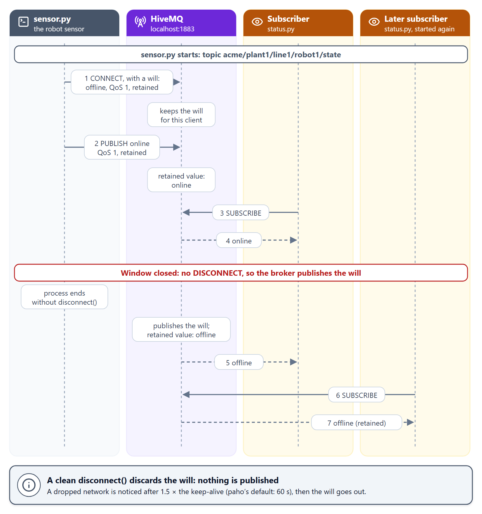
<figcaption>The will and the retained status topic, from connect to crash</figcaption>
</figure>
</div>

Read the diagram top to bottom. Messages 1 and 2 are the new `connect_mqtt`: the will travels to HiveMQ with the connection, then `online` is published as the topic's retained value. Messages 3 and 4 are step 4, where `status.py` shows `online` at once. Under the red band is step 5: the broker publishes the will, and the retained value becomes `offline`, so a client that subscribes only now, in messages 6 and 7, still learns that the sensor is gone. That is step 6. The bar at the foot is the case that sends nothing: a clean `disconnect()`.

::::

## Troubleshooting <!-- no-step -->

<details>
<summary>sensor.py prints "Failed to connect" or a connection refused error</summary>

HiveMQ is not running, or something else holds port `1883`. Run `C:\Streaming\run-podman-streaming.ps1 -Status` to see which brokers run, and `C:\Streaming\run-podman-streaming.ps1 -Broker hivemq` to start HiveMQ. The script names any other container that holds the port.

</details>

<details>
<summary>sensor.py prints "DeprecationWarning: Callback API version 1 is deprecated"</summary>

The `sensor.py` you run is an older copy that creates its client with `CallbackAPIVersion.VERSION1`. Take the current one from the **Lab Files** below: it uses `VERSION2`, whose `on_connect` takes `reason_code` and `properties`.

</details>

<details>
<summary>robot_sensor.txt does not appear</summary>

The publisher must be running while the parent runs: each lab's script stays running in its own window. Check that the topic in **MQTT consumer** is exactly `acme/plant1/line1/robot1/telemetry`, and that **Transformation** names `tr_process_robot_data.ktr`, the child you saved in the same folder.

</details>

<details>
<summary>robot_sensor.txt holds only the last few lines</summary>

**Append** is not selected. It is on the **Content** tab of **Text file output**, not the **File** tab: without it, each run of the child replaces the file with its own batch.

</details>

## Lab Files

Click a file to download. For `.ktr` and `.kjb` files, **Open in Pentaho Data Integration** launches Pentaho Data Integration with the file loaded. If Pentaho Data Integration is already running, the path is copied to your clipboard — switch to Pentaho Data Integration and press `Ctrl+O`, `Ctrl+V`, `Enter`.

These files are also on disk in `C:\Workshop-SD-Specialty\03-mqtt\04-mqtt-hivemq`. The publisher, its dependency list, and the status watcher for part 8:

[sensor.py](./files/sensor.py)

[requirements.txt](./files/requirements.txt)

[status.py](./files/status.py)

### Solution <!-- no-step -->

The finished robot pipeline: the parent, `tr_robot_consumer.ktr`, and its child, `tr_process_robot_data.ktr`. Open them alongside your own to compare.

Also on disk at `C:\Workshop-SD-Specialty\03-mqtt\04-mqtt-hivemq\solution`.

[tr_robot_consumer.ktr](./files/solution/tr_robot_consumer.ktr) <button data-launch="spoon" data-path="files/solution/tr_robot_consumer.ktr">Open in Pentaho Data Integration</button> <button data-graph="files/solution/tr_robot_consumer.ktr">View graph</button>

[tr_process_robot_data.ktr](./files/solution/tr_process_robot_data.ktr) <button data-launch="spoon" data-path="files/solution/tr_process_robot_data.ktr">Open in Pentaho Data Integration</button> <button data-graph="files/solution/tr_process_robot_data.ktr">View graph</button>

---

> **Tip:** Next, a second protocol: queues and exchanges with AMQP. Start with the AMQP [Overview](../05-amqp/guide.md).
