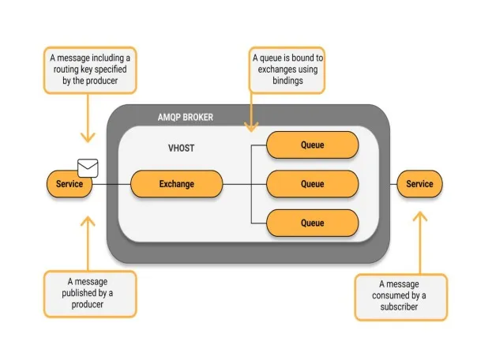
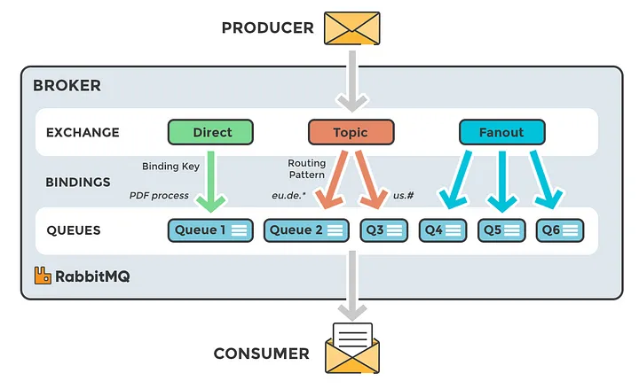
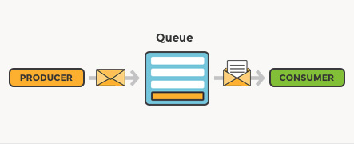

# Overview

The Advanced Message Queuing Protocol (AMQP) is a broker protocol for reliable, decoupled messaging between applications. A producer publishes to an exchange, the exchange routes each message to queues, and a consumer reads from a queue. This module explains that model, then the workshop consumes room-sensor data from RabbitMQ.

**What You'll Learn**

* **Exchanges, bindings and routing keys** - how a message finds its queue.
* **The exchange types** - direct, fanout, topic and headers, and the default exchange.
* **Queues** - durability, exclusivity and auto-delete.

<figure>

<figcaption>AMQP model: exchange, bindings, queues</figcaption>
</figure>

> **Note:**
>
> #### Advanced Message Queuing Protocol
>
> AMQP brokers carry messages between applications. They suit scenarios that need:
>
> * **Asynchronous communication:** producers and consumers exchange messages without waiting for each other.
> * **System decoupling:** applications communicate through messages rather than direct calls, so each can change on its own.
> * **Resilience:** a queue holds messages while a consumer is down, so a temporary failure loses nothing.
> * **Load balancing:** several consumers can share the messages of one queue.
>
> AMQP is an open standard, and RabbitMQ is the broker this course uses.

## AMQP concepts

::: tabs

### Exchanges

Messages are not published directly to a queue; instead, the producer sends messages to an **exchange**. An exchange routes messages to queues with the help of **bindings** and **routing keys**.

* A **binding** is a link between a queue and an exchange.
* The **routing key** is a message attribute the exchange looks at when deciding how to route the message (depending on exchange type).

Exchanges and queues can be *durable* (they survive a restart) or *auto-delete* (removed when the last binding or consumer goes). RabbitMQ provides four exchange types: **direct**, **fanout**, **topic** and **headers**. Its built-in **default exchange** - the one with no name, used when no exchange is named - is a **direct** exchange: every queue is bound to it automatically, with the queue's own name as the routing key. A **fanout** exchange, by contrast, broadcasts every message it receives to all bound queues, ignoring routing keys. A message that an exchange cannot route to any bound queue is dropped: publish only after the queue is bound.

<figure>

<figcaption>Direct, topic and fanout exchanges</figcaption>
</figure>

### Queues

In RabbitMQ, **queues** are the central structures where messages are stored for a consuming application to process. Messages flow into the queue from producers and wait there until a consumer retrieves them, allowing asynchronous communication and workload decoupling.

Queues have several important characteristics:

* **Durability:** durable queues are saved to disk and survive broker restarts. RabbitMQ 4 no longer accepts a transient queue unless it is exclusive, so the labs declare every queue durable.
* **Exclusivity:** an exclusive queue is used by only one connection and is deleted when that connection closes.
* **Auto-delete:** an auto-delete queue deletes itself when its consumer count drops to zero.

Messages are typically consumed FIFO (first in, first out), though RabbitMQ supports other dispatching strategies.

<figure>

<figcaption>A queue between producer and consumer</figcaption>
</figure>

:::

This module has one hands-on workshop:

* [RabbitMQ](../06-amqp-rabbitmq/guide.md) — consume room-sensor data from a RabbitMQ broker and append it to `tv_room_sensor.txt`.

> **Tip:** Next, consume room-sensor data from RabbitMQ: [RabbitMQ](../06-amqp-rabbitmq/guide.md).
