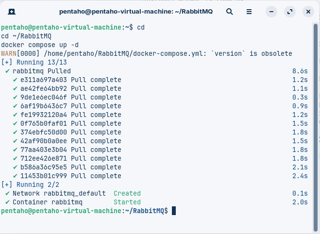
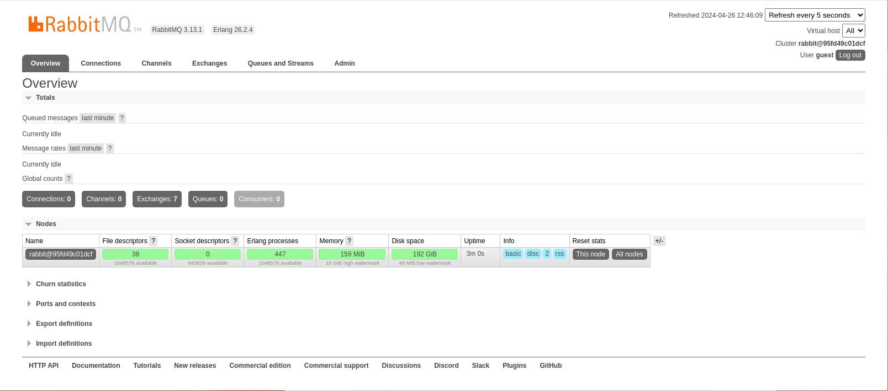
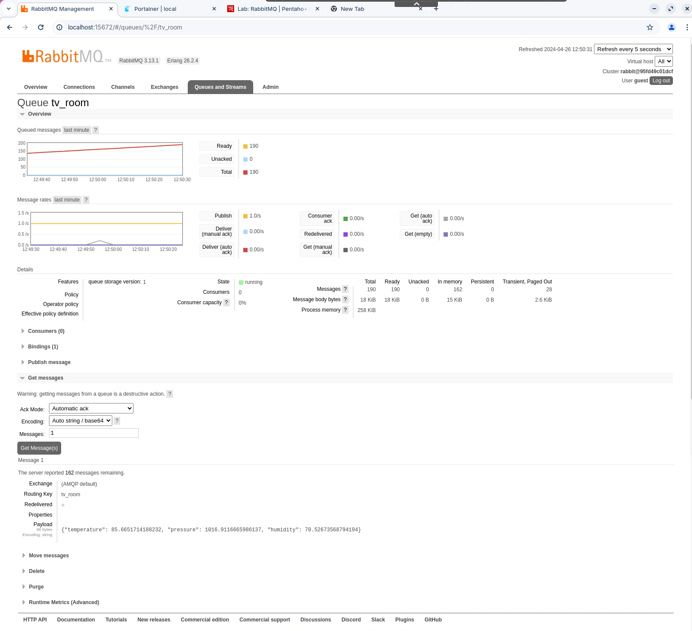
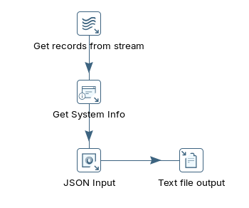
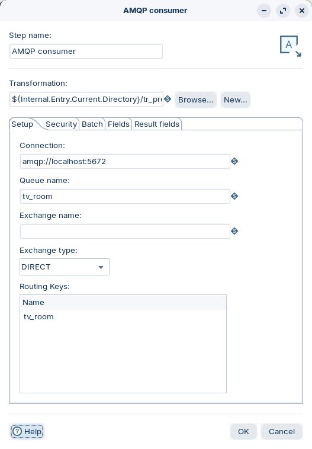
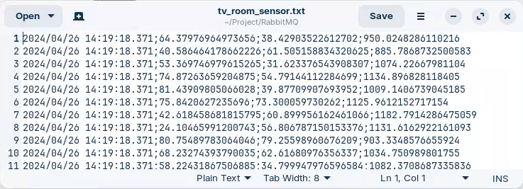

# RabbitMQ

> **Warning:**
>
> #### Workshop - RabbitMQ (room sensors)
>
> A house has a sensor in each room measuring **temperature**, **pressure** and **humidity**, and the TV room's sensor publishes its readings to a RabbitMQ queue. RabbitMQ is an open-source message broker that routes messages to queues; AMQP is one of the protocols it speaks. You consume the queue in Pentaho Data Integration with the **AMQP consumer** step and a child transformation that appends each reading to a file.
>
> **What you'll do**
>
> * Start RabbitMQ with Podman and sign in to its management UI
> * Publish simulated room-sensor readings to the `tv_room` queue with a Python script
> * Build a child transformation that parses each JSON reading and appends it to a file
> * Build a parent transformation whose **AMQP consumer** step runs the child for each batch
> * Watch the queue empty as Pentaho Data Integration takes the messages
>
> **Prerequisites:**
>
> * The brokers and Python from [Before You Start](../00-before-you-start/guide.md)
> * The parent/child pattern, from the Streaming Data [Overview](../01-overview/guide.md)
> * Exchanges and queues, from the AMQP [Overview](../05-amqp/guide.md)
>
> **Estimated time:** 30 minutes

:::: tabs

### 1. Start RabbitMQ

> **Note:**
>
> #### Start RabbitMQ
>
> RabbitMQ runs as a container under **Podman**, which is free for commercial use; Docker Desktop needs a paid subscription in larger organizations. The commands match, so `podman` replaces `docker` throughout. RabbitMQ lives in the course's workshop-services compose file alongside the other brokers.

1. Start the streaming brokers. If you started them for an earlier lab, they are running already. In PowerShell, from the app's install folder, run:

```powershell
provisioning\setup-services.ps1 -Streaming
```

2. Check that RabbitMQ is running:

```powershell
podman ps --filter name=pcm-rabbitmq
```

<div align="center">
<figure>

<figcaption>RabbitMQ started (an older setup that used docker compose from its own folder)</figcaption>
</figure>
</div>

> **Success:** Checkpoint: one container, `pcm-rabbitmq`, publishing port `5672` (AMQP) and port `15672` (the management UI).

3. Open `http://localhost:15672` in a browser and sign in:

| | |
| --- | --- |
| Username | `guest` |
| Password | `guest` |

<div align="center">
<figure>

<figcaption>RabbitMQ management UI, Overview</figcaption>
</figure>
</div>

> **Success:** Checkpoint: the **Overview** page opens, signed in as `guest`.

### 2. Publish Sensor Data

> **Note:**
>
> #### Publish room-sensor readings
>
> `sensor_tv_room.py` plays the TV room's sensor. Once a second it publishes a JSON reading to the `tv_room` queue, through the default exchange. It uses [pika](https://pypi.org/project/pika/), a Python AMQP client library.

1. Install the script's one dependency. In PowerShell, run:

```powershell
Set-Location C:\Workshop-SD-Specialty\04-amqp\06-amqp-rabbitmq
pip install -r requirements.txt
```

2. Review the publisher, `sensor_tv_room.py`:

```python
import pika
import random
import time
import json

rabbitmq_host = 'localhost'
port = 5672
queue_name = 'tv_room'

def generate_sensor_data():
    return {
        'temperature': random.uniform(20.0, 100.0),
        'pressure': random.uniform(800.0, 1200.0),
        'humidity': random.uniform(30.0, 80.0)
    }

def publish_sensor_data():
    connection = pika.BlockingConnection(pika.ConnectionParameters(host=rabbitmq_host, port=port))
    channel = connection.channel()
    channel.queue_declare(queue=queue_name)
    while True:
        sensor_data = generate_sensor_data()
        message = json.dumps(sensor_data)
        channel.basic_publish(exchange='', routing_key=queue_name, body=message)
        print(f"Sent sensor data: {message}")
        time.sleep(1)
    connection.close()

if __name__ == '__main__':
    publish_sensor_data()
```

`exchange=''` is the default exchange: RabbitMQ binds every queue to it by the queue's own name, so the routing key `tv_room` delivers to the `tv_room` queue.

3. Start the publisher, and leave it running in its own PowerShell window:

```powershell
python sensor_tv_room.py
```

> **Success:** Checkpoint: one line a second, `Sent sensor data: {"temperature": ..., "pressure": ..., "humidity": ...}`, with a new value in each field.

4. In the management UI, select **Queues and Streams**, then select the `tv_room` queue.

<div align="center">
<figure>

<figcaption>The tv_room queue fills at one message a second</figcaption>
</figure>
</div>

> **Success:** Checkpoint: **Ready** grows by about one message a second, the publish rate is about `1.0/s`, and **Consumers** is `0`.

5. To read one message, open **Get messages**, set **Ack Mode** to `Automatic ack`, and select **Get Message(s)**. The message is removed from the queue: getting a message this way is destructive.

> **Success:** Checkpoint: the **Payload** is one JSON reading with `temperature`, `pressure` and `humidity`; **Exchange** is `(AMQP default)` and **Routing Key** is `tv_room`.

### 3. Child Transformation

> **Note:**
>
> #### Process one batch
>
> The child transformation handles one batch of messages: **Get records from stream** hands it the batch as rows, **JSON input** splits each reading into fields, and **Text file output** appends them to a file. Build the child first, so the parent has a file to point to.

1. Start Spoon with the **Start Pentaho Data Integration** button below, or from a terminal:

::: tabs

### Windows (PowerShell)

```powershell
Set-Location C:\Pentaho\design-tools\data-integration
.\spoon.bat
```

### macOS / Linux

```bash
cd ~/Pentaho/design-tools/data-integration
./spoon.sh
```

:::

<button data-launch="spoon" data-path="">Start Pentaho Data Integration</button>

2. Select **File > New > Transformation** (`Ctrl+N`).
3. Select **File > Save as** and save it as `tr_process_sensor_data.ktr` in `C:\Workshop-SD-Specialty\04-amqp\06-amqp-rabbitmq`.
4. On the **Design** tab, open the **Streaming** folder and drag **Get records from stream** onto the canvas.
5. Double-click **Get records from stream**. Fill the **Fields** grid with one row, the message text:

| Fieldname | Type |
| --- | --- |
| `message` | String |

6. Select **OK**.
7. On the **Design** tab, open the **Input** folder and drag **Get system info** onto the canvas.
8. Create a hop from **Get records from stream** to **Get system info**: hold `Shift` and drag from one step to the other.
9. Double-click **Get system info**. Set **Step name** to `Get System Info`.
10. Fill the **Fields** grid with one row: set **Name** to `current_time`, select the **Type** cell and pick `system date (fixed)` in the **Select info type** list.

| Name | Type |
| --- | --- |
| `current_time` | `system date (fixed)` |

11. Select **OK**.
12. From the **Input** folder, drag **JSON input** onto the canvas, and create a hop from **Get System Info** to **JSON input**.
13. Double-click **JSON input**. Set **Step name** to `JSON Input`.
14. On the **File** tab, select **Source is from a previous step** and set **Select field** to `message`.
15. Open the **Content** tab and check that **Ignore missing path**, **Default path leaf to null** and **Do not raise an error if no files** are selected.
16. Open the **Fields** tab and fill the grid:

| Name | Path | Type |
| --- | --- | --- |
| `temperature` | `$.temperature` | String |
| `humidity` | `$.humidity` | String |
| `pressure` | `$.pressure` | String |

17. Select **OK**.
18. From the **Output** folder, drag **Text file output** onto the canvas, and create a hop from **JSON Input** to **Text file output**.
19. Double-click **Text file output**. On the **File** tab, set:

| Setting | Value |
| --- | --- |
| **Filename** | `${Internal.Transformation.Filename.Directory}/tv_room_sensor` |
| **Extension** | `txt` |
| **Append** | selected |
| **Create Parent folder** | selected |
| **Do not create file at start** | cleared |

20. Open the **Content** tab and set:

| Setting | Value |
| --- | --- |
| **Separator** | `;` |
| **Enclosure** | `"` |
| **Header** | selected |
| **Format** | `DOS` |

21. Open the **Fields** tab and select **Get Fields**. Right-click the `message` row and select **Delete selected lines**, so the grid lists four fields:

| Name | Type |
| --- | --- |
| `current_time` | Date |
| `temperature` | String |
| `humidity` | String |
| `pressure` | String |

22. Select **OK**, and save the transformation (`Ctrl+S`).

<div align="center">
<figure>

<figcaption>tr_process_sensor_data: four steps</figcaption>
</figure>
</div>

> **Success:** Checkpoint: four steps joined by hops: **Get records from stream**, **Get System Info**, **JSON Input** and **Text file output**.

### 4. Parent Transformation

> **Note:**
>
> #### Consume the queue with AMQP consumer
>
> The **AMQP consumer** step receives messages through an AMQP 0-9-1 broker. It reads from an existing queue or creates one, collects the messages into batches, and runs the child for each batch.

1. Select **File > New > Transformation** (`Ctrl+N`).
2. Select **File > Save as** and save it as `tr_rabbit_consumer.ktr` in `C:\Workshop-SD-Specialty\04-amqp\06-amqp-rabbitmq`, next to the child.
3. On the **Design** tab, open the **Streaming** folder and drag **AMQP consumer** onto the canvas.
4. Double-click **AMQP consumer**. Keep its step name, `AMQP consumer`.
5. Set **Transformation** to `${Internal.Entry.Current.Directory}/tr_process_sensor_data.ktr`.
6. On the **Setup** tab, set:

| Setting | Value |
| --- | --- |
| **Connection** | `amqp://localhost:5672` |
| **Queue name** | `tv_room` |
| **Exchange name** | empty |
| **Exchange type** | `DIRECT` |
| **Routing Keys** | empty |

<div align="center">
<figure>

<figcaption>AMQP consumer reading the tv_room queue</figcaption>
</figure>
</div>

The screenshot lists `tv_room` under **Routing Keys**. With **Exchange name** empty the step uses the default exchange, which already routes `tv_room` to the queue of that name, so the key adds nothing.

| Option | What it is |
| --- | --- |
| **Connection** | The URI of the AMQP broker the step connects to (see the RabbitMQ URI specification). |
| **Queue name** | The queue to read from. A new queue is created on the first run, durable, not auto-delete and not exclusive by default. If a queue of that name exists with different settings, the transformation stops. |
| **Exchange name** | A new or existing exchange to bind the queue to. Leave it empty to use the default exchange, of type DIRECT. |
| **Routing Keys** | For a DIRECT or TOPIC exchange, one or more routing keys. |

7. Open the **Batch** tab and set:

| Setting | Value |
| --- | --- |
| **Duration (ms)** | `1000` |
| **Number of records** | `1000` |
| **Maximum concurrent batches** | `1` |
| **Message prefetch limit** | `100000` |

8. Under **Ack management**, select **Ack when message received**.
9. Select **OK**, and save the transformation (`Ctrl+S`).

### 5. Run

> **Note:**
>
> #### Run the consumer
>
> With the publisher still sending, start the parent. The messages waiting in the queue arrive first, then one reading a second.

1. Press `F9` (**Action > Run**), and select **Run** in the **Run Options** dialog. The transformation keeps running: a streaming consumer has no last row.
2. In the management UI, refresh the `tv_room` queue.

> **Success:** Checkpoint: **Consumers** is `1`, and **Ready** drops to `0`: Pentaho Data Integration took the waiting messages.

3. Open `C:\Workshop-SD-Specialty\04-amqp\06-amqp-rabbitmq\tv_room_sensor.txt` in a text editor.

<div align="center">
<figure>

<figcaption>tv_room_sensor.txt: the queued readings arrived in one batch (written to another folder in this run)</figcaption>
</figure>
</div>

> **Success:** Checkpoint: lines of `;`-separated values: the time, then the temperature, humidity and pressure. The readings that waited in the queue arrive in the first batch and share one time; after that, a batch closes every second, with about one reading each.

4. Stop the transformation: select **Stop** in the canvas toolbar. Then press `Ctrl+C` in the publisher's window.

> **Under the hood:**
>
> #### The broker let go of each message as soon as Pentaho Data Integration had it
>
> With **Ack when message received**, the AMQP consumer acknowledges each
> message as it is delivered, and RabbitMQ removes it from the queue at
> once: that is why **Ready** fell to `0` while the child was still
> writing. If a batch failed in the child, its messages would already be
> gone. **Ack when batch completed** holds the acknowledgments until the
> child has finished the batch; messages that are still unacknowledged when
> the consumer's connection closes go back to the queue.
>
> **Why it matters:** pick per feed. Room readings every second can afford
> to lose a batch; orders or payments cannot, and are worth the extra
> unacknowledged messages that **Ack when batch completed** keeps on the
> broker.

::::

## Troubleshooting <!-- no-step -->

<details>
<summary>tv_room_sensor.txt stays empty</summary>

The publisher must be running while the parent runs, each in its own window. In the management UI, the `tv_room` queue shows **Consumers** `1` while Pentaho Data Integration is reading it; if it shows `0`, look again at **Connection** and **Queue name** in **AMQP consumer**.

</details>

## Lab Files

Click a file to download. For `.ktr` and `.kjb` files, **Open in Pentaho Data Integration** launches Pentaho Data Integration with the file loaded. If Pentaho Data Integration is already running, the path is copied to your clipboard — switch to Pentaho Data Integration and press `Ctrl+O`, `Ctrl+V`, `Enter`.

These files are also on disk in `C:\Workshop-SD-Specialty\04-amqp\06-amqp-rabbitmq`. The publisher and its dependency list:

[sensor_tv_room.py](./files/sensor_tv_room.py)

[requirements.txt](./files/requirements.txt)

### Solution <!-- no-step -->

The parent and child transformations for this lab. Open them alongside your own to compare.

Also on disk at `C:\Workshop-SD-Specialty\04-amqp\06-amqp-rabbitmq\solution`.

[tr_rabbit_consumer.ktr](./files/tr_rabbit_consumer.ktr) <button data-launch="spoon" data-path="files/tr_rabbit_consumer.ktr">Open in Pentaho Data Integration</button> <button data-graph="files/tr_rabbit_consumer.ktr">View graph</button>

[tr_process_sensor_data.ktr](./files/tr_process_sensor_data.ktr) <button data-launch="spoon" data-path="files/tr_process_sensor_data.ktr">Open in Pentaho Data Integration</button> <button data-graph="files/tr_process_sensor_data.ktr">View graph</button>
