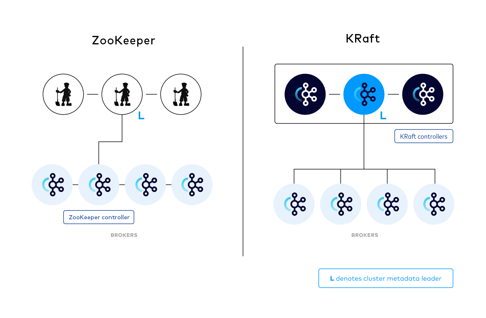
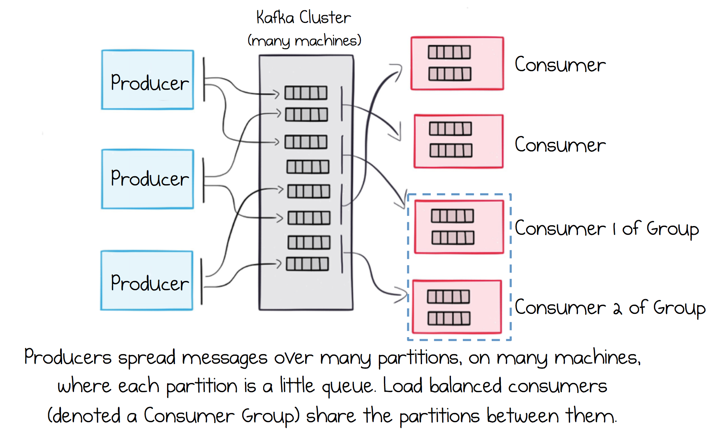

# Overview

Apache Kafka is a distributed event-streaming platform: producers append records to topics, Kafka keeps them, and consumers read them at their own pace. This module explains the parts of a Kafka cluster in KRaft mode and how topics, partitions and consumer groups decide who reads what, before the workshop loads a Kafka stream into MySQL.

**What You'll Learn**

* **KRaft mode** - why Kafka 4 runs without ZooKeeper, and what a controller and a broker do.
* **Topics, partitions and consumer groups** - how records are spread, ordered and shared between consumers.
* **Offsets** - how a consumer group resumes where it stopped.
* **Schema Registry** - the separate service many deployments add, and what Pentaho Data Integration does instead.
* **Change data capture** - where the events come from when the source is a database.

<figure>

<figcaption>ZooKeeper mode, which Kafka 4.0 removed, and KRaft mode, the only mode since</figcaption>
</figure>

> **Note:**
>
> #### Apache Kafka
>
> Apache Kafka is a distributed streaming platform for publishing, subscribing to, storing and processing streams of records in real time. It is designed to handle high volumes of data, which suits it to large-scale message processing. Kafka is built around a distributed commit log, spread over the nodes of a cluster, which gives it fault tolerance, durability and high throughput for both publishing and subscribing.
>
> Producers send records to topics, and consumers read and process them. Kafka serves applications such as real-time analytics, event sourcing and log aggregation.

Apache Kafka in **KRaft (Kafka Raft metadata) mode** needs no external ZooKeeper cluster, which makes it simpler to run. Since Kafka 4.0 (2025) KRaft is the only mode: ZooKeeper support is gone, and a cluster still on ZooKeeper must migrate to KRaft on a 3.x release before it can upgrade. This course runs Kafka 4.4, one node that is both broker and controller. These are the parts of a KRaft cluster, plus Schema Registry, a separate service many deployments add.

::: tabs

### Controller

Manages the state of the cluster and is responsible for administrative tasks such as topic creation, deletion, and partition reassignment. In KRaft mode the controllers are Kafka nodes that agree on cluster metadata with the Raft protocol. A large cluster runs dedicated controllers; a small one, like this course's single node, runs the controller and broker roles in one process.

### Broker

A server in the Kafka cluster that stores data and serves client requests: producers write records to it, and consumers read them from it. Each broker holds some of the partitions of each topic.

### Topics, Partitions and Consumer Groups

A **topic** is a named stream of records, such as the workshop's `pdi-users`. Kafka splits each topic into **partitions**, and each partition is an ordered log that only grows: a new record goes on the end.

Every record in a partition has an **offset**, its position in that partition. An offset is unique within a partition, not across the topic, so a record is identified by its partition and offset together.

Consumers read as a **consumer group**. Each partition is read by one member of a group at a time, so the group shares the work, and members beyond the partition count sit idle. A group commits the offsets it has processed, so after a stop it resumes where it stopped.

A record's **key** decides its partition: records with the same key go to the same partition, so Kafka keeps their order per key. Records with no key are spread over the partitions.

<figure>

<figcaption>Producers, partitions and a consumer group</figcaption>
</figure>

### KRaft Mode

Kafka KRaft is Apache Kafka's controller architecture that eliminates the dependency on Apache ZooKeeper. It keeps the cluster metadata within Kafka itself, replacing the ZooKeeper-based controller, which Kafka 4.0 removed. One system to run instead of two, and metadata changes no longer wait on ZooKeeper.

### Schema Registry

Schema Registry provides a centralized repository for managing and validating schemas for topic message data, and for serialization and deserialization of the data over the network. It is not part of Apache Kafka itself, but there are several open-source options to choose from. It lives separately from your brokers; producers and consumers talk to Kafka to publish and read messages, and concurrently talk to Schema Registry to send and retrieve the schemas that describe those messages.

A registry enforces a *data contract*: the agreed shape of a topic's messages. It can refuse a producer's new schema that would break the consumers, before a single message is sent. Pentaho Data Integration's Kafka steps do not talk to a schema registry: they read and write each message as text or bytes. A pipeline therefore checks the contract itself, as each message arrives: step error handling for what cannot be parsed, **Data validator** for what is parsed but wrong, and a rejects topic for what fails. The [Contracts, Rejects and Replay](../09-kafka-contracts/guide.md) workshop builds exactly that.

### Change Data Capture

In this module's workshops an application publishes each event to Kafka. Often the events you want are already happening somewhere else: as inserts, updates and deletes in an operational database. *Change data capture* (CDC) reads them from the database's own transaction log, without touching the application, and publishes each change to Kafka as an event that says what the row looked like before and after.

Everything in this module still applies to such a feed. It is a topic like any other: a consumer group reads it, a child loads it, offsets let a pipeline resume, and a replay rebuilds a target from the log. What changes is the message: a change event carries an operation (create, update or delete) as well as the row, so the child applies each change rather than only inserting. Pentaho offers log-based CDC, built on Debezium and integrated with Pentaho Data Integration; ask Pentaho about access.

:::

This module has three hands-on workshops:

* [Use Cases](../08-kafka-use-cases/guide.md) — consume a user-activity stream from Kafka in real time and load it into a MySQL warehouse.
* [Contracts, Rejects and Replay](../09-kafka-contracts/guide.md) — check each event against a contract, send the ones that break it to a rejects topic, read consumer lag, and rebuild the table by replaying the log.
* [Streams to the Lake](../10-kafka-lake/guide.md) — land the stream in an object-store data lake as Avro files, and read them back with Pentaho Data Integration and with another engine.

> **Tip:** Next, load a Kafka user-activity stream into MySQL: [Use Cases](../08-kafka-use-cases/guide.md).
