# Use Cases

> **Warning:**
>
> #### Workshop - Use Cases (real-time user-activity stream)
>
> Your company tracks user registrations across web and mobile platforms, and each registration is published to a Kafka topic as it happens. In this workshop you build a streaming pipeline in Pentaho Data Integration that reads these events continuously, parses the JSON payload, converts the timestamp and loads each event into a MySQL table, ready for dashboards and analytics.
>
> **What you'll do**
>
> * Create the warehouse table and start the event publisher
> * Configure **Kafka consumer** in a parent transformation to read `pdi-users` in batches
> * Parse the JSON payload and set field metadata in a child transformation
> * Convert epoch milliseconds to seconds with a **Formula** step
> * Load the events into a MySQL `user_events` table with **Table output**
> * Run the pipeline and check the loaded rows with SQL
>
> **Prerequisites:**
>
> * The services and Python from [Before You Start](../00-before-you-start/guide.md): Kafka on `127.0.0.1:9092` (`C:\Streaming\run-podman-streaming.ps1`) and the MySQL kit's `sampledata-mysql` on `localhost:3306` (`C:\MySQL\run-podman-mysql.ps1`)
> * Partitions, offsets and consumer groups, from the Kafka [Overview](../07-kafka/guide.md)
> * Familiarity with steps, hops and database connections
>
> **Estimated time:** 45 minutes

This workshop uses Pentaho Data Integration's parent/child pattern. The parent's **Kafka consumer** reads messages in batches, every 500 milliseconds or 100 records, whichever comes first, and passes each batch to the child, which parses, transforms and writes it to MySQL:

<div align="center">
<figure>
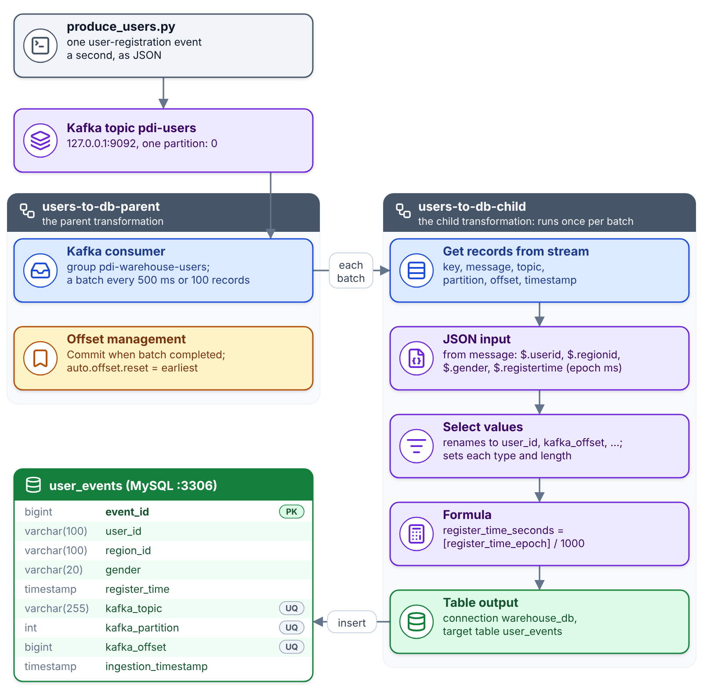
<figcaption>The pipeline: users-to-db-parent hands each batch to users-to-db-child, which loads user_events</figcaption>
</figure>
</div>

Read the diagram down the left, then down the right. `produce_users.py` feeds the `pdi-users` topic; the parent's **Kafka consumer** reads it as the group `pdi-warehouse-users` and commits a batch's offsets only once the child has finished it. Each batch starts one run of the child, whose five steps you build in part 3, and **Table output** inserts the rows into `user_events`, whose columns come from `01-create-kafka-warehouse.sql`. `PK` marks the AUTO_INCREMENT key MySQL fills, and `UQ` the three columns of the unique key that keeps each event in the table once.

:::: tabs

### 1. Prepare

> **Note:**
>
> #### Warehouse and event stream
>
> Create the `kafka_warehouse` database, and start the publisher that feeds the `pdi-users` topic. `produce_users.py` emits user-registration events in the shape of Kafka's datagen users quickstart. The Streaming kit created the topic, with one partition, when it started Kafka.

1. Create the `kafka_warehouse` database, its `kafka_user` and the `user_events` table in the MySQL kit's `sampledata-mysql` container. In PowerShell, run:

```powershell
Get-Content C:\Workshop-SD-Specialty\05-kafka\08-kafka-use-cases\01-create-kafka-warehouse.sql -Raw | podman exec -i sampledata-mysql mysql -uroot -ppassword
```

> **Success:** Checkpoint: the only output is MySQL's warning that a password on the command line can be insecure.

2. Install the publisher's one dependency, the Confluent Kafka client. In PowerShell, run:

```powershell
Set-Location C:\Workshop-SD-Specialty\05-kafka\08-kafka-use-cases
pip install -r requirements.txt
```

3. Start the publisher, and leave it running in its own PowerShell window:

```powershell
python produce_users.py
```

It sends one event a second to `pdi-users` on `127.0.0.1:9092`, numbering the users from `User_1` each time it starts. Each event looks like this sample:

```json
{"registertime": 1795696994000, "userid": "User_1", "regionid": "Region_9", "gender": "MALE"}
```

> **Success:** Checkpoint: the script prints `Producing to pdi-users on 127.0.0.1:9092 - Ctrl+C to stop`, then a line every 25 seconds: `25 events sent`, `50 events sent`, and so on.

### 2. Kafka Consumer

> **Note:**
>
> #### The parent: Kafka consumer
>
> The parent holds one step, **Kafka consumer**. It reads the topic as a member of a consumer group, collects records into batches, and runs the child for each batch.
>
> <div align="center">
> <figure>
> 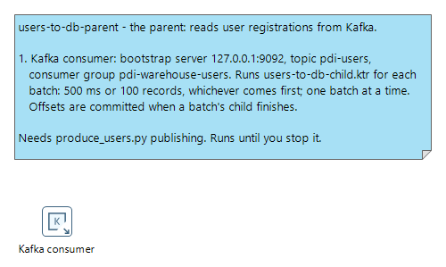
> <figcaption>What you build: users-to-db-parent</figcaption>
> </figure>
> </div>

1. Start Spoon with the **Start Pentaho Data Integration** button below, or from PowerShell:

```powershell
Set-Location C:\Pentaho\design-tools\data-integration
.\spoon.bat
```

<button data-launch="spoon" data-path="">Start Pentaho Data Integration</button>

2. Select **File > New > Transformation** (`Ctrl+N`).
3. Select **File > Save as** and save it as `users-to-db-parent.ktr` in `C:\Workshop-SD-Specialty\05-kafka\08-kafka-use-cases`.
4. On the **Design** tab, open the **Streaming** folder and drag **Kafka consumer** onto the canvas. The step comes with Pentaho Data Integration 11, in its `pentaho-streaming-kafka-plugin`, and uses the Kafka 4.1 client, which talks to the course's Kafka 4.4 broker.

5. Double-click **Kafka consumer**. Keep its step name, `Kafka consumer`.
6. Set **Transformation** to `${Internal.Entry.Current.Directory}/users-to-db-child.ktr`.
7. On the **Setup** tab, set:

| Setting | Value |
| --- | --- |
| **Connection** | **Direct** |
| **Bootstrap servers** | `127.0.0.1:9092` |
| **Topics** | `pdi-users` |
| **Consumer group** | `pdi-warehouse-users` |

<div align="center">
<figure>
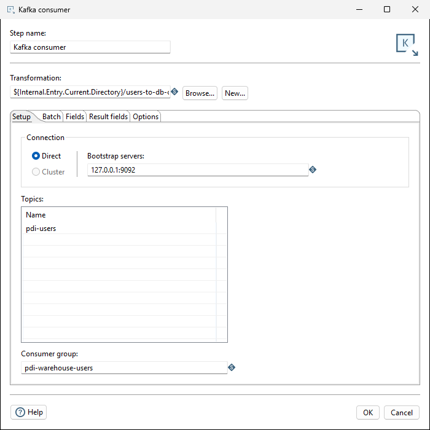
<figcaption>Kafka consumer, Setup tab</figcaption>
</figure>
</div>

Use the IP address, not `localhost`, as [Before You Start](../00-before-you-start/guide.md) explains: Windows can resolve `localhost` to IPv6 first, where the broker does not listen. Each consumer step runs a single thread; as part of a consumer group, each consumer is assigned a subset of the topic's partitions. A partition goes to one member of the group at a time, so members beyond the partition count sit idle.

8. Open the **Batch** tab and set:

| Setting | Value |
| --- | --- |
| **Duration (ms)** | `500` |
| **Number of records** | `100` |
| **Maximum concurrent batches** | `1` |
| **Message prefetch limit** | `100000` |
| **Offset management** | **Commit when batch completed** |

<div align="center">
<figure>
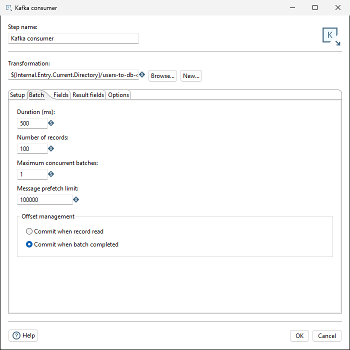
<figcaption>Kafka consumer, Batch tab</figcaption>
</figure>
</div>

Whichever threshold is reached first sends the batch to the child. With `pdi-users` producing about one message a second, the 500 ms duration almost always comes first, so most batches carry a single record. When the consumer starts more than 100 records behind the topic, as after a long stop, **Number of records** comes first, and batches of 100 catch up. Set **Duration (ms)** to `5000` to collect about five records per batch.

9. Open the **Fields** tab and check the grid. These are the fields every Kafka record brings, and the child reads them in this order:

| Input name | Output name | Type | What it holds |
| --- | --- | --- | --- |
| `key` | `Key` | String | The record key, which decides the partition; without one, records are spread across partitions |
| `message` | `Message` | String | The record value: here, the JSON event |
| `topic` | `Topic` | String | The topic name |
| `partition` | `Partition` | Integer | The partition number |
| `offset` | `Offset` | Integer | The record's position, unique within its partition |
| `timestamp` | `Timestamp` | Integer | The record's timestamp |

10. Open the **Options** tab and set the value of `auto.offset.reset` to `earliest`: a consumer group with no committed offset starts at the beginning of the topic, not at its end.
11. Select **OK**, and save the transformation (`Ctrl+S`).

### 3. Child Transformation

> **Note:**
>
> #### The child: parse, convert, load
>
> **Get records from stream** receives each batch from `users-to-db-parent.ktr`. It produces rows, so it must be the first step in the child transformation.
>
> <div align="center">
> <figure>
> 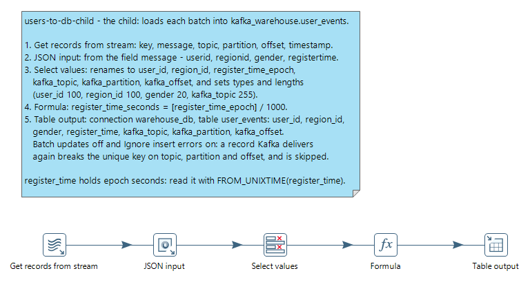
> <figcaption>What you build: users-to-db-child</figcaption>
> </figure>
> </div>

1. Select **File > New > Transformation** (`Ctrl+N`).
2. Select **File > Save as** and save it as `users-to-db-child.ktr` in `C:\Workshop-SD-Specialty\05-kafka\08-kafka-use-cases`, next to the parent.
3. On the **Design** tab, open the **Streaming** folder and drag **Get records from stream** onto the canvas.
4. Double-click **Get records from stream**. Fill the **Fields** grid with the six fields the **Kafka consumer** sends, in the same order:

| Fieldname | Type |
| --- | --- |
| `key` | String |
| `message` | String |
| `topic` | String |
| `partition` | Integer |
| `offset` | Integer |
| `timestamp` | Integer |

<div align="center">
<figure>
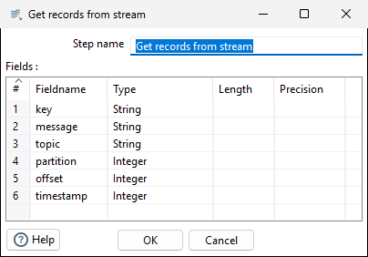
<figcaption>Get records from stream: the six fields of a Kafka record</figcaption>
</figure>
</div>

5. Select **OK**.
6. On the **Design** tab, open the **Input** folder and drag **JSON input** onto the canvas.
7. Create a hop from **Get records from stream** to **JSON input**: hold `Shift` and drag from one step to the other.
8. Double-click **JSON input**. On the **File** tab, select **Source is from a previous step** and set **Select field** to `message`.

<div align="center">
<figure>
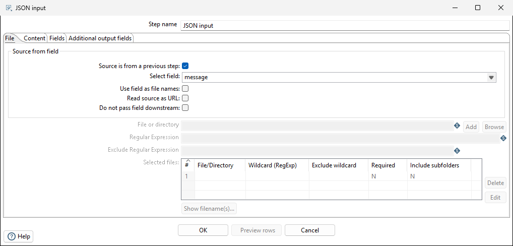
<figcaption>JSON input, File tab: the source is the field message</figcaption>
</figure>
</div>

9. Open the **Content** tab and check that **Ignore missing path**, **Default path leaf to null** and **Do not raise an error if no files** are selected.
10. Open the **Fields** tab and fill the grid:

| Name | Path | Type |
| --- | --- | --- |
| `userid` | `$.userid` | String |
| `regionid` | `$.regionid` | String |
| `gender` | `$.gender` | String |
| `registertime` | `$.registertime` | Integer |

<div align="center">
<figure>
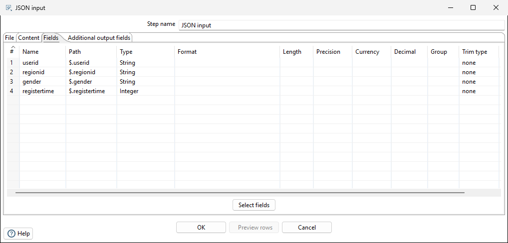
<figcaption>JSON input, Fields tab: four fields from each event</figcaption>
</figure>
</div>

`registertime` is the registration time in epoch milliseconds; `userid` looks like `User_1`, `regionid` like `Region_9`, and `gender` is `FEMALE`, `MALE` or `OTHER`.

11. Select **OK**.
12. From the **Transform** folder, drag **Select values** onto the canvas, and create a hop from **JSON input** to **Select values**.
13. Double-click **Select values**. Open the **Meta-data** tab and fill the grid, which renames fields and sets each one's type and length. Leave **Rename to** empty where a field keeps its name.

| Fieldname | Rename to | Type | Length |
| --- | --- | --- | --- |
| `userid` | `user_id` | String | `100` |
| `regionid` | `region_id` | String | `100` |
| `gender` | | String | `20` |
| `registertime` | `register_time_epoch` | Integer | `15` |
| `topic` | `kafka_topic` | String | `255` |
| `partition` | `kafka_partition` | Integer | `9` |
| `offset` | `kafka_offset` | Integer | `15` |
| `key` | | String | `100` |
| `message` | | String | `5000` |
| `timestamp` | | Integer | `15` |

<div align="center">
<figure>
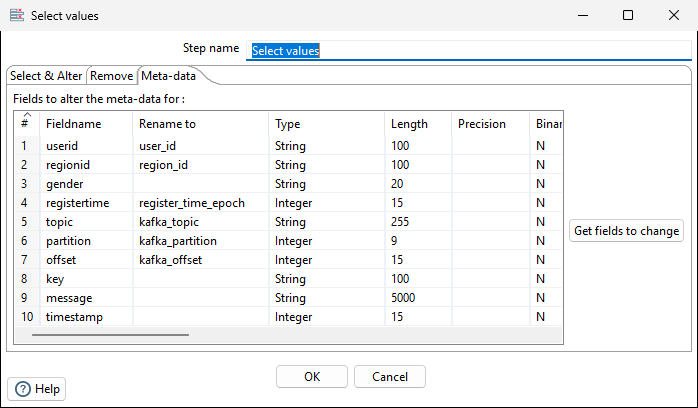
<figcaption>Select values, Meta-data tab: names, types and lengths for MySQL</figcaption>
</figure>
</div>

> **Warning:** The lengths matter for MySQL. Without them, Pentaho Data Integration maps a String field to `TINYTEXT` when it generates SQL, and MySQL refuses to index such a column, with errors like `BLOB/TEXT column 'user_id' used in key specification without a key length`.

14. Select **OK**.
15. From the **Scripting** folder, drag **Formula** onto the canvas, and create a hop from **Select values** to **Formula**.
16. Double-click **Formula**. Fill the **Fields** grid with one row, and select **OK**:

| New field | Formula | Value type |
| --- | --- | --- |
| `register_time_seconds` | `[register_time_epoch] / 1000` | Integer |

<div align="center">
<figure>
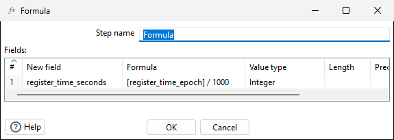
<figcaption>Formula: epoch milliseconds to seconds</figcaption>
</figure>
</div>

`user_events.register_time` is a `BIGINT` of epoch seconds, which `01-create-kafka-warehouse.sql` defines. A `TIMESTAMP` column would refuse the number: `Incorrect datetime value`. Read it as a date with `FROM_UNIXTIME(register_time)`.

**Formula** takes the constant `1000` inline. **Calculator** divides one field by another, so the constant would first need a field of its own.

17. Select **File > New > Database Connection**. On the **General** page, set:

| Setting | Value |
| --- | --- |
| **Connection name** | `warehouse_db` |
| **Connection type** | **MySQL** |
| **Access** | **Native (JDBC)** |
| **Host Name** | `localhost` |
| **Database Name** | `kafka_warehouse` |
| **Port Number** | `3306` |
| **Username** | `kafka_user` |
| **Password** | `password` (set by `01-create-kafka-warehouse.sql`) |

<div align="center">
<figure>
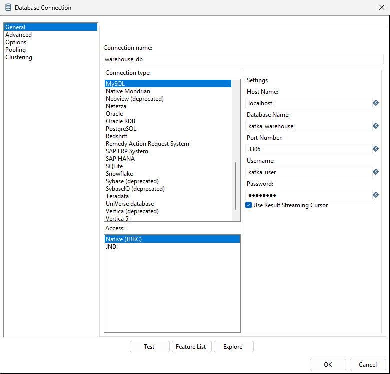
<figcaption>The warehouse_db connection: kafka_user on kafka_warehouse</figcaption>
</figure>
</div>

18. Select **Test**.

> **Success:** Checkpoint: Spoon shows **Connection tested successfully**.

19. Select **OK** to close the message, then **OK** to save the connection.
20. From the **Output** folder, drag **Table output** onto the canvas, and create a hop from **Formula** to **Table output**.
21. Double-click **Table output**. Keep its step name, `Table output`. On the **Main options** tab, clear **Use batch update for inserts** first; **Ignore insert errors** can be selected only then. Set:

| Setting | Value |
| --- | --- |
| **Connection** | `warehouse_db` |
| **Target schema** | empty |
| **Target table** | `user_events` |
| **Commit size** | `1000` |
| **Truncate table** | cleared |
| **Specify database fields** | selected |
| **Use batch update for inserts** | cleared |
| **Ignore insert errors** | selected |

Leave **Target schema** empty for MySQL: the table is found in the connection's database. Setting it qualifies the table as `kafka_warehouse.user_events`, which can fail.

**Ignore insert errors** can be selected only with batch updates cleared. It lets the step skip a row the database refuses and carry on: here, a record Kafka delivers a second time, which the table's unique key on `kafka_topic`, `kafka_partition` and `kafka_offset` refuses. **Under the hood** in part 4 explains when that happens.

<div align="center">
<figure>
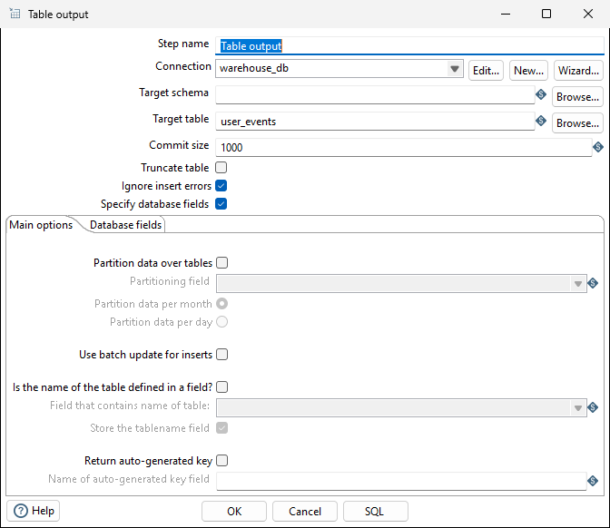
<figcaption>Table output: one insert at a time, refused rows skipped</figcaption>
</figure>
</div>

22. Open the **Database fields** tab and fill the grid:

| Table field | Stream field |
| --- | --- |
| `user_id` | `user_id` |
| `region_id` | `region_id` |
| `gender` | `gender` |
| `register_time` | `register_time_seconds` |
| `kafka_topic` | `kafka_topic` |
| `kafka_partition` | `kafka_partition` |
| `kafka_offset` | `kafka_offset` |

> **Danger:** Do not map `event_id` (the AUTO_INCREMENT primary key) or `ingestion_timestamp` (DEFAULT CURRENT_TIMESTAMP): MySQL fills them. If you select **SQL** and Pentaho Data Integration suggests `ALTER TABLE ... MODIFY user_id TINYTEXT`, close the window without running it, and fix the lengths on the **Meta-data** tab of **Select values**.

23. Select **OK**, and save the transformation (`Ctrl+S`).

### 4. Run and Verify

> **Note:**
>
> #### Run the pipeline
>
> Run the parent while the publisher sends events, then check the table. The parent keeps running until you stop it: a streaming consumer has no last row.

1. Select the **users-to-db-parent** tab. With `produce_users.py` still running, press `F9` (**Action > Run**), and select **Run** in the **Run Options** dialog.
2. In **Execution Results**, open the **Step Metrics** tab.

> **Success:** Checkpoint: the transformation keeps running, and the counts on the **Kafka consumer** row grow as batches pass to the child, about one record a second.

3. Open a MySQL session as `kafka_user`. In PowerShell, run:

```powershell
podman exec -it sampledata-mysql mysql -ukafka_user -ppassword kafka_warehouse
```

Or, in DBeaver, connect to `kafka_warehouse` on `localhost:3306` as `kafka_user`.

4. Run these queries:

```sql
-- Record count (grows over time)
SELECT COUNT(*) FROM user_events;

-- Recent records, register_time read as a date
SELECT user_id, region_id, gender, FROM_UNIXTIME(register_time) AS registered,
       kafka_partition, kafka_offset
FROM user_events ORDER BY ingestion_timestamp DESC, event_id DESC LIMIT 5;

-- Duplicate check (returns no rows)
SELECT kafka_topic, kafka_partition, kafka_offset, COUNT(*)
FROM user_events
GROUP BY kafka_topic, kafka_partition, kafka_offset
HAVING COUNT(*) > 1;

-- Offset progress by partition
SELECT kafka_partition, MIN(kafka_offset) AS min_offset,
       MAX(kafka_offset) AS max_offset, COUNT(*) AS record_count
FROM user_events
GROUP BY kafka_partition
ORDER BY kafka_partition;
```

The recent records and the offset progress, from a run of this workshop:

```text
user_id   region_id  gender  registered           kafka_partition  kafka_offset
User_396  Region_1   MALE    2026-11-26 12:43:14  0                395
User_395  Region_3   MALE    2026-11-26 12:43:13  0                394
User_394  Region_1   OTHER   2026-11-26 12:43:12  0                393
User_393  Region_3   FEMALE  2026-11-26 12:43:11  0                392
User_392  Region_7   OTHER   2026-11-26 12:43:10  0                391

kafka_partition  min_offset  max_offset  record_count
0                0           395         396
```

> **Success:** Checkpoint: the count grows each time you run it, and the duplicate check returns no rows. The topic has one partition, `0`. On a fresh topic, offset `0` holds `User_1`, offset `1` holds `User_2`, and so on.

5. Stop the parent: select **Stop** in the canvas toolbar. Leave the publisher running.

> **Under the hood:**
>
> #### The consumer group remembers where it stopped
>
> With **Commit when batch completed**, the Kafka consumer commits a
> batch's offsets for the group `pdi-warehouse-users` only after the child
> has finished with that batch. `auto.offset.reset` `earliest` applies only
> when the group has no committed offset: the first run starts at offset
> `0`, and every later run resumes after the last committed offset. The
> commit follows the child, so a stop that lands between a batch's
> insert and its commit leaves that batch uncommitted: the next run reads
> it again. That is *at-least-once* delivery. The table's unique key on
> `kafka_topic`, `kafka_partition` and `kafka_offset` refuses the second
> copy, and **Ignore insert errors** on **Table output** skips it instead
> of stopping the pipeline.
>
> **Why it matters:** a stopped pipeline picks up where it left off,
> without a hand-kept bookmark, and the warehouse holds each event once.
> Without **Ignore insert errors**, the first record read twice stops the
> child with `Duplicate entry ... for key 'user_events.uq_kafka_offset'`,
> and the pipeline never catches up. The skip is blind, though: it also
> drops a row that fails for any other reason. Where that matters, load
> with **Insert / update** keyed on topic, partition and offset instead.

6. Wait 30 seconds, then press `F9` (**Action > Run**) and select **Run** in the **Run Options** dialog to start the parent again.
7. Run the count and the duplicate check again.

> **Success:** Checkpoint: the count catches up with the events sent while the parent was stopped, about 30 more, and the duplicate check still returns no rows.

8. Stop the parent, and press `Ctrl+C` in the publisher's window.

::::

## Troubleshooting <!-- no-step -->

<details>
<summary>"BLOB/TEXT column 'user_id' used in key specification without a key length"</summary>

A String field reached MySQL without a length. Set the lengths on the **Meta-data** tab of **Select values** as the table in part 3 shows, and do not run the `ALTER TABLE` that the **SQL** button suggests.

</details>

<details>
<summary>The connection test fails with "Public Key Retrieval is not allowed"</summary>

In the **Database Connection** dialog, select **Options** in the list on the left and add the parameter `allowPublicKeyRetrieval` with the value `true`, then select **Test** again.

</details>

<details>
<summary>"Incorrect datetime value" for column 'register_time'</summary>

The table was created by an older `01-create-kafka-warehouse.sql`, whose `register_time` was a `TIMESTAMP`. Drop the table as `root`. In PowerShell, run:

```powershell
podman exec -i sampledata-mysql mysql -uroot -ppassword -e "DROP TABLE kafka_warehouse.user_events;"
```

Then run the current script from part 1 again: it makes `register_time` a `BIGINT` of epoch seconds.

</details>

<details>
<summary>The parent stops with "Duplicate entry ... for key 'user_events.uq_kafka_offset'"</summary>

Kafka delivered a record again after a stop, and **Table output** refused it. Clear **Use batch update for inserts** and select **Ignore insert errors** on **Table output**, as part 3 shows, and run the parent again.

</details>

<details>
<summary>No rows reach user_events</summary>

The publisher must be running while the parent runs, each in its own window. Check that the topic is exactly `pdi-users`, and that **Transformation** in **Kafka consumer** names `users-to-db-child.ktr` in the same folder.

</details>

## Lab Files

Click a file to download. For `.ktr` and `.kjb` files, **Open in Pentaho Data Integration** launches Pentaho Data Integration with the file loaded. If Pentaho Data Integration is already running, the path is copied to your clipboard — switch to Pentaho Data Integration and press `Ctrl+O`, `Ctrl+V`, `Enter`.

These files are also on disk in `C:\Workshop-SD-Specialty\05-kafka\08-kafka-use-cases`. The publisher and its dependency list:

[produce_users.py](./files/produce_users.py)

[requirements.txt](./files/requirements.txt)

`01-create-kafka-warehouse.sql` creates the `kafka_warehouse` database, its user and the `user_events` table:

[01-create-kafka-warehouse.sql](./files/01-create-kafka-warehouse.sql)

### Solution <!-- no-step -->

The finished parent and child transformations for this lab. Open them alongside your own to compare. The child carries its own `warehouse_db` connection, the one part 3 creates.

Also on disk at `C:\Workshop-SD-Specialty\05-kafka\08-kafka-use-cases\solution`.

[users-to-db-parent.ktr](./files/solution/users-to-db-parent.ktr) <button data-launch="spoon" data-path="files/solution/users-to-db-parent.ktr">Open in Pentaho Data Integration</button> <button data-graph="files/solution/users-to-db-parent.ktr">View graph</button>

[users-to-db-child.ktr](./files/solution/users-to-db-child.ktr) <button data-launch="spoon" data-path="files/solution/users-to-db-child.ktr">Open in Pentaho Data Integration</button> <button data-graph="files/solution/users-to-db-child.ktr">View graph</button>

---

> **Tip:** Next, what happens when the events break the agreed shape, and how to rebuild a table from the log: [Contracts, Rejects and Replay](../09-kafka-contracts/guide.md).
