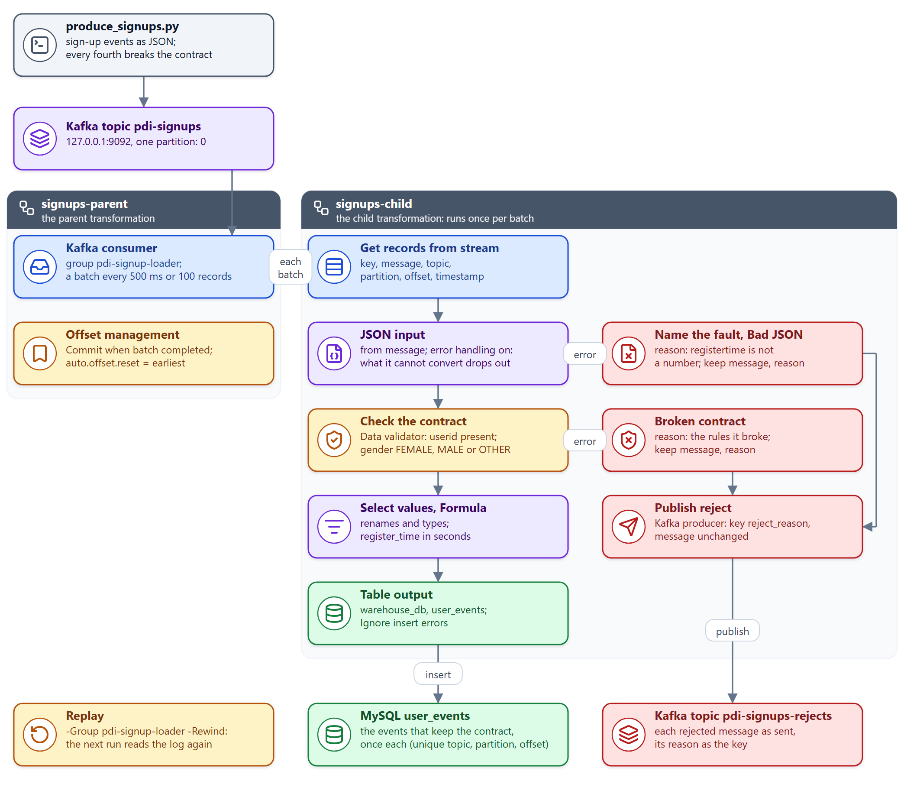
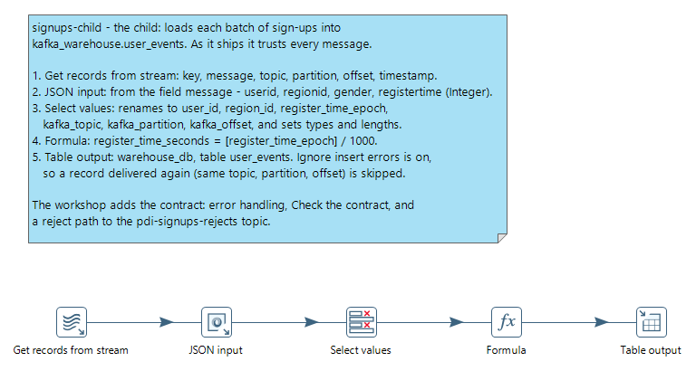
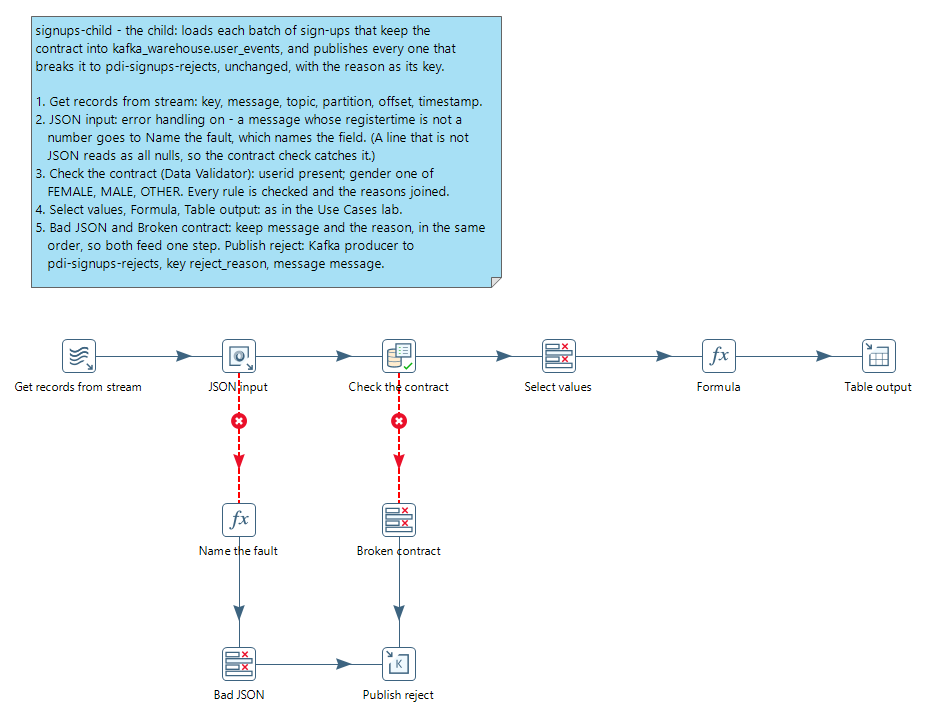
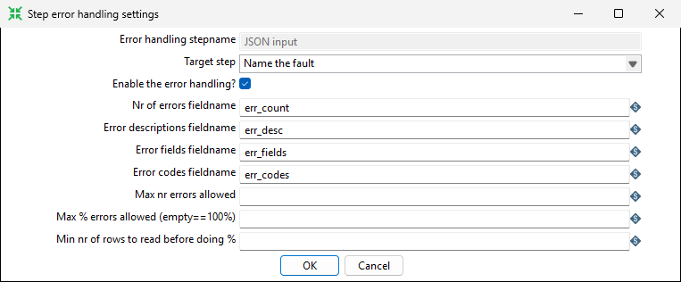
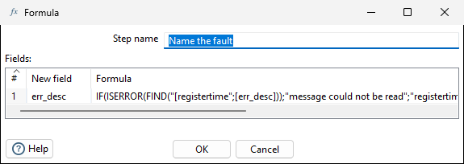
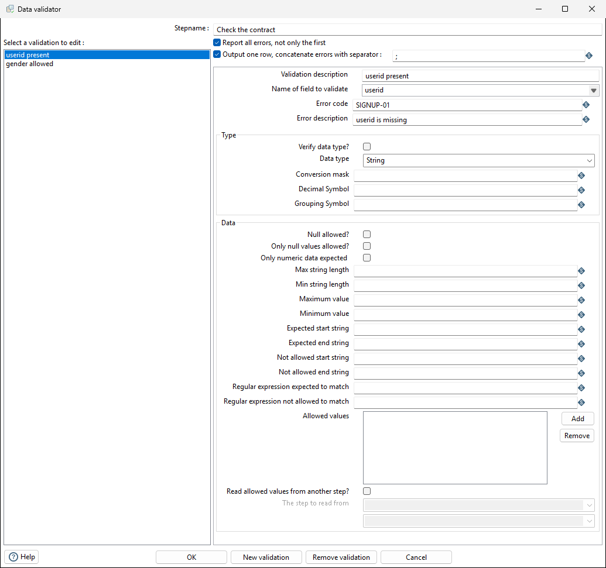
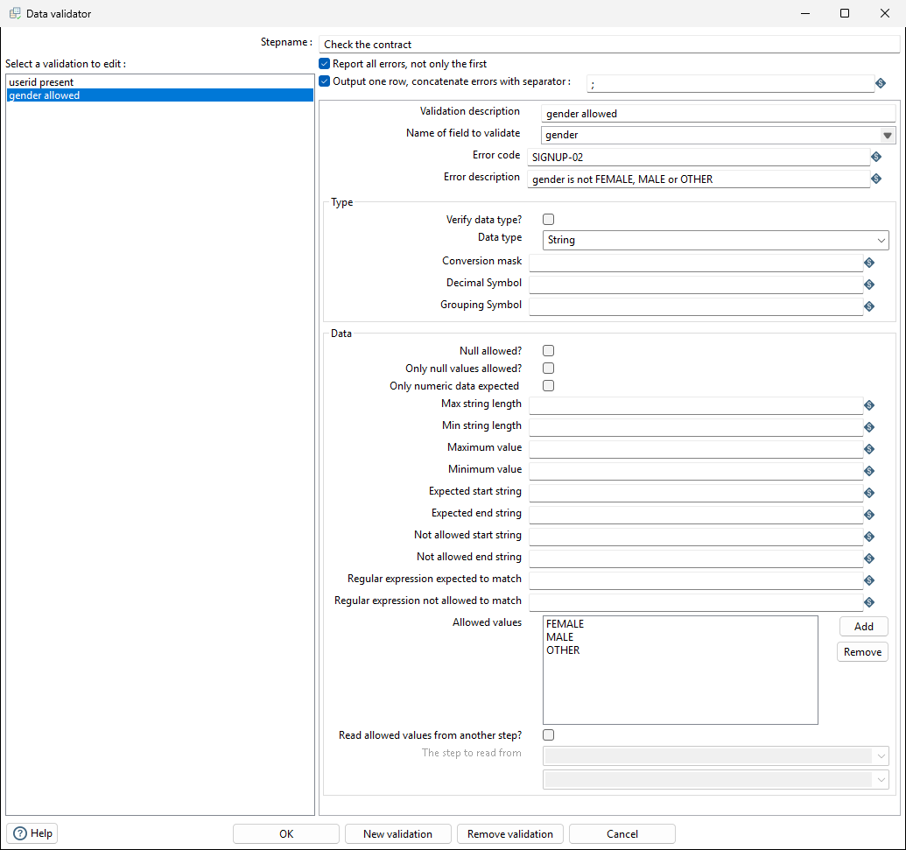
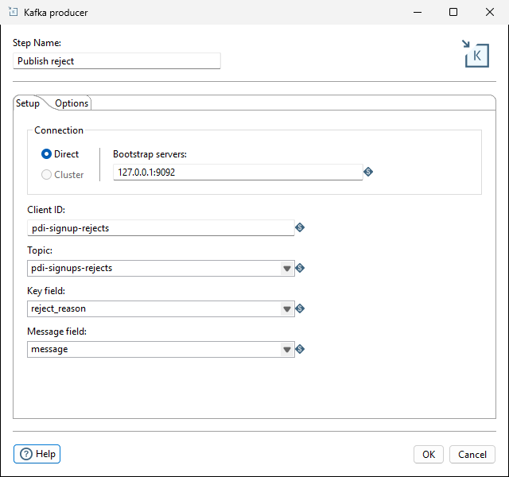

# Contracts, Rejects and Replay

> **Warning:**
>
> #### Workshop - Contracts, Rejects and Replay (when the events go wrong)
>
> The sign-up feed from the Use Cases lab now comes from a second app, and that app does not always keep to the agreed shape: a field goes missing, a value arrives as text, a gender code is not one the warehouse knows, a line is not JSON at all. In this workshop you see what one such message does to the pipeline as it stands, then give the child a *contract*: messages that keep it load into MySQL, and messages that break it go, unchanged and with the reason, to a *rejects* topic. Last, you use the topic's log to catch up after a stop and to rebuild the warehouse table from the start.
>
> **What you'll do**
>
> * Watch one bad message load wrong data, drop a row silently, and then stop the pipeline for good
> * Route the messages **JSON input** cannot read to an error path with step error handling
> * Check the contract with **Data validator**: required fields and allowed values
> * Publish every rejected message to the `pdi-signups-rejects` topic with a **Kafka producer**, the reason as its key
> * Read a consumer group's lag, and watch the pipeline catch up
> * Rewind the group and rebuild the table from the log, without a single duplicate
>
> **Prerequisites:**
>
> * The [Use Cases](../08-kafka-use-cases/guide.md) workshop: its `kafka_warehouse` database, `user_events` table and `warehouse_db` connection, which this lab loads too
> * Kafka on `127.0.0.1:9092` and the MySQL kit's `sampledata-mysql`, from [Before You Start](../00-before-you-start/guide.md)
> * Streaming kit 1.2.0 or later: `C:\Streaming\run-podman-streaming.ps1` prints its version when it runs
>
> **Estimated time:** 50 minutes

This workshop's pipeline: `produce_signups.py` publishes to `pdi-signups`, the parent's **Kafka consumer** reads it as the group `pdi-signup-loader`, and each batch runs the child. Messages that keep the contract go along the top to `user_events`; messages that break it drop to the error path and leave on `pdi-signups-rejects`:

<div align="center">
<figure>

<figcaption>The pipeline: good messages to user_events, rejects to their own topic</figcaption>
</figure>
</div>

:::: tabs

### 1. Prepare

> **Note:**
>
> #### The contract and the feed
>
> `produce_signups.py` publishes sign-up events in the same shape as the Use Cases lab, to a new topic, `pdi-signups`. That shape is the *contract* between the app and the pipeline:
>
> | Field | Contract |
> | --- | --- |
> | `userid` | Required: `User_1`, `User_2`, ... |
> | `regionid` | `Region_1` to `Region_9` |
> | `gender` | Required, one of `FEMALE`, `MALE`, `OTHER` |
> | `registertime` | A number: epoch milliseconds |
>
> Every fourth event breaks it, always in this order: `gender` is `F`; `userid` is missing; `registertime` is text; the message is not JSON. So events 4, 8, 12 and 16 break it, and then 20, 24, 28, 32, and so on.

1. Install the publisher's one dependency, the Confluent Kafka client. In PowerShell, run:

```powershell
Set-Location C:\Workshop-SD-Specialty\05-kafka\09-kafka-contracts
pip install -r requirements.txt
```

2. Check that the Streaming kit is 1.2.0 or later, and Kafka is up:

```powershell
C:\Streaming\run-podman-streaming.ps1 -Status
```

> **Success:** Checkpoint: the first line reads `run-podman-streaming.ps1 1.2.0` (or later), and `kafka` is `running`. An older kit has no `-Rewind` or `-Read`: install the current course version, which lays the kit down again.

3. Start Spoon with the **Start Pentaho Data Integration** button below, or from PowerShell:

```powershell
Set-Location C:\Pentaho\design-tools\data-integration
.\spoon.bat
```

<button data-launch="spoon" data-path="">Start Pentaho Data Integration</button>

4. Select **File > Open** (`Ctrl+O`) and open `C:\Workshop-SD-Specialty\05-kafka\09-kafka-contracts\signups-parent.ktr`, then `signups-child.ktr` from the same folder.

The parent is the Use Cases parent, pointed at the new topic: **Kafka consumer** reads `pdi-signups` as the group `pdi-signup-loader`, a batch every 500 ms or 100 records, and commits a batch's offsets when the child has finished it. The child is the Use Cases child, step for step:

<div align="center">
<figure>

<figcaption>signups-child as it ships: it trusts every message</figcaption>
</figure>
</div>

### 2. Run It as It Ships

> **Note:**
>
> #### One bad message
>
> Run the pipeline as it ships against 16 events, four of which break the contract, and see what each does.

1. Select the **signups-parent** tab, press `F9` (**Action > Run**), and select **Run** in the **Run Options** dialog.
2. In PowerShell, in the lab folder, start the publisher for 16 events, one a second:

```powershell
python produce_signups.py --count 16
```

> **Success:** Checkpoint: within about 12 seconds the parent stops by itself. **Execution Results** shows an error on **Kafka consumer**, and the **Logging** tab reads `Unexpected conversion error while converting value [registertime String] to an Integer`, then `Error in sub-transformation`.

3. Look at what reached the warehouse. Open a MySQL session as `kafka_user`:

```powershell
podman exec -it sampledata-mysql mysql -ukafka_user -ppassword kafka_warehouse
```

4. Run:

```sql
SELECT user_id, gender, kafka_offset
FROM user_events WHERE kafka_topic = 'pdi-signups'
ORDER BY kafka_offset;
```

> **Success:** Checkpoint: 10 rows, `User_1` to `User_11` without `User_8`. `User_4` is there with gender `F`.

Each bad message did something different, and only one of them was loud:

| Event | What broke | What the pipeline did |
| --- | --- | --- |
| `User_4` | `gender` is `F` | Loaded it: the warehouse now holds a value no report expects |
| `User_8` | No `userid` | Dropped it without a word: MySQL refused the `NULL`, and **Ignore insert errors** skipped the row |
| `User_12` | `registertime` is text | Failed the batch, and the parent with it |

5. Type `exit` to leave MySQL. Ask Kafka where the group stopped:

```powershell
C:\Streaming\run-podman-streaming.ps1 -Group pdi-signup-loader
```

> **Success:** Checkpoint: `CURRENT-OFFSET` is `11`, `LOG-END-OFFSET` is `16`, and `LAG` is `5`. Offset `11` is `User_12`: the batch that failed was never committed.

6. Run the parent again (`F9`, **Run**).

> **Success:** Checkpoint: it stops again at once, with the same error. Nothing new reaches the warehouse.

7. Leave the parent stopped, and the MySQL session open in its window.

> **Under the hood:**
>
> #### A poison message
>
> With **Commit when batch completed**, the group commits a batch only after
> the child finishes it. The child failed on `User_12`, so offset `11` was
> never committed, and every restart reads `User_12` first and fails on it
> again. A message that stops a consumer every time it is read is called a
> *poison message*: the pipeline cannot pass it, and everything behind it
> waits, `User_13` and every event after.
>
> **Why it matters:** the loud failure is the easy one to see. The two quiet
> ones are worse: a wrong value in the warehouse and a row that never
> arrived, with nothing in any log. A contract has to deal with all three.

### 3. Catch What JSON Input Cannot Read

> **Note:**
>
> #### Step error handling
>
> Any step that supports error handling can send the rows it cannot process down a second hop, with fields that say what went wrong, instead of failing the transformation. Give **JSON input** an error path, and name the fault in words.
>
> <div align="center">
> <figure>
> 
> <figcaption>What you build: the child with its contract and reject path</figcaption>
> </figure>
> </div>

1. Select the **signups-child** tab.
2. On the **Design** tab, open the **Scripting** folder and drag **Formula** onto the canvas, below **JSON input**. Rename it `Name the fault`.
3. Right-click **JSON input** and select **Error Handling...**, and set:

| Setting | Value |
| --- | --- |
| **Target step** | `Name the fault` |
| **Enable the error handling?** | selected |
| **Nr of errors fieldname** | `err_count` |
| **Error descriptions fieldname** | `err_desc` |
| **Error fields fieldname** | `err_fields` |
| **Error codes fieldname** | `err_codes` |

<div align="center">
<figure>

<figcaption>JSON input's error handling: failed rows go to Name the fault</figcaption>
</figure>
</div>

4. Select **OK**. The new hop from **JSON input** to **Name the fault** is drawn red, with an error icon: it carries only the rows that fail.
5. Double-click **Name the fault**. In the first row, set **New field** to `err_desc`, **Replace value** to `err_desc`, **Value type** to `String`, and **Formula** to:

```text
IF(ISERROR(FIND("[registertime";[err_desc]));"message could not be read";"registertime is not a number")
```

<div align="center">
<figure>

<figcaption>Name the fault: a short reason in place of the Java exception</figcaption>
</figure>
</div>

The error description **JSON input** writes is the Java exception, over several lines. A reject's reason is read by people, so the formula replaces it with a short one.

6. Select **OK**. From the **Transform** folder, drag **Select values** below **Name the fault**, rename it `Bad JSON`, and create a hop from **Name the fault** to **Bad JSON**.
7. Double-click **Bad JSON**. On the **Select & Alter** tab, fill the grid with two rows, in this order:

| Fieldname | Rename to |
| --- | --- |
| `message` | |
| `err_desc` | `reject_reason` |

8. Select **OK**, and save the transformation (`Ctrl+S`).

### 4. Check the Contract

> **Note:**
>
> #### Data validator
>
> **Data validator** checks each row against a list of rules and sends the rows that break any of them down its error hop. Here it checks the two rules that JSON can keep while still being wrong: `userid` present, and `gender` one of three values.

1. Select the hop from **JSON input** to **Select values** and press `Delete`.
2. From the **Validation** folder, drag **Data validator** between them, and rename it `Check the contract`. Create hops from **JSON input** to **Check the contract**, and from **Check the contract** to **Select values**. If Spoon asks which kind of hop one of them is, choose **Main output of step**: the red hop to **Name the fault** stays the error path.
3. Double-click **Check the contract**. Select **Report all errors, not only the first** and **Output one row, concatenate errors with separator**, and set the separator to `; ` (a semicolon and a space).
4. Select **New validation**, and set:

| Setting | Value |
| --- | --- |
| **Validation description** | `userid present` |
| **Name of field to validate** | `userid` |
| **Error code** | `SIGNUP-01` |
| **Error description** | `userid is missing` |
| **Null allowed?** | cleared |

<div align="center">
<figure>

<figcaption>Check the contract: userid present</figcaption>
</figure>
</div>

5. Select **New validation** again, and set:

| Setting | Value |
| --- | --- |
| **Validation description** | `gender allowed` |
| **Name of field to validate** | `gender` |
| **Error code** | `SIGNUP-02` |
| **Error description** | `gender is not FEMALE, MALE or OTHER` |
| **Null allowed?** | cleared |
| **Allowed values** | `FEMALE`, `MALE`, `OTHER`, each added with **Add** |

<div align="center">
<figure>

<figcaption>Check the contract: gender is one of three values</figcaption>
</figure>
</div>

6. Select **OK**. From the **Transform** folder, drag **Select values** below **Check the contract** and rename it `Broken contract`.
7. Right-click **Check the contract**, select **Error Handling...**, and set **Target step** to `Broken contract`, with the same four field names as in tab 3: `err_count`, `err_desc`, `err_fields`, `err_codes`. Select **OK**.
8. Double-click **Broken contract** and fill its **Select & Alter** grid exactly as **Bad JSON**'s: `message`, then `err_desc` renamed `reject_reason`. Select **OK**, and save (`Ctrl+S`).

The two error paths now end in rows of the same shape, `message` then `reject_reason`, so one step can take both.

### 5. Publish the Rejects

> **Note:**
>
> #### A rejects topic
>
> A rejected message goes to its own topic, `pdi-signups-rejects`, unchanged, with the reason as the record's key. Nothing is lost: a person, or a second pipeline, can read the rejects, fix the cause, and send them again. This pattern is often called a *dead-letter topic*.

1. From the **Streaming** folder, drag **Kafka producer** below **Broken contract**, and rename it `Publish reject`.
2. Create hops from **Bad JSON** to **Publish reject**, and from **Broken contract** to **Publish reject**.
3. Double-click **Publish reject** and, on the **Setup** tab, set:

| Setting | Value |
| --- | --- |
| **Connection** | **Direct**, **Bootstrap servers** `127.0.0.1:9092` |
| **Client ID** | `pdi-signup-rejects` |
| **Topic** | `pdi-signups-rejects` |
| **Key field** | `reject_reason` |
| **Message field** | `message` |

<div align="center">
<figure>

<figcaption>Publish reject: the original message, keyed by its reason</figcaption>
</figure>
</div>

Kafka creates `pdi-signups-rejects` when the first reject arrives.

4. Select **OK**, and save the transformation (`Ctrl+S`).

### 6. Run with the Contract

> **Note:**
>
> #### Past the poison message
>
> Run the parent again. It resumes at offset `11`, `User_12`, the message that stopped it.

1. Select the **signups-parent** tab, and run it (`F9`, **Run**).
2. Start the publisher for 24 more events, `User_17` to `User_40`:

```powershell
python produce_signups.py --count 24 --start 17
```

> **Success:** Checkpoint: the parent keeps running. In **Step Metrics**, the counts on **Kafka consumer** grow about once a second.

3. When the publisher prints `done`, read the rejects topic:

```powershell
C:\Streaming\run-podman-streaming.ps1 -Read pdi-signups-rejects
```

> **Success:** Checkpoint: 8 records, `User_12` and `User_16` from the first run, then the six from `User_20` to `User_40`. The key comes first, then `|`, then the message as the app sent it:
>
> ```text
> registertime is not a number | {"registertime": "2026-11-27 11:11:02", "userid": "User_12", ...}
> userid is missing; gender is not FEMALE, MALE or OTHER | userid=User_16;regionid=Region_8;gender=FEMALE
> gender is not FEMALE, MALE or OTHER | {"registertime": 1795777870397, "userid": "User_20", ...}
> userid is missing | {"registertime": 1795777874407, "regionid": "Region_4", ...}
> ```

4. In MySQL, count the rows again:

```sql
SELECT COUNT(*) FROM user_events WHERE kafka_topic = 'pdi-signups';
```

> **Success:** Checkpoint: `31`: the 10 from the first run, and the 21 good events from `User_13` to `User_40`.

5. Leave the parent running for the next tab.

> **Under the hood:**
>
> #### Why a line that is not JSON reaches the contract check
>
> `User_16` is not JSON, yet its reason comes from **Check the contract**,
> not from **JSON input**. **JSON input** has **Ignore missing path** and
> **Default path leaf to null** selected, so a message where none of the
> paths can be found is not an error: every field reads as `NULL`. The
> contract then catches it, because `userid` and `gender` may not be null.
> **JSON input**'s own error path catches what it cannot convert, such as a
> date in a number field.
>
> **Why it matters:** each rule sits where it can see the fault. Type
> errors are found where the type is set; meaning, such as which genders
> exist, is checked in one named place, **Check the contract**, where the
> next rule is easy to add.

### 7. Lag

> **Note:**
>
> #### How far behind?
>
> A consumer group's *lag* is how many records it has not yet committed: the end of the log minus its committed offset. Stop the pipeline, let the app keep publishing, and watch the lag grow, then shrink.

1. In Spoon, select **Stop** in the canvas toolbar to stop **signups-parent**.
2. Publish 20 more events, `User_41` to `User_60`, as fast as the app can:

```powershell
python produce_signups.py --count 20 --start 41 --fast
```

3. Ask Kafka about the group:

```powershell
C:\Streaming\run-podman-streaming.ps1 -Group pdi-signup-loader
```

> **Success:** Checkpoint: `CURRENT-OFFSET` `40`, `LOG-END-OFFSET` `60`, `LAG` `20`, and no consumer: the group's `CONSUMER-ID` is `-`.

4. Run **signups-parent** again (`F9`, **Run**). After about 5 seconds, ask Kafka again.

> **Success:** Checkpoint: `LAG` `0`. The 20 records arrived as one batch, because **Number of records** (100) was not reached and **Duration (ms)** (500) ran out first. In MySQL, the count is now `46`.

5. Stop **signups-parent** (**Stop** in the canvas toolbar).

### 8. Rebuild by Replay

> **Note:**
>
> #### The log is the source
>
> Kafka keeps every record, whether the group has read it or not. So the warehouse table can be rebuilt from the topic: delete the rows this pipeline loaded, move the group back to the start, and let the pipeline read the topic again, this time with the contract. `User_4`'s `F` goes, and `User_8`, the row that vanished in tab 2, appears among the rejects.

1. In MySQL, delete the rows loaded from `pdi-signups`:

```sql
DELETE FROM user_events WHERE kafka_topic = 'pdi-signups';
```

2. Rewind the group to the start of its topic:

```powershell
C:\Streaming\run-podman-streaming.ps1 -Group pdi-signup-loader -Rewind
```

> **Success:** Checkpoint: `Rewound pdi-signup-loader to the start of its topics`, then `CURRENT-OFFSET` `0` and `LAG` `60`. If the script says to stop the transformation first, the group still counts the last run as a member: wait a minute and run it again.

3. Run **signups-parent** (`F9`, **Run**). After about 10 seconds, stop it.
4. In MySQL, run:

```sql
SELECT COUNT(*) AS loaded,
       SUM(gender NOT IN ('FEMALE', 'MALE', 'OTHER')) AS bad_gender,
       SUM(user_id = 'User_8') AS user_8
FROM user_events WHERE kafka_topic = 'pdi-signups';
```

> **Success:** Checkpoint: `loaded` `45`, `bad_gender` `0`, `user_8` `0`: the 45 events of 60 that keep the contract, and nothing else.

5. Read the rejects topic again with `-Read pdi-signups-rejects`.

> **Success:** Checkpoint: the first 13 records are those of tabs 6 and 7. After them come 15 more, the replay's: `User_4`, `User_8`, `User_12`, `User_16` and every fourth event to `User_60`.

6. Type `exit` to leave MySQL. The workshop is done: leave Kafka running for the capstone.

> **Under the hood:**
>
> #### Replay is safe for the table, not for the rejects
>
> The rewind moved the group's committed offset to `0`, so the next run
> read all 60 records again. The table cannot take an event twice: its
> unique key on `kafka_topic`, `kafka_partition` and `kafka_offset` refuses a
> second copy, so a replay, or a record Kafka delivers twice after a crash,
> lands once. The rejects topic has no such key. Every replay publishes
> its rejects again, which is why `User_12` and `User_16` are on it twice.
> A reader of the rejects dedupes by the message, or the pipeline keys
> each reject by its source offset.
>
> **Why it matters:** with *at-least-once* delivery, every write has to be
> one that can safely happen twice. Kafka's log turns a pipeline bug from
> lost data into a re-run: fix the pipeline, rewind, replay.

::::

## Troubleshooting <!-- no-step -->

<details>
<summary>The parent stops at once with a conversion error, even after the contract is in</summary>

**JSON input**'s error handling is missing or disabled. Right-click **JSON input**, select **Error Handling...**, and check that **Target step** is `Name the fault` and **Enable the error handling?** is selected. The hop from **JSON input** to **Name the fault** must be red.

</details>

<details>
<summary>Every row goes to the rejects, or none do</summary>

Check the hops out of **Check the contract**: the main output goes to **Select values**, and the error hop, red, to **Broken contract**. In each validation, **Null allowed?** must be cleared, and **Allowed values** must hold exactly `FEMALE`, `MALE` and `OTHER`, in capitals.

</details>

<details>
<summary>Publish reject fails with "mixing row layouts" or a field not found</summary>

**Bad JSON** and **Broken contract** must output the same fields in the same order: `message`, then `reject_reason`. Open each one's **Select & Alter** tab and compare.

</details>

<details>
<summary>-Rewind says "Stop the transformation that reads as pdi-signup-loader"</summary>

Kafka resets only a group with no consumer. Stop **signups-parent** in Spoon. A consumer that ended without closing, such as one in a Spoon that was closed, stays a member until Kafka's session timeout: wait a minute, and run the command again.

</details>

<details>
<summary>-Rewind or -Read: "A parameter cannot be found"</summary>

`C:\Streaming\run-podman-streaming.ps1` is older than 1.2.0. Install the current version of the course, which lays the Streaming kit down again.

</details>

## Lab Files

Click a file to download. For `.ktr` and `.kjb` files, **Open in Pentaho Data Integration** launches Pentaho Data Integration with the file loaded. If Pentaho Data Integration is already running, the path is copied to your clipboard — switch to Pentaho Data Integration and press `Ctrl+O`, `Ctrl+V`, `Enter`.

These files are also on disk in `C:\Workshop-SD-Specialty\05-kafka\09-kafka-contracts`. The publisher and its dependency list:

[produce_signups.py](./files/produce_signups.py)

[requirements.txt](./files/requirements.txt)

The starter transformations:

[signups-parent.ktr](./files/signups-parent.ktr) <button data-launch="spoon" data-path="files/signups-parent.ktr">Open in Pentaho Data Integration</button> <button data-graph="files/signups-parent.ktr">View graph</button>

[signups-child.ktr](./files/signups-child.ktr) <button data-launch="spoon" data-path="files/signups-child.ktr">Open in Pentaho Data Integration</button> <button data-graph="files/signups-child.ktr">View graph</button>

### Solution <!-- no-step -->

The finished parent and child, with the contract and the reject path. Open them alongside your own to compare.

Also on disk at `C:\Workshop-SD-Specialty\05-kafka\09-kafka-contracts\solution`.

[signups-parent.ktr](./files/solution/signups-parent.ktr) <button data-launch="spoon" data-path="files/solution/signups-parent.ktr">Open in Pentaho Data Integration</button> <button data-graph="files/solution/signups-parent.ktr">View graph</button>

[signups-child.ktr](./files/solution/signups-child.ktr) <button data-launch="spoon" data-path="files/solution/signups-child.ktr">Open in Pentaho Data Integration</button> <button data-graph="files/solution/signups-child.ktr">View graph</button>

---

> **Tip:** Next, put the whole course together: [Capstone: A Plant-Floor Alert Feed](../10-capstone-a-plant-floor-alert-feed/guide.md).
