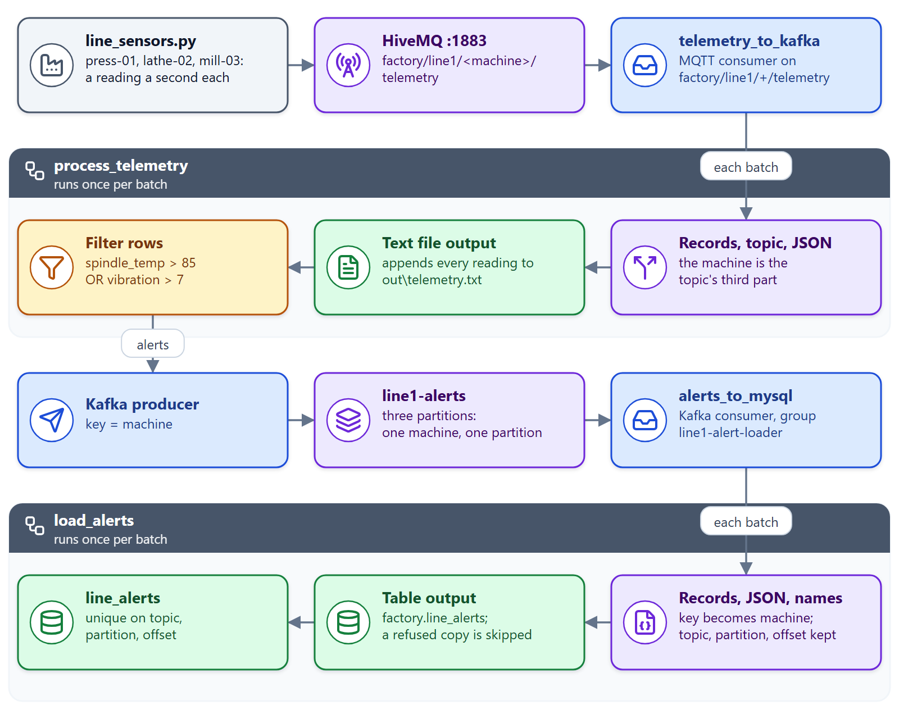

# Capstone: A Plant-Floor Alert Feed

> **Capstone Project — bring it all together.**

You're the data engineer for a factory's line 1. Three machines on the
line, a press, a lathe and a mill, each publish a telemetry reading
every second over MQTT: spindle temperature, vibration and speed. The
maintenance team wants two things. Every reading kept, so they can look
back at a failure. And every reading that crosses a threshold delivered
as an alert to the systems that act on it, in order for each machine,
and stored once in a table their dashboards read, even when the feed is
stopped and started again.

The machines, the broker and the database are running. The pipelines
are yours to build.

> **Objectives:**
>
> - Subscribe to all three machines with one MQTT wildcard, and take each reading's machine from its topic.
> - Archive every reading to a file, a batch at a time.
> - Publish the readings that cross a threshold to a Kafka topic with three partitions, keyed so each machine's alerts stay in order.
> - Load the alerts from Kafka into MySQL with a consumer group, so a restart resumes where it stopped and no alert is stored twice.
> - Produce something portfolio-worthy ("I built this for my Specialty course accreditation").
>
> **Estimated time:** 2 hours for a clean, well-named solution. Re-shape and revisit as you'd like.

---

> **Warning:**
>
> #### Required for your course accreditation: five checks on your own folders
>
> The course accreditation is issued only when all five of these checks
> pass. They read your workshop folder, so save (or copy) your work into
> exactly these places **before you take the exam**:
>
> | # | What must be there | Where |
> | --- | --- | --- |
> | 1 | Your MQTT parent, `telemetry_to_kafka.ktr`, subscribed to `factory/line1/+/telemetry` | `C:\Workshop-SD-Specialty\capstone\solution\` |
> | 2 | Your MQTT child, `process_telemetry.ktr`, with a **Kafka producer** step | `C:\Workshop-SD-Specialty\capstone\solution\` |
> | 3 | Your Kafka parent, `alerts_to_mysql.ktr`, with a **Kafka consumer** step | `C:\Workshop-SD-Specialty\capstone\solution\` |
> | 4 | Your archive, `telemetry.txt`, written by your MQTT child | `C:\Workshop-SD-Specialty\capstone\out\` |
> | 5 | Your `README.md`: how to start, run, stop and check the feed | `C:\Workshop-SD-Specialty\capstone\solution\` |
>
> Your `solution\` folder starts with a **blank** transformation for
> each file named below: build each one and save it. A blank file
> passes no check. Select **Run checks** under **Verification checks**
> to see where you stand.

## Inputs

Download the files from **Lab Files** at the bottom of this page, or
use the copies the installer put in `C:\Workshop-SD-Specialty\capstone\data\`.

| File | What it is |
| ---- | ---------- |
| `line_sensors.py` | Line 1's three machines: `press-01`, `lathe-02` and `mill-03`. Each is its own MQTT client and publishes one reading a second to HiveMQ on `localhost:1883` |
| `requirements.txt` | The script's one dependency, the Paho MQTT client |
| `create_factory.sql` | The `factory` database, its `line_user`, and the `line_alerts` table the alerts load into |

Each reading goes to `factory/line1/<machine>/telemetry` as JSON:

```json
{"ts": 1795699969663, "spindle_temp": 69.1, "vibration": 3.8, "rpm": 2181}
```

`ts` is the reading's time in epoch milliseconds. Now and then a
machine runs hot or shakes. Each machine also keeps a retained `online`
or `offline` on `factory/line1/<machine>/status`, with a Last Will.

---

## Required behavior

Build the feed in five stages. Each maps to a part of the course, so
you can look back at the workshop that taught it.

### 1. One subscription for the line *(MQTT, HiveMQ)*

`telemetry_to_kafka.ktr`, a parent with one **MQTT consumer** on
`localhost:1883`, subscribed to `factory/line1/+/telemetry`: one
wildcard for all three machines, and for any machine added later. A
batch every 5 seconds or 50 messages.

### 2. Every reading archived *(Streaming Data, HiveMQ)*

`process_telemetry.ktr`, the child the parent runs for each batch. It
takes the machine from the message's topic, parses the reading, and
appends every reading to
`C:\Workshop-SD-Specialty\capstone\out\telemetry.txt`, one line each:
machine, `ts`, `spindle_temp`, `vibration`, `rpm`, separated by `;`,
no header.

### 3. Alerts to Kafka, in order per machine *(Kafka)*

In the same child, a reading is an alert when `spindle_temp` is above
`85` or `vibration` is above `7`. Publish each alert's original JSON
message to the Kafka topic `line1-alerts` on `127.0.0.1:9092`, with the
machine as the record's key. Create the topic yourself with three
partitions.

### 4. Alerts stored once *(Kafka Use Cases)*

`alerts_to_mysql.ktr`, a parent with one **Kafka consumer** in the
consumer group `line1-alert-loader`, reading `line1-alerts` from the
earliest offset, and `load_alerts.ktr`, its child, which loads each
alert into `factory.line_alerts`: the machine, the reading's `ts`, its
three values, and the record's topic, partition and offset. Stop the
loader and start it again: no alert may be lost, and none stored twice.

### 5. Hand it in

Keep the four transformations in `capstone\solution\`, and write a
`README.md` that says how to start the brokers and the machines, which
transformations to run and in what order, how to stop the feed, and
which query shows that every machine's alerts are in one partition.

---

## Suggested shape

<div align="center">
<figure>

<figcaption>Two pipelines joined by a keyed Kafka topic: MQTT in, an archive and alerts out, alerts stored once</figcaption>
</figure>
</div>

Read the diagram top to bottom. The top row is the MQTT side: the three
machines publish to HiveMQ, and one wildcard subscription brings all of
them to `telemetry_to_kafka`. Its child archives every reading and
sends only the alerts on, each keyed by its machine, so Kafka puts every
alert of one machine into the same one of the topic's three partitions.
The bottom row is the loader: a consumer group reads the topic and its
child loads `line_alerts`, where the unique key on the Kafka topic,
partition and offset refuses a record delivered twice.

```text
C:\Workshop-SD-Specialty\capstone\
├── data\                          line_sensors.py, requirements.txt, create_factory.sql
├── solution\
│   ├── telemetry_to_kafka.ktr     the MQTT parent
│   ├── process_telemetry.ktr      its child: archive and alerts
│   ├── alerts_to_mysql.ktr        the Kafka parent
│   ├── load_alerts.ktr            its child: the table load
│   └── README.md
└── out\
    └── telemetry.txt              written by every batch of process_telemetry
```

Every `.ktr` above is waiting for you in `solution\` as a blank file,
with no steps or connections: the names are given, what goes in them is
yours. The `README.md` you create. If `C:\Workshop-SD-Specialty\` has
no `capstone` folder, create `capstone\data\`, `capstone\solution\` and
`capstone\out\` yourself.

---

## Hints for the tricky bits

- **The machine is in the topic.** Name the **MQTT consumer**'s topic field on its **Fields** tab, declare it in the child's **Get records from stream**, and split it on `/`: the third part is the machine.
- **Two outputs from one stream.** **Text file output** passes its rows on, so the alerts can follow the archive: archive every row, then filter.
- **The file beside the transformations.** `${Internal.Transformation.Filename.Directory}` is `solution\`; the archive goes in its sibling, `out\`.
- **The key decides the partition.** The **Kafka producer** sends the field you name as the key. Records with the same key always land in the same partition, which is what keeps one machine's alerts in order.
- **Creating the topic.** Kafka creates a topic it does not know with one partition. Create `line1-alerts` yourself before the first alert: the Streaming kit's `-Topic` and `-Partitions` options create a topic and describe it.
- **The fields a Kafka record brings.** The **Kafka consumer**'s **Fields** tab lists them; the child's **Get records from stream** declares the ones it reads, by the same names.
- **Stored once.** A stop between a batch's insert and its offset commit delivers that batch again. The workshop's answer works here too.

---

## Lab Files

Click a file to download. Put all three in `C:\Workshop-SD-Specialty\capstone\data\`
before you start, if the installer has not already. Beyond these and the
blank files in `solution\`, nothing in the capstone is supplied: the
pipelines are yours to build.

[line_sensors.py](./files/line_sensors.py)

[requirements.txt](./files/requirements.txt)

[create_factory.sql](./files/create_factory.sql)

---

## Verification checks

> **Warning:** These five checks decide your course accreditation, and
> they look only in `C:\Workshop-SD-Specialty\capstone\`: in
> `solution\` your `telemetry_to_kafka.ktr` with its wildcard topic,
> your `process_telemetry.ktr` with a **Kafka producer**, your
> `alerts_to_mysql.ktr` with a **Kafka consumer**, and your
> `README.md`; and in `out\` your `telemetry.txt`. Save your work there
> before you take the exam.

After running both pipelines for a few minutes, select **Run checks**
below to confirm each file landed where expected. The checks confirm
that the files exist and hold the parts named above. Check the feed
yourself: the readings are random, so there are no fixed totals, but a
correct feed always passes these tests.

| Test | How to see it | A correct feed shows |
| ---- | ------------- | -------------------- |
| One subscription, three machines | `telemetry.txt` | Lines for `press-01`, `lathe-02` and `mill-03`, about three a second |
| Only alerts reach Kafka | `SELECT COUNT(*) FROM line_alerts WHERE spindle_temp <= 85 AND vibration <= 7;` | `0` |
| One partition per machine | `SELECT machine, COUNT(DISTINCT kafka_partition) FROM line_alerts GROUP BY machine;` | `1` for every machine |
| Stored once | `SELECT kafka_partition, kafka_offset, COUNT(*) FROM line_alerts GROUP BY kafka_partition, kafka_offset HAVING COUNT(*) > 1;` | No rows |
| Nothing lost | `C:\Streaming\run-podman-streaming.ps1 -Group line1-alert-loader` | **LAG** `0` on each partition it lists once the loader has caught up (a partition that never held an alert is not listed), and the rows in `line_alerts` equal the sum of the **LOG-END-OFFSET** column |

Run the SQL as `line_user`:

```powershell
podman exec -it sampledata-mysql mysql -uline_user -ppassword factory
```

About one reading in ten is an alert, so a minute of the feed brings
roughly twenty. Which partition a machine's alerts land in depends only
on its key: in a run of this capstone, `lathe-02` and `press-01` shared
partition 2 and `mill-03` had partition 1, and partition 0 stayed empty.

> **Under the hood:**
>
> #### Why three partitions held only two machines' worth of alerts
>
> The **Kafka producer** hashes each record's key and takes it modulo
> the number of partitions. The same key always gives the same
> partition, so one machine's alerts stay in the order they were sent,
> and a consumer reads them in that order. Different keys can share a
> partition: three keys over three partitions can leave one empty. A
> record with no key is spread across the partitions, and its order
> against the machine's other alerts is lost.
>
> **Why it matters:** order is kept per key, never across a whole
> topic. Choose the key for the thing whose order matters, here the
> machine, and add partitions for throughput, knowing a consumer group
> can use at most one member per partition.

---

## Deliverables

Your `solution\` folder and your `out\` folder, under
`C:\Workshop-SD-Specialty\capstone\`:

1. `telemetry_to_kafka.ktr` — the MQTT parent, with its wildcard subscription
2. `process_telemetry.ktr` — its child: the machine from the topic, the archive, the threshold filter and the **Kafka producer**
3. `alerts_to_mysql.ktr` — the Kafka parent, with its consumer group
4. `load_alerts.ktr` — its child: the alerts into `factory.line_alerts`, each once
5. `README.md` — how to start, run, stop and check the feed
6. `out\telemetry.txt` — the archive, from your last run

> **Warning:** Save into `capstone\solution\`, not into the course
> folder. Course content is refreshed from the repository on every
> launch, so anything you leave there will be overwritten. Reinstalling
> or upgrading the course never touches `capstone\solution\` or
> `capstone\out\`, and only puts back a blank file you have deleted.

This becomes a portfolio piece: name things clearly, keep the folder
tidy, and be ready to explain why two machines can share a partition.

---

## Build outline and hints <!-- no-step -->

One section per file, in the order you build them. Each says what the
file must do, what it reads and writes, which requirement it meets, and
what a correct run shows. The hints name a step or a technique; the
settings are yours to work out. Each file starts blank in `solution\`:
open it in Spoon (**File > Open**), build it and save it.

:::: tabs

### 1. Prepare

**Must do:** start the brokers and the MySQL kit, create the `factory`
database and the `line1-alerts` topic, and start the machines.

**Reads:** `data\create_factory.sql`, `data\line_sensors.py`.
**Meets:** requirements 3 and 4.

```powershell
C:\Streaming\run-podman-streaming.ps1
C:\MySQL\run-podman-mysql.ps1
Set-Location C:\Workshop-SD-Specialty\capstone\data
Get-Content create_factory.sql -Raw | podman exec -i sampledata-mysql mysql -uroot -ppassword
pip install -r requirements.txt
python line_sensors.py
```

Create the topic yourself, with three partitions, before the first
alert: see **Creating the topic** under **Hints for the tricky bits**.

> **Success:** Checkpoint: `line_sensors.py` prints `press-01: connected`, `lathe-02: connected` and `mill-03: connected`, then a line every 25 seconds; the topic's description lists `PartitionCount: 3` and partitions `0`, `1` and `2`.

### 2. process_telemetry.ktr

**Must do:** for each batch, take the machine from the topic, parse the
reading, append it to `out\telemetry.txt`, and publish the alerts to
`line1-alerts`, keyed by the machine.

**Reads:** the batch from `telemetry_to_kafka.ktr`.
**Writes:** `out\telemetry.txt`; records on `line1-alerts`.
**Meets:** requirements 2 and 3.

**Hints:** **Get records from stream**, **Split fields**, **JSON input**,
**Text file output**, **Filter rows** with two conditions joined by
`OR`, and **Kafka producer**.

> **Success:** Checkpoint: built, it cannot run on its own; the next file runs it.

### 3. telemetry_to_kafka.ktr

**Must do:** subscribe to the whole line with one wildcard and run
`process_telemetry.ktr` for each batch.

**Meets:** requirement 1.

**Hints:** **MQTT consumer**; its **Fields** tab names the message and
the topic fields the child receives.

> **Success:** Checkpoint: run it with the machines publishing, and `out\telemetry.txt` grows by about fifteen lines every 5 seconds, five per machine; once the loader in step 5 runs, `-Group line1-alert-loader` shows the alerts' offsets growing.

### 4. load_alerts.ktr

**Must do:** load each batch of alerts into `factory.line_alerts`,
each record once.

**Reads:** the batch from `alerts_to_mysql.ktr`.
**Writes:** `factory.line_alerts`.
**Meets:** requirement 4.

**Hints:** **Get records from stream**, **JSON input**, **Select
values**, and **Table output** on a connection to `factory` as
`line_user`.

> **Success:** Checkpoint: built, it cannot run on its own; the next file runs it.

### 5. alerts_to_mysql.ktr

**Must do:** read `line1-alerts` as the group `line1-alert-loader` and
run `load_alerts.ktr` for each batch.

**Meets:** requirement 4.

**Hints:** **Kafka consumer**, with **Commit when batch completed** and
`auto.offset.reset` `earliest`.

> **Success:** Checkpoint: every test under **Verification checks** passes. Stop the loader, wait a minute, and start it again: the alerts sent meanwhile arrive, and the duplicate test still returns no rows.

### 6. README.md

**Must do:** say how to start the brokers and the machines, which
transformations to run and in what order, how to stop the feed, and
how to check it.

**Meets:** requirement 5.

> **Success:** Checkpoint: all five checks under **Verification checks** pass.

::::

---

> **Tip:** When every check passes, your feed is the course's last deliverable. To look back at how any piece works, every workshop is still in the sidebar: [HiveMQ](../04-mqtt-hivemq/guide.md) for the MQTT consumer, [Use Cases](../08-kafka-use-cases/guide.md) for the Kafka consumer and the table load.
