# Streams to the Lake

> **Warning:**
>
> #### Workshop - Streams to the Lake (land the stream as files)
>
> The warehouse holds the sign-ups that keep the contract. The analytics team wants every event, as it arrived, in the company's *data lake*: cheap object storage, where any engine can read the files later. In this workshop a second consumer group reads the same Kafka topic and lands each batch in a MinIO bucket as an **Avro** file, a compact format that carries its own schema. You see how the batch size decides how many files the lake gets, then read a batch back in Pentaho Data Integration, and read the whole lake with a script that has nothing to do with Pentaho.
>
> **What you'll do**
>
> * Create a bucket in MinIO and connect Pentaho Data Integration to it with a VFS connection
> * Land each batch of `pdi-signups` records as an Avro file with **Avro output**
> * Read the topic from the start with a new consumer group, without touching the warehouse loader
> * Watch small batches make many small files, and bigger batches make fewer
> * Read one landed file back with **Avro input**, and the whole lake with `query_lake.py`
>
> **Prerequisites:**
>
> * The [Contracts, Rejects and Replay](../09-kafka-contracts/guide.md) workshop: this lab reads the same topic, `pdi-signups`, and its 60 events
> * Kafka, and the MinIO kit's `pcm-minio`, from [Before You Start](../00-before-you-start/guide.md): `C:\minIO\run-podman-minio.ps1` starts MinIO
>
> **Estimated time:** 45 minutes

This workshop's pipeline: the lake writer is a new consumer group on `pdi-signups`. Each batch runs the child once, and the child writes one Avro file into the `streaming-lake` bucket. Two readers follow, one in Pentaho Data Integration and one without it:

<div align="center">
<figure>
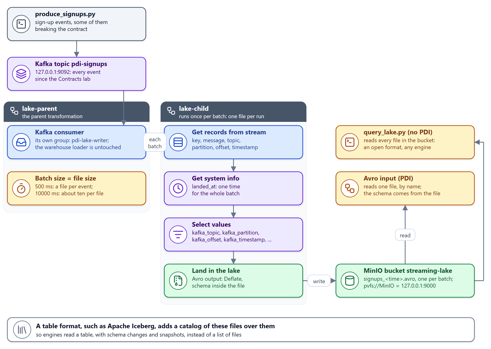
<figcaption>The pipeline: one Avro file per batch, read back two ways</figcaption>
</figure>
</div>

:::: tabs

### 1. Prepare

> **Note:**
>
> #### MinIO and the bucket
>
> MinIO is an object store that speaks the Amazon S3 API, so what you build here runs against Amazon S3 too. Objects live in *buckets*. The lake gets a bucket of its own, `streaming-lake`.

1. Install the scripts' dependencies: the Kafka client for the publisher, and `fastavro` and `minio` for the lake reader. In PowerShell, run:

```powershell
Set-Location C:\Workshop-SD-Specialty\05-kafka\10-kafka-lake
pip install -r requirements.txt
```

2. Start MinIO, if it is not running:

```powershell
C:\minIO\run-podman-minio.ps1
```

3. Open the MinIO console at `http://127.0.0.1:9099` and sign in as `minioadmin` / `minioadmin`. The kit runs a community build of MinIO, so the sign-in page is branded **SILO**; after sign-in you are in MinIO's **Object Browser**.

<div align="center">
<figure>
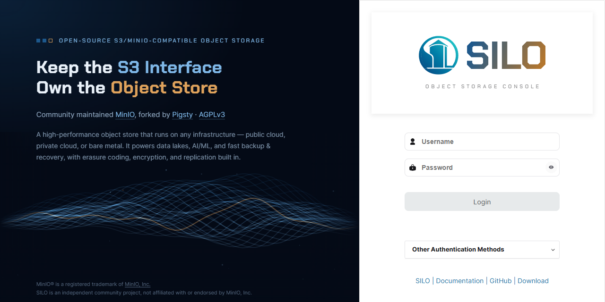
<figcaption>The console sign-in page: SILO, a community build of MinIO</figcaption>
</figure>
</div>
4. Select **Create Bucket**, set **Bucket Name** to `streaming-lake`, leave **Versioning**, **Object Locking** and **Quota** off, and select **Create Bucket**.

<div align="center">
<figure>
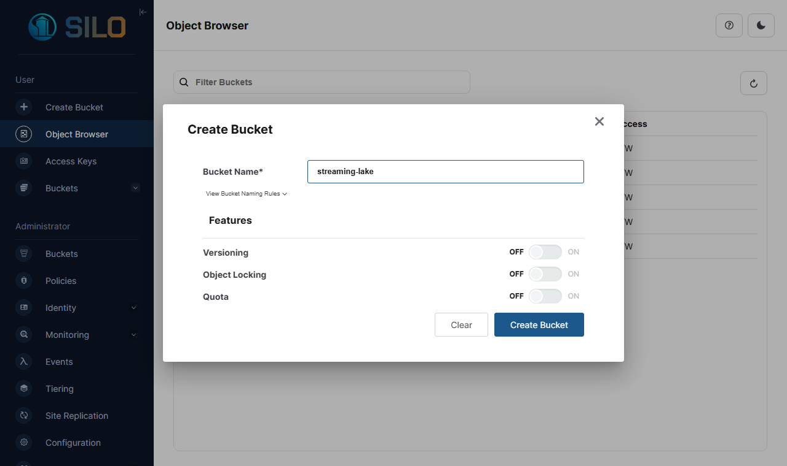
<figcaption>Create Bucket: the lake's own bucket</figcaption>
</figure>
</div>

> **Success:** Checkpoint: the console opens the bucket, and reads `This location is empty`.

### 2. Connect to MinIO

> **Note:**
>
> #### A VFS connection
>
> Pentaho Data Integration reaches object storage through a named **VFS connection**. A path such as `pvfs://MinIO/streaming-lake/signups_` means "bucket `streaming-lake`, through the connection called **MinIO**". If you made this connection in the Data Integration course, it is already there: skip to tab 3.

1. Start Spoon with the **Start Pentaho Data Integration** button below, or from PowerShell:

```powershell
Set-Location C:\Pentaho\design-tools\data-integration
.\spoon.bat
```

<button data-launch="spoon" data-path="">Start Pentaho Data Integration</button>

2. In Spoon, open the **View** tab, right-click **VFS Connections** and select **New...**. Set:

| Setting | Value |
| --- | --- |
| **Connection Name** | `MinIO` |
| **Connection Type** | Amazon S3/Minio/HCP |
| **S3 Connection Type** | Minio/HCP |
| **Access Key** | `minioadmin` |
| **Secret Key** | `minioadmin` |
| **Endpoint** | `http://127.0.0.1:9000` |
| **Signature Version** | `AWSS3V4SignerType` |
| **PathStyle Access** | selected |

<div align="center">
<figure>
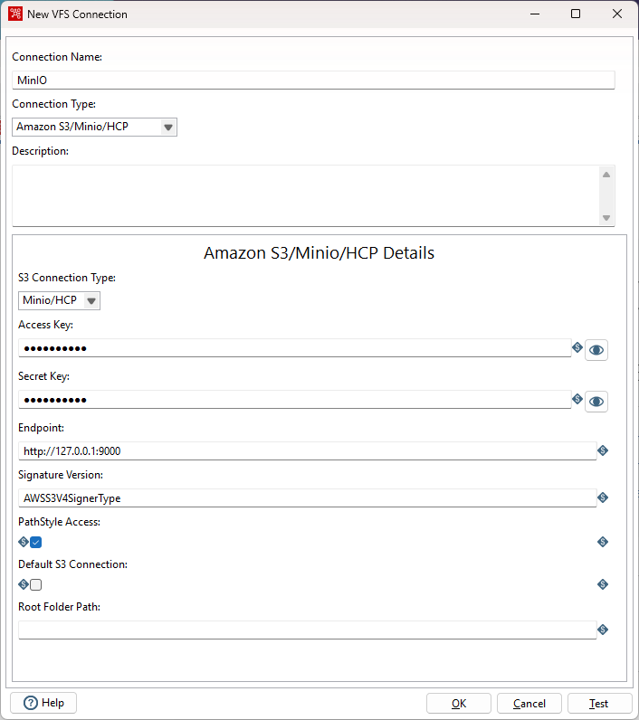
<figcaption>The MinIO connection, filled in</figcaption>
</figure>
</div>

3. Select **Test**.

> **Success:** Checkpoint: Spoon reports `Connection was successfully established.` With **Signature Version** empty, the test fails with `unknown signer type: aws.endpoint`.

4. Select **OK**. The connection is saved for every transformation on this machine.

### 3. Land Each Batch

> **Note:**
>
> #### One file per batch
>
> The child runs once per batch, and its **Avro output** step writes everything it receives to one file, so each batch becomes one file in the lake. The file keeps each record as it arrived, with where it came from in Kafka and when it landed.
>
> <div align="center">
> <figure>
> 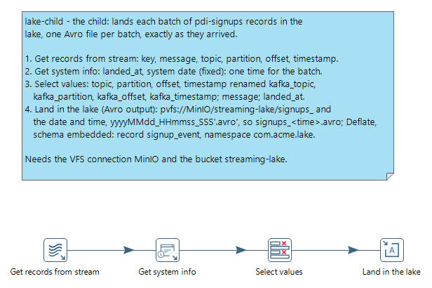
> <figcaption>What you build: lake-child</figcaption>
> </figure>
> </div>

1. Select **File > Open** (`Ctrl+O`) and open `C:\Workshop-SD-Specialty\05-kafka\10-kafka-lake\lake-child.ktr`. It ships with one step, **Get records from stream**, which hands the child the batch: `key`, `message`, `topic`, `partition`, `offset` and `timestamp`.
2. From the **Input** folder, drag **Get system info** to the right of **Get records from stream**, and create a hop to it. Double-click it and add one field: **Name** `landed_at`, **Type** `system date (fixed)`.

<div align="center">
<figure>
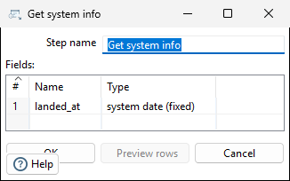
<figcaption>Get system info: one landing time for the whole batch</figcaption>
</figure>
</div>

3. Select **OK**. From the **Transform** folder, drag **Select values** to the right, and create a hop to it. On its **Select & Alter** tab, fill the grid:

| Fieldname | Rename to |
| --- | --- |
| `topic` | `kafka_topic` |
| `partition` | `kafka_partition` |
| `offset` | `kafka_offset` |
| `timestamp` | `kafka_timestamp` |
| `message` | |
| `landed_at` | |

<div align="center">
<figure>
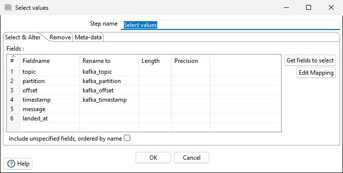
<figcaption>Select values: names that say where each value came from</figcaption>
</figure>
</div>

4. Select **OK**. From the **Big Data** folder, drag **Avro output** to the right, create a hop to it, and rename it `Land in the lake`. Double-click it and set:

| Setting | Value |
| --- | --- |
| **Folder/File name** | `pvfs://MinIO/streaming-lake/signups_` |
| **Overwrite existing output file** | selected |

5. On the **Fields** tab, select **Get fields**. Check that the grid matches this, and correct an **Avro type** where it does not:

| Avro path | Name | Avro type | Nullable |
| --- | --- | --- | --- |
| `kafka_topic` | `kafka_topic` | String | No |
| `kafka_partition` | `kafka_partition` | Long | No |
| `kafka_offset` | `kafka_offset` | Long | No |
| `kafka_timestamp` | `kafka_timestamp` | Long | No |
| `message` | `message` | String | Yes |
| `landed_at` | `landed_at` | Timestamp | No |

<div align="center">
<figure>
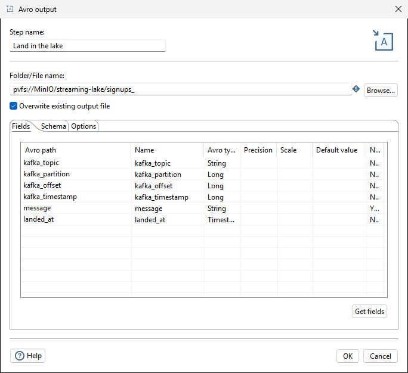
<figcaption>Land in the lake, Fields tab: one Avro field per stream field</figcaption>
</figure>
</div>

6. On the **Schema** tab, leave **File name** empty, so the schema is written into each data file, and set **Namespace** `com.acme.lake`, **Record name** `signup_event` and **Doc value** `One Kafka record from pdi-signups, as it arrived`.

<div align="center">
<figure>
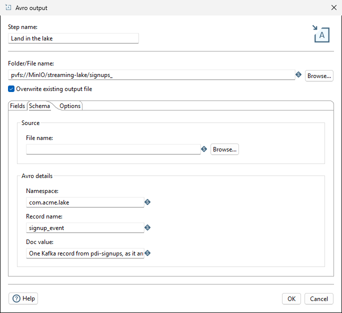
<figcaption>Schema tab: the name the schema carries in every file</figcaption>
</figure>
</div>

7. On the **Options** tab, set **Compression** to `Deflate`, select **Specify date time format**, and enter this format, quotes included:

```text
yyyyMMdd_HHmmss_SSS'.avro'
```

<div align="center">
<figure>
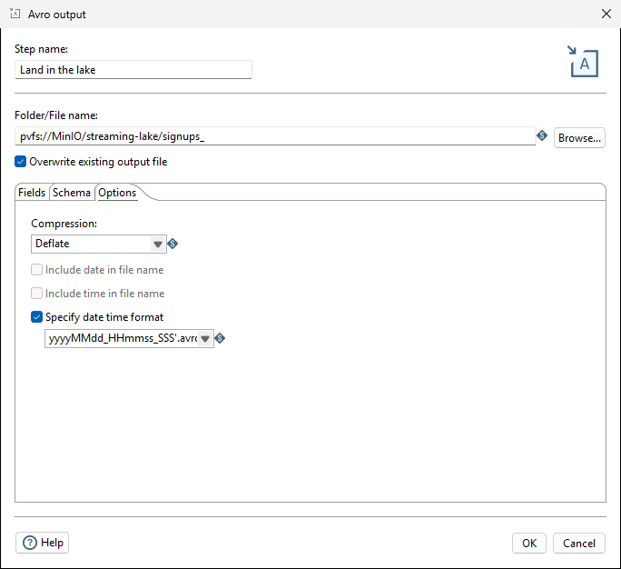
<figcaption>Options tab: a time in every file name, and the .avro extension</figcaption>
</figure>
</div>

The date time format is added to the file name, so each run writes a new file, such as `signups_20261127_133124_415.avro`. The text in single quotes is copied as it is: it is how the file gets its `.avro` extension, which **Avro output** does not add.

8. Select **OK**, and save the transformation (`Ctrl+S`).

### 4. Run and Look in the Bucket

> **Note:**
>
> #### A new reader of an old topic
>
> `lake-parent.ktr` reads `pdi-signups` as a consumer group of its own, `pdi-lake-writer`. A group that has never read the topic starts at its first record, so the lake gets the 60 events of the Contracts lab before anything new, and the warehouse loader's group does not move.

1. Select **File > Open** (`Ctrl+O`) and open `lake-parent.ktr` from the same folder. Its **Kafka consumer** is set as in the Contracts lab: a batch every 500 ms or 100 records.
2. Press `F9` (**Action > Run**), and select **Run**.
3. In the MinIO console, open the `streaming-lake` bucket and select **Refresh**.

> **Success:** Checkpoint: one file, `signups_` and the time `.avro`, of about 1.2 KiB: the 60 earlier events, landed as one batch.

4. Leave the parent running. In PowerShell, in the lab folder, publish 20 new events, one a second:

```powershell
python produce_signups.py --count 20 --start 61
```

5. When the publisher prints `done`, select **Refresh** in the console again.

<div align="center">
<figure>
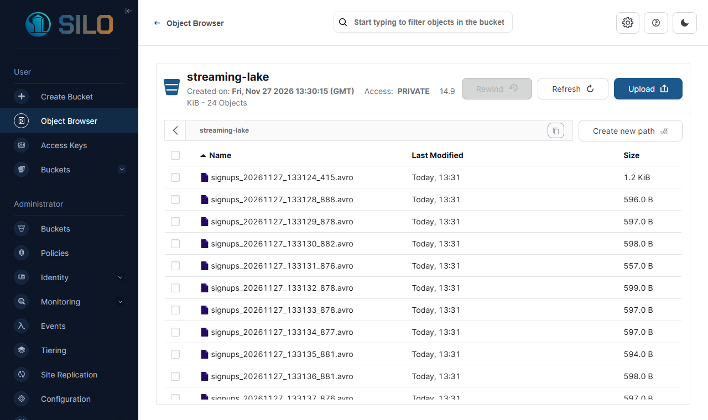
<figcaption>One second, one file: the 500 ms batch lands each event on its own</figcaption>
</figure>
</div>

> **Success:** Checkpoint: 21 files. After the first, a run of 20 files about a second apart, each about 600 bytes: one event each.

6. Stop **lake-parent** (**Stop** in the canvas toolbar).

### 5. Fewer, Bigger Files

> **Note:**
>
> #### The batch is the file
>
> With a batch every 500 ms and one event a second, almost every batch holds one event, so almost every event became a file. Make the batch longer and each file holds more.

1. In **lake-parent**, double-click **Kafka consumer**, open the **Batch** tab, and set **Duration (ms)** to `10000` and **Number of records** to `1000`.

<div align="center">
<figure>
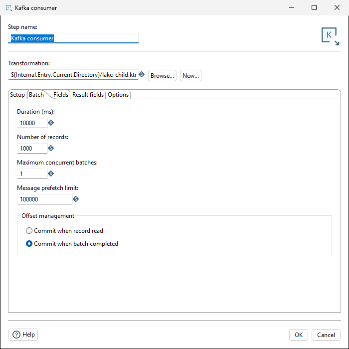
<figcaption>The Batch tab: a batch every 10 seconds, or at 1000 records</figcaption>
</figure>
</div>

2. Select **OK**, save (`Ctrl+S`) and run the parent (`F9`, **Run**).
3. Publish 20 more events:

```powershell
python produce_signups.py --count 20 --start 81
```

4. When the publisher prints `done`, wait 10 seconds, and select **Refresh** in the console.

> **Success:** Checkpoint: two or three new files, about ten events each, the newest a little under 1 KiB. Twenty events made 20 files at 500 ms; at 10 seconds they made two or three.

5. Stop **lake-parent**.

> **Under the hood:**
>
> #### Small files cost more than their size
>
> Every Avro file carries a header and its schema, about 550 bytes here,
> before the first record: the one-event files are nearly all header.
> Each object is also one more request for every engine that reads the
> lake, and one more entry to list. A lake fed in tiny batches slows every
> query that reads it, which is why streaming writers batch, and why lakes
> run *compaction*, rewriting many small files as a few big ones.
>
> **Why it matters:** the batch settings on a consumer decide the lake's
> file sizes. A longer batch means fewer, bigger files, at the cost of
> the data arriving later: choose the trade-off, rather than inherit
> 500 ms from a pipeline built for a database.

### 6. Read a Batch Back

> **Note:**
>
> #### Avro input
>
> **Avro input** reads an Avro file and turns its records into rows. The schema is inside the file, so the step can list the fields by itself. On the Pentaho engine it reads one file at a time.

1. Select **File > New > Transformation** (`Ctrl+N`), and save it as `read-lake.ktr` in the lab folder.
2. From the **Big Data** folder, drag **Avro input** onto the canvas, and rename it `Read one batch`.
3. Double-click it. On the **Source** tab, keep **Format** `Avro file` and **From file**, and select **Browse...**. In the browser, open the **MinIO** connection and the `streaming-lake` bucket, and select the first file, the one holding the 60 earlier events.

<div align="center">
<figure>
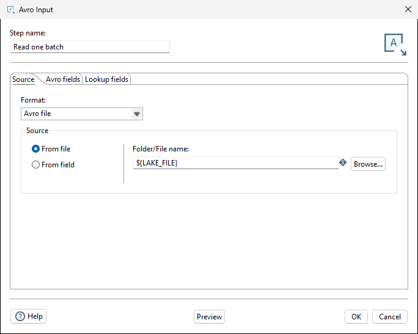
<figcaption>Avro input, Source tab: one landed file</figcaption>
</figure>
</div>

4. Open the **Avro fields** tab and select **Get fields**.

<div align="center">
<figure>
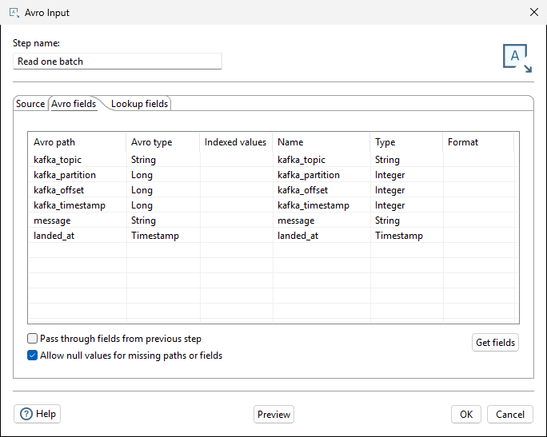
<figcaption>Avro fields: read from the schema inside the file</figcaption>
</figure>
</div>

> **Success:** Checkpoint: six fields, the ones **Land in the lake** wrote, with their types: `kafka_offset` an Integer, `landed_at` a Timestamp.

5. Select **Preview**, and **OK** in the **Enter preview size** dialog.

> **Success:** Checkpoint: 60 rows, `kafka_offset` `0` to `59`, every one with the same `landed_at`. `message` holds each event as the app sent it, the broken ones too.

6. Close the preview and select **OK**. Save the transformation.

### 7. Read the Whole Lake

> **Note:**
>
> #### Any engine, no Pentaho
>
> An open file format is what makes a lake a lake: the files outlive the tool that wrote them. `query_lake.py` reads every Avro file in the bucket with `fastavro`, a Python library, through MinIO's S3 API.

1. In PowerShell, in the lab folder, run:

```powershell
python query_lake.py
```

> **Success:** Checkpoint: one line per file, about 24, then a total of `100 rows, offsets 0 to 99, 100 distinct`, `75 keep the sign-up contract, 25 do not`, and the schema the files carry, record `com.acme.lake.signup_event`. Every event since the Contracts lab is in the lake once, the broken ones included.

2. The workshop is done. Leave Kafka and MinIO running for the capstone.

> **Under the hood:**
>
> #### From files to a lakehouse
>
> The lake keeps what arrived, untouched; judging it is left to whoever
> reads it, as the warehouse loader did with its contract. Avro writes
> whole records, row by row, which suits landing a stream. Columnar
> formats such as Parquet suit analysis, because a query reads only the
> columns it needs; Pentaho Data Integration writes Parquet with the
> big-data plugin's **Parquet output** step. On top of either, a *table
> format* such as Apache Iceberg or Delta Lake keeps a catalog of the files
> that make up a table, with its schema and snapshots, so Spark, Trino,
> Snowflake and others read one table, not a list of files.
>
> **Why it matters:** this is the landing zone of a lakehouse. The stream
> lands as open files in cheap object storage, every engine reads them,
> and no system owns the data.

::::

## Troubleshooting <!-- no-step -->

<details>
<summary>Land in the lake fails with "Parent directory [pvfs://MinIO/streaming-lake] does not exist"</summary>

The bucket is missing, or its name differs. Create `streaming-lake` in the MinIO console, as in tab 1. An object store has no folders until something is written under a name, so write to the bucket itself, as `pvfs://MinIO/streaming-lake/signups_` does.

</details>

<details>
<summary>The connection test fails with "unknown signer type: aws.endpoint"</summary>

Set **Signature Version** to `AWSS3V4SignerType` in the **MinIO** VFS connection, select **PathStyle Access**, and test again.

</details>

<details>
<summary>The files have no .avro extension, or the name runs into the time</summary>

The date time format on the **Options** tab is `yyyyMMdd_HHmmss_SSS'.avro'`, single quotes included, and the **Folder/File name** ends with `signups_`.

</details>

<details>
<summary>The lake gets no files at all</summary>

Check that the parent's group is `pdi-lake-writer`, so it reads from the start of the topic. If the group already read the topic, only new events land: publish more, or move the group back with `C:\Streaming\run-podman-streaming.ps1 -Group pdi-lake-writer -Rewind` while the parent is stopped.

</details>

<details>
<summary>Avro input fails with "Unable to read data from file" on a bucket or folder</summary>

On the Pentaho engine, **Avro input** reads one file. Point **Folder/File name** at a single `.avro` file. To read many, use another engine, as `query_lake.py` does.

</details>

## Lab Files

Click a file to download. For `.ktr` and `.kjb` files, **Open in Pentaho Data Integration** launches Pentaho Data Integration with the file loaded. If Pentaho Data Integration is already running, the path is copied to your clipboard — switch to Pentaho Data Integration and press `Ctrl+O`, `Ctrl+V`, `Enter`.

These files are also on disk in `C:\Workshop-SD-Specialty\05-kafka\10-kafka-lake`. The publisher, the lake reader and their dependency list:

[produce_signups.py](./files/produce_signups.py)

[query_lake.py](./files/query_lake.py)

[requirements.txt](./files/requirements.txt)

The starter transformations:

[lake-parent.ktr](./files/lake-parent.ktr) <button data-launch="spoon" data-path="files/lake-parent.ktr">Open in Pentaho Data Integration</button> <button data-graph="files/lake-parent.ktr">View graph</button>

[lake-child.ktr](./files/lake-child.ktr) <button data-launch="spoon" data-path="files/lake-child.ktr">Open in Pentaho Data Integration</button> <button data-graph="files/lake-child.ktr">View graph</button>

### Solution <!-- no-step -->

The finished parent, with its 10-second batch, the child, and `read-lake.ktr`, whose **Avro input** reads the file named in its parameter `LAKE_FILE`: set it in the **Run Options** dialog, for example to `pvfs://MinIO/streaming-lake/signups_20261127_133124_415.avro`.

Also on disk at `C:\Workshop-SD-Specialty\05-kafka\10-kafka-lake\solution`.

[lake-parent.ktr](./files/solution/lake-parent.ktr) <button data-launch="spoon" data-path="files/solution/lake-parent.ktr">Open in Pentaho Data Integration</button> <button data-graph="files/solution/lake-parent.ktr">View graph</button>

[lake-child.ktr](./files/solution/lake-child.ktr) <button data-launch="spoon" data-path="files/solution/lake-child.ktr">Open in Pentaho Data Integration</button> <button data-graph="files/solution/lake-child.ktr">View graph</button>

[read-lake.ktr](./files/solution/read-lake.ktr) <button data-launch="spoon" data-path="files/solution/read-lake.ktr">Open in Pentaho Data Integration</button> <button data-graph="files/solution/read-lake.ktr">View graph</button>

---

> **Tip:** Next, put the whole course together: [Capstone: A Plant-Floor Alert Feed](../11-capstone-a-plant-floor-alert-feed/guide.md).
