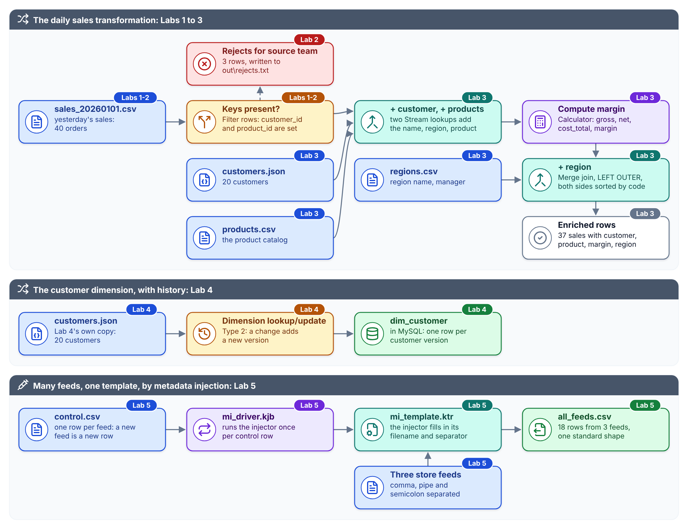
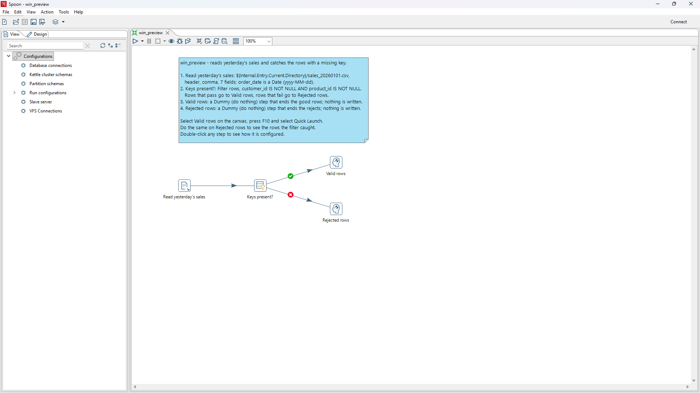
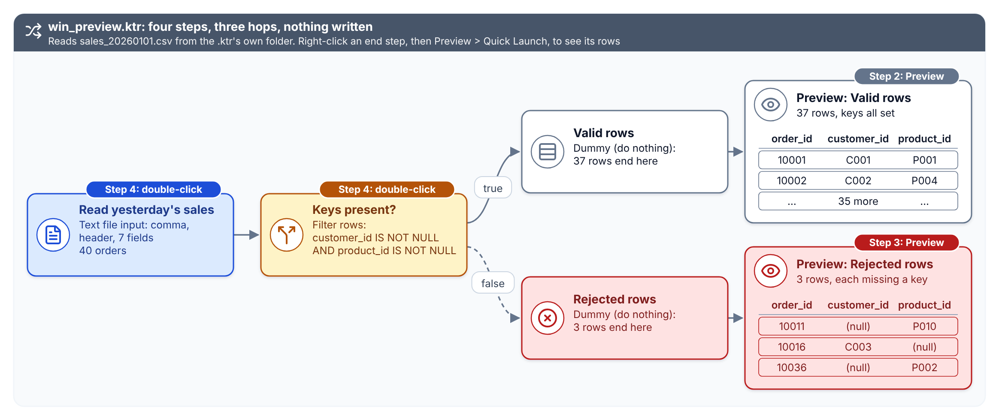
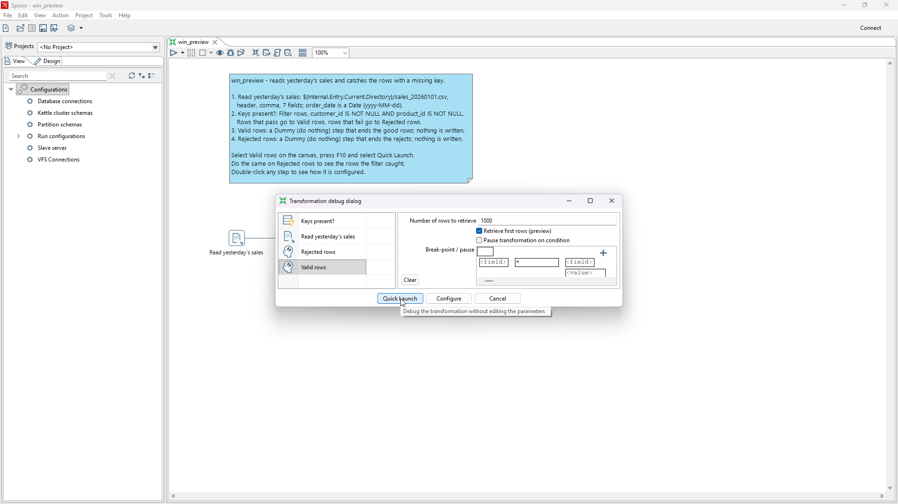
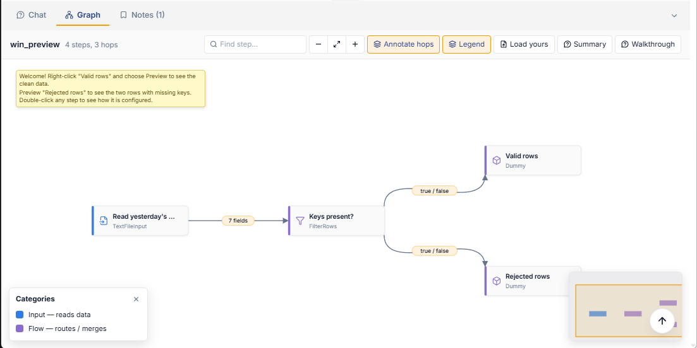

# Your First Win

> **Warning:**
>
> #### Workshop - Your First Win
>
> Before any theory, see the product do something. You'll open a
> finished pipeline, run it, and watch it separate good data from bad
> — in under ten minutes, without writing a line of code.
>
> **What you'll do**
>
> * Open a prepared transformation in Pentaho Data Integration.
> * Preview live data at any point in the flow.
> * See three bad rows get caught automatically.
>
> **Prerequisites:**
>
> * [Before You Start](../00-before-you-start/guide.md) completed.
>
> **Estimated time:** 10 minutes

<figure>

<figcaption class="pcm-video-caption">Walkthrough: coming soon</figcaption>

</figure>

> **Note:** **The scenario for the next two hours.** You're the data
> engineer at a small retailer. Every morning, yesterday's sales must
> be validated, joined with customer and product master data, and
> loaded into the warehouse — with history tracked — by 9am. Today
> you build that pipeline. This workshop shows you the finished first
> stage so you get an idea of how a pipeline is created.

Here is where the next two hours lead, with the lab that builds each piece.

<div align="center">
<figure>

<figcaption>The retailer pipeline, lab by lab</figcaption>
</figure>
</div>

Read the top panel left to right. Yesterday's 40 orders go through **Keys present?**, which sends the 3 rows missing a key up to a rejects file for the source team. The valid rows pick up the customer's name and region and the product from two Stream lookups, get their margin computed, and are joined to `regions.csv`, giving 37 enriched rows. The badge on each box names the lab where you meet it.

The top panel is the daily sales transformation: this lab runs its
first stage, Lab 2 builds that stage yourself, and Lab 3 enriches the
valid rows. Lab 4 is a separate transformation that keeps the customer
dimension's history in MySQL, and Lab 5 shows one template taking in
many differently shaped files.

:::: tabs

### 1. Open the pipeline

Select **Open in Pentaho Data Integration** below — Pentaho Data Integration opens with the transformation loaded.
(If Pentaho Data Integration is already running, the file path is copied to your
clipboard: switch to Pentaho Data Integration and press `Ctrl+O`, `Ctrl+V`, `Enter`.)

<button data-launch="spoon" data-path="files/win_preview.ktr">Open in Pentaho Data Integration</button>

1. If the pipeline - `win_preview.ktr` - has not displayed in Pentaho Data Integration, select **File > Open** (`Ctrl+O`) and open:

Path to Transformation:

```text
C:\Workshop\pdi-2hr\02-see-it-work\01-your-first-win\win_preview.ktr
```

You should see four connected steps on the canvas: a file reader, a
filter, and two end points — one for valid rows, one for rejects.

<div align="center">
<figure>

<figcaption>win_preview.ktr</figcaption>
</figure>
</div>

### 2. Preview the valid rows

Before you run it, here is what you'll see at each point in `win_preview`.

<div align="center">
<figure>

<figcaption>win_preview: what each preview shows</figcaption>
</figure>
</div>

Read the diagram left to right. The 40 orders flow from **Read yesterday's sales** into **Keys present?**, which sends every row with both keys up the true hop to **Valid rows** and the 3 rows missing one down the dashed false hop to **Rejected rows**. The grids on the right are what **Preview** shows on each end step in steps 2 and 3. Both end steps are Dummy steps, so nothing is written anywhere. In step 4 you double-click the first two steps to see how they're set.

1. Right-click **Valid rows** and select **Preview**.
2. Select **Quick Launch**.

<div align="center">
<figure>

<figcaption>Preview → Quick Launch</figcaption>
</figure>
</div>

A grid appears with 37 of yesterday's orders — typed columns, formatted
dates, all clean rows. This habit helps debug and validate your pipelines:
**you can look at the data at any step, at any time**, before
anything is written anywhere.

> **Under the hood:**
>
> #### Preview is the real engine, not a simulation
>
> Three words first, because you will see them everywhere. The picture
> on the canvas is a **Transformation**: Pentaho Data Integration's name for a pipeline that
> reads rows - **Extract**, changes them - **Transform** and writes them somewhere - **Loads**. Each box is a
> **Step**, one thing the data passes through: read a file, keep or
> drop rows, write a file. The arrows are **Hops**, and a hop carries
> rows from one step to the next.
>
> When you selected **Preview**, Pentaho Data Integration did not show you a cached sample or a
> guess made at design time. It started the transformation,
> ran every step over the sales data file, and stopped once it had enough
> rows to show you, writing nothing anywhere.
>
> It can do that because there is nothing to compile or deploy first.
> Each step is a small independent worker, and rows pass between the
> workers in micro batches, so the whole thing starts in under a
> second, can be watched at any step, and stops just as fast.
>
> **Why it matters:** there is no build-then-deploy-then-check loop.
> You look at real data at any point in the flow while you are still
> designing, which is why work in Pentaho Data Integration tends to converge in minutes
> rather than in rounds of "add a log line, redeploy, look again".

### 3. Preview the rejects

1. Select **Close**.
2. Right-click **Rejected rows**, select **Preview**, then select **Quick Launch**.

Three rows. Two are missing their `customer_id`, one its
`product_id` — they were planted in the file, and the filter caught
all three. In a hand-coded pipeline this is a try/except and a log
line you write yourself; here it's a visible branch in the flow you
can inspect.

> **Under the hood:**
>
> #### Two hops mean two real streams
>
> The filter step does not tag rows as "good" or "bad" within a single list. Instead, it creates two distinct outgoing hops; each is a separate stream of rows with its own buffer and downstream worker. Valid rows are routed one way, rejected rows the other, and both branches run simultaneously.
>
> This is what "Preview on Rejected rows" just demonstrated: the rejected branch contains real data you can inspect independently, rather than just a line in a log file.
>
> **Why it matters:** The question of "what do we do with the rejected data?" is no longer a piece of error-handling code buried deep inside a program. Instead, it becomes a visible path on the canvas—one that anyone can point to during a review and one you can preview independently, just as you just did.

### 4. Look inside a step

1. Double-click **Read yesterday's sales**. This is the entire
   configuration for parsing the file — delimiter, header, and on the
   **Fields** tab, every column with its type and format. No code was
   generated; this *is* the pipeline.

2. Select **Cancel** to close the dialog (so nothing changes).
3. Double-click **Keys present?**.
   The Filter Rows step allows you to filter rows based on conditions and comparisons.
   In this example we're filtering for rows where the ids / keys are not null.

> **Under the hood:**
>
> #### The Dialog is the Source Code
>
> Nothing was generated from what you just looked at. The file you opened, `win_preview.ktr`, is Pentaho Data Integration's transformation file, with the extension standing for "Kettle transformation," derived from the engine's original name. Inside it is plain text in XML: a list of steps, each step's settings, and the hops between them. The dialog you opened reads that text and writes it back, and the engine runs the same text. There is no build step, and no generated program that can drift away from what you see on the canvas.
>
> Two consequences worth noting are:
>
> * Because it is plain text, a transformation can live in version control alongside your code, and two people's changes to it can be compared and merged.
> * Because the same file is what a server runs later, the thing you tested is literally the thing that ships.

4. Select **Cancel** to close the dialog (so nothing changes).

> **Note:**
>
> **Key Takeaways**
>
> * The dialog serves as the source code for your transformation.
> * The transformation file is plain text in XML format.
> * The dialog reads the text and writes it back, and the engine runs the same text.
> * There is no built-in build step or generated program that can drift away from the canvas.
> * The transformation file can be version-controlled and changes can be compared and merged.
> * The file is also what the server runs, making it the actual deployed version.

### 5. See the flow as a diagram

The same file, rendered by this guide's built-in viewer — select any
step to see its configuration:

<button data-graph="files/win_preview.ktr">View graph</button>

<div align="center">
<figure>

<figcaption>Graph</figcaption>
</figure>
</div>

Try out the other AI options:

- **Summary:** summarized in a few sentences.
- **Walkthrough:** Step-by-step walkthrough of the transformation.
- **Explain this Step:** Select a step to view its properties and 'Explanation'.

::::

## Troubleshooting <!-- no-step -->

<details>

<summary>Preview shows no rows / a file-not-found error</summary>

The transformation looks for `sales_20260101.csv` in the same folder
as the `.ktr` — this works when you opened it via the button above.
If you copied the `.ktr` elsewhere, copy the CSV (from **Lab Files**
below) next to it.

</details>

---

> **Tip:** Ten minutes in, you've run a pipeline, previewed data
> mid-flow, and caught rejected rows. Next: build this exact
> transformation yourself, from an empty canvas — it takes about
> fifteen minutes.

## Lab Files

[sales_20260101.csv](./files/sales_20260101.csv)

[win_preview.ktr](./files/win_preview.ktr)  <button data-graph="files/win_preview.ktr">View graph</button>
