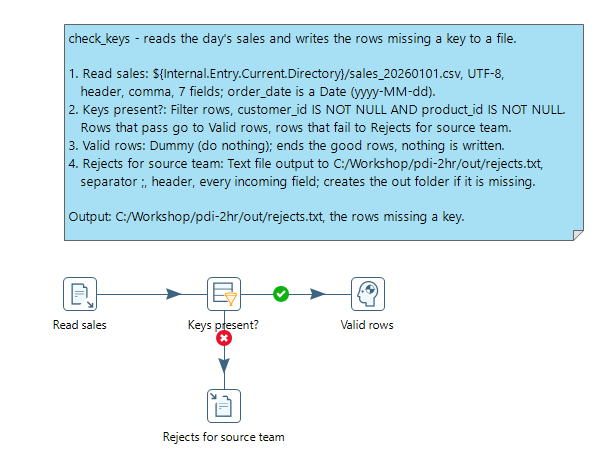
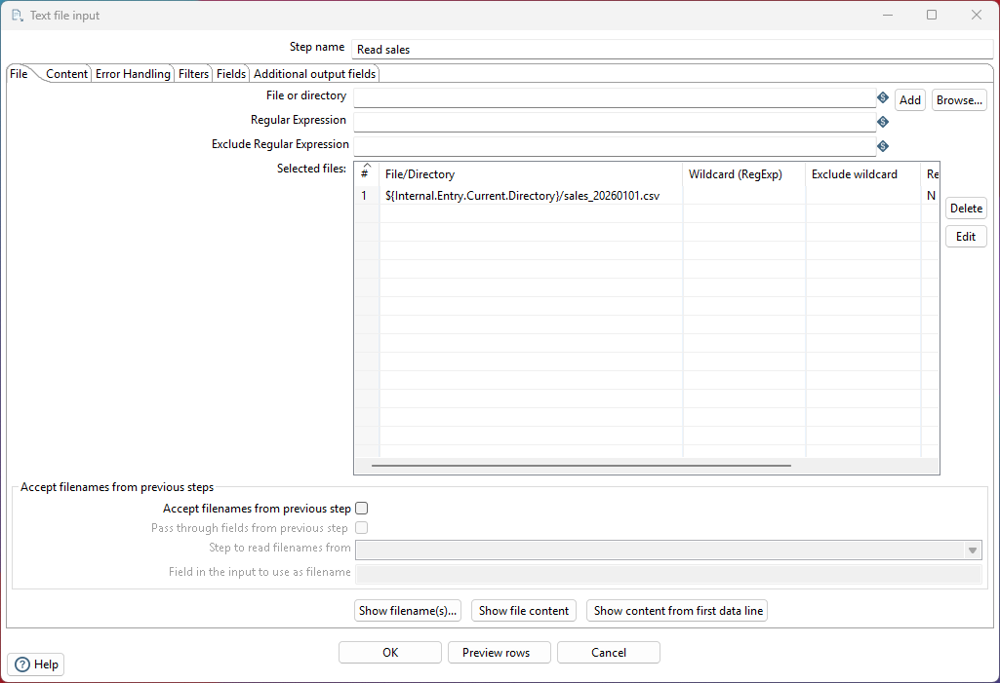
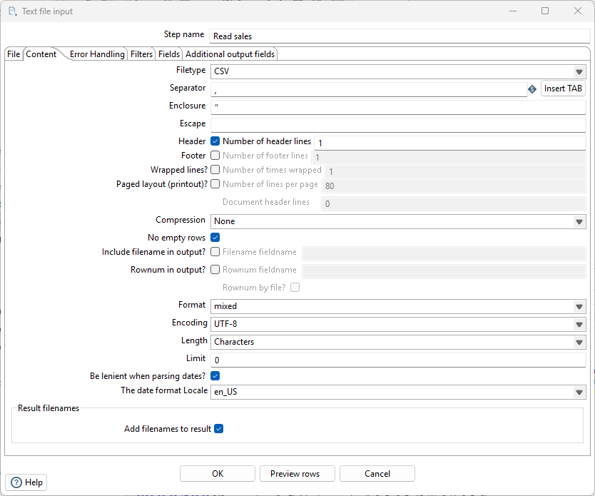
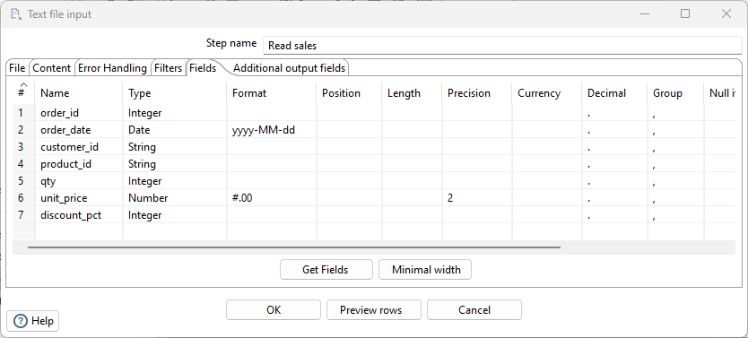
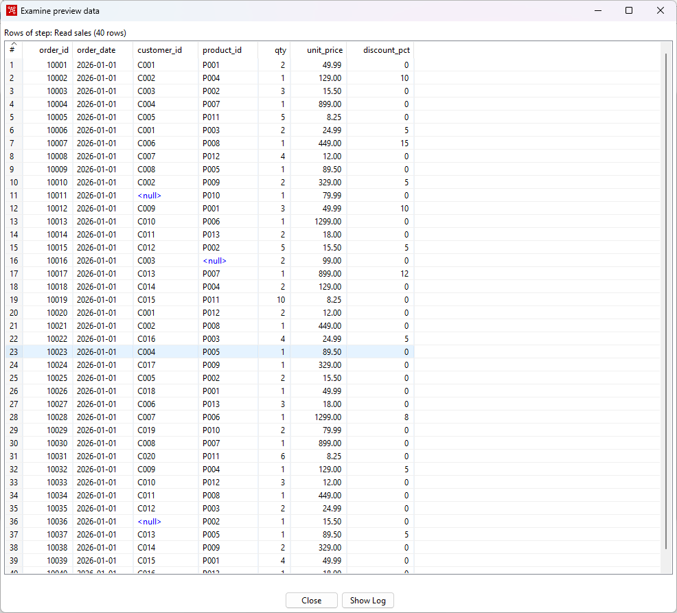
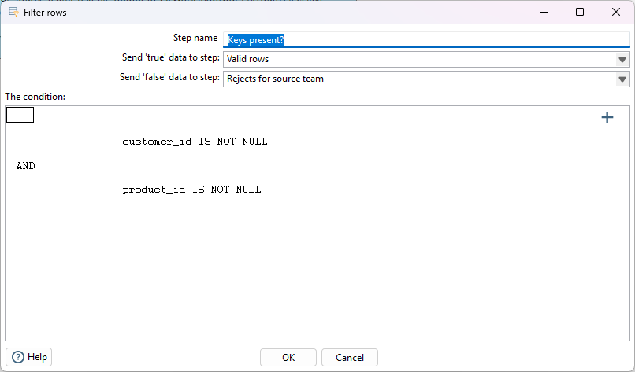
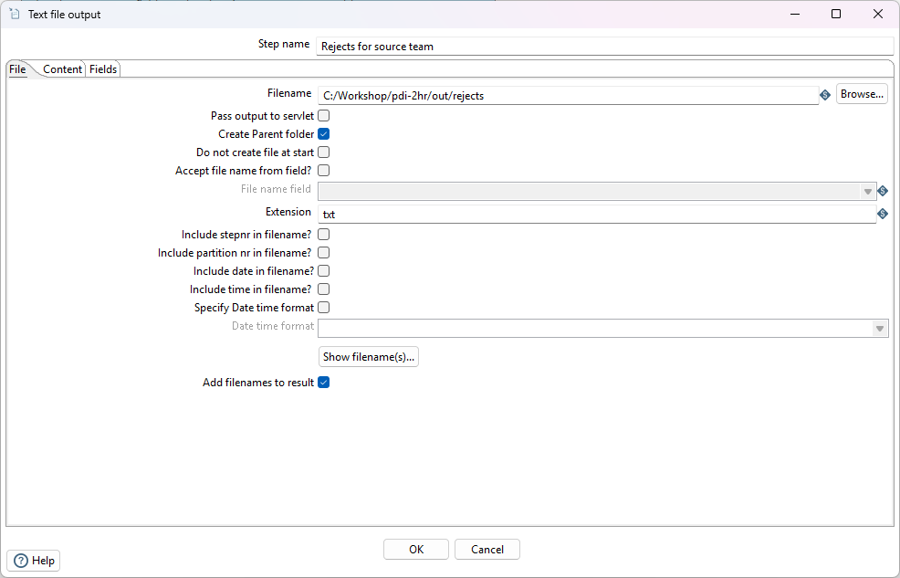
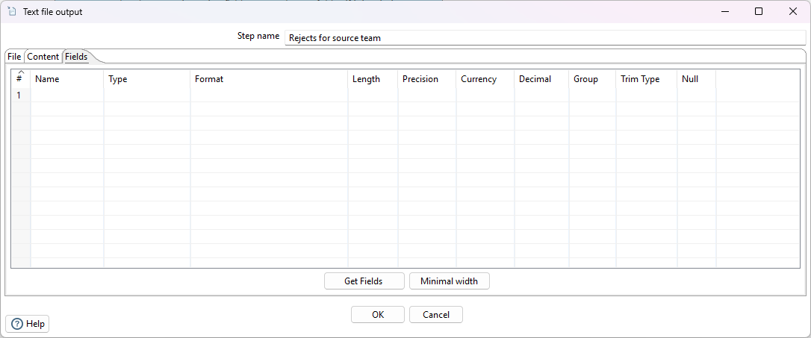
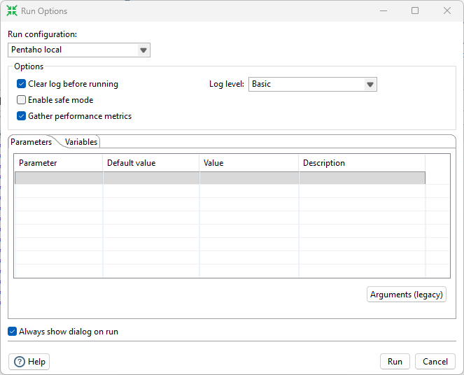
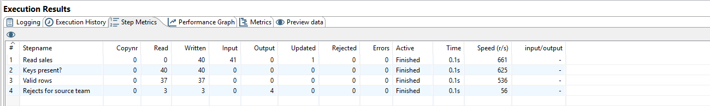

# Build the Pipeline Yourself

> **Warning:**
>
> #### Workshop - Build the Pipeline Yourself
>
> Now you build what you just ran: read the sales file, validate it,
> and write the rejects to a file for the source team.
>
> **What you'll do**
>
> * Read a CSV with **Text file input** (and let PDI detect the columns).
> * Route rows with missing keys to a reject stream with **Filter rows**.
> * Write the rejects to a CSV with **Text file output**.
>
> **Prerequisites:** 
> * [Your First Win](../01-first-win/guide.md) pipeline completed.
>
> **Estimated time:** 15 minutes

<figure>

<figcaption class="pcm-video-caption">Walkthrough: coming soon</figcaption>

</figure>

> **Note:** **Get the data file first.** Check the file:
> `sales_20260101.csv` has been downloaded into the workshop folder:

```text
C:\Workshop\pdi-2hr\02-see-it-work\02-build-the-pipeline\
```
<div align="center">
<figure>

<figcaption>Part 1: Onboard and filter sales data</figcaption>
</figure>
</div>

## Create a new transformation

Select **File > New > Transformation** (`Ctrl+N`). You get an
empty canvas and, on the left, the **Design** palette — every
capability of the engine, organized by category. Familiarize yourself with some of the steps.
Select **File > Save as** and save it as: 

```text
C:\Workshop\pdi-2hr\02-see-it-work\02-build-the-pipeline\check_keys.ktr
```

## Read the file
> **Note:**
>
> The **Text file input** step loads the day's sales orders from `sales_20260101.csv`. It parses the comma-separated values (CSV) and identifies the header row, converting the raw text file into a structured data stream that PDI can process.

1. On the **Design** tab, open the **Input** folder and drag **Text file input**
   onto the canvas.

> **Tip:**
>
> This is a steep learning curve, so use the **Search** box to narrow down the hunt for the Step.

2. Double-click **Text file input**. Set **Step name** to `Read sales`.
3. On the **File** tab, select **Browse** and pick:

```text
C:\Workshop\pdi-2hr\02-see-it-work\02-build-the-pipeline\sales_20260101.csv
```
4. Select **Add** so it appears in the **Selected files** grid.
<div align="center">
<figure>

<figcaption>Add - sales data</figcaption>
</figure>
</div>

5. On the **Content** tab, set:
   -   **Separator** to: comma and make sure 
   -   **Header** is selected with 1 header line
   -   **Format** is: mixed
   -   **Encoding** is: UTF8
<div align="center">
<figure>

<figcaption>Content tab</figcaption>
</figure>
</div>

6. Open the **Fields** tab and select **Get Fields** — PDI reads the file and detects every column and type for you. Accept the defaults.
<div align="center">
<figure>

<figcaption>Fields tab after Get Fields</figcaption>
</figure>
</div>

> **Note:** **Get Fields matters more than it looks.** You didn't
> declare a schema — the tool read the data and proposed one. In workshop - Bring Your Own Data -
> you'll point this same pipeline at *your own* file, and this
> button is why that works.

7. Select **Preview rows** at the bottom of the dialog — the same
   habit as Lab 1, available while you're still configuring.
<div align="center">
<figure>

<figcaption>Preview rows</figcaption>
</figure>
</div>

8. Select **OK**.

> **Under the hood:**
>
> #### Get Fields wrote a contract, not just a grid
>
> Every row that flows through a transformation has a shape: the column names
> , the data type of each one (text, whole number, decimal,
> date), and the format, its dates and numbers are written in. PDI calls
> that shape the row's **metadata**, and it travels along the hops
> ahead of the data itself, so every step knows what is coming before
> the first row arrives.
>
> Get Fields read the first rows of your file, worked out a name, a
> type and a format for every column, and stored that as this step's
> metadata. You declared nothing.
>
> That is why the next step you add will already know `unit_price` is
> a number and `order_date` is a date, why Preview shows typed columns
> before anything is written, and why a column typed wrongly is caught
> while you are designing rather than at two in the morning. The grid
> is editable: the guess is a starting point, not a lock.
>
> **Why it matters:** you got a typed description of a plain CSV in one
> click, without writing a database table definition or a parser. Lab
> 6 points this same step at a file PDI has never seen, and it works
> for exactly this reason.

## Validate the keys
> **Note:**
>
> Think of the **Filter rows** step as a fork in the road. It evaluates a condition and decides where each row should go next. In this lab, we use it to split the stream: valid records continue forward, while records that fail the validation (like a missing key) are diverted to a separate "rejects" file..

1. On the **Design** tab, open the **Flow** folder and drag **Filter rows** onto the canvas.
2. Create a hop from **Read sales** to **Filter rows**: hold `Shift` and
   drag from one step to the other (or hover over **Read sales** and drag
   from its output connector to the filter).
3. Double-click **Filter rows**. Set **Step name** to `Keys present?`.

<div align="center">
<figure>

<figcaption>Filter keys</figcaption>
</figure>
</div>

4. Build the condition: click the left field and pick
   `customer_id`, set the function to `IS NOT NULL`.
5. Select **Add condition** (the + icon), set the second clause to
   `product_id IS NOT NULL`, joined with **AND**.
6. Select **OK**.

## Send the rejects to a file

1. On the **Design** tab, open the **Output** folder and drag **Text file output** onto the canvas.
2. Create a hop from **Keys present?** to **Text file output**. When Spoon
   asks, select the **FALSE** (result is false) branch.
3. Double-click **Text file output**. Set **Step name** to `Rejects for source team`. 
4. Set the **Filename** to: 

```text
C:\Workshop\pdi-2hr\out\rejects
```
PDI adds the **Extension**, `txt`.

<div align="center">
<figure>

<figcaption>Output File</figcaption>
</figure>
</div>

5. Open its **Fields** tab, select **Get Fields**, then select **OK**.

<div align="center">
<figure>

<figcaption>Get Fields</figcaption>
</figure>
</div>

6. On the **Design** tab, open the **Flow** folder and drag **Dummy (do nothing)**
   onto the canvas. Create a hop from **Keys present?** to **Dummy (do nothing)**
   and select the **TRUE** branch. Double-click **Dummy (do nothing)** and set
   **Step name** to `Valid rows`.

## Run it
> **Note:**
>
> The **Run Options** dialog decides where and how this run happens: the **Run configuration** (**Pentaho local** runs it on this machine), the **Log level**, and values for any parameters. Running several copies of one step in parallel is a setting of the step, not of the run: right-click the step and select **Change Number of Copies to Start...**.

1. Press `F9` (**Action > Run**, or the ▶ in the canvas toolbar), and select
   **Run** in the **Run Options** dialog.

<div align="center">
<figure>

<figcaption>Run</figcaption>
</figure>
</div>

2. In **Execution Results**, open the **Step Metrics** tab and watch it
   fill in: 40 rows read, 37 valid, 3 written to the reject file.

<div align="center">
<figure>

<figcaption>Step metrics</figcaption>
</figure>
</div>

3. Open `C:\Workshop\pdi-2hr\out\rejects.txt` — there are your three
   bad rows, ready to send back to the source system's owner.
   * [ ] 40 rows read from the sales file.
   * [ ] 3 rows in the reject output.
   * [ ] Run finishes with no errors (every step shows a green check mark).

> **Under the hood:**
>
> #### Every step ran at the same time
>
> The Step Metrics table tempts you to read the run top to bottom, as
> if the reader finished all 40 rows and then handed them to the
> filter. That is not what happened. **All four steps started
> together.** Each step is its own worker, and rows moved between them
> in micro batches: the filter was already deciding about row 1 while
> the reader was still parsing row 20.
>
> This is why PDI copes with files far larger than the machine's
> memory: only the rows in flight are held at any moment, never the
> whole file. The transformation you just ran on 40 rows would run
> unchanged on 40 million. You would wait longer, but nothing about
> the design changes.
>
> **Why it matters:** the parallel running is free and automatic. You
> wrote no code to run things at the same time, manage queues or pick
> batch sizes. You drew boxes and arrows, and the engine turned that
> into a pipeline where everything works at once.

>
### Troubleshooting <!-- no-step -->
<details>

<summary>The hop dialog didn't ask TRUE or FALSE</summary>

Right-click the hop between the filter and the output step and
select which result to send down it — or right-click the filter step
and set **Define error/result targets**. TRUE and FALSE hops are also
editable inside the Filter rows dialog (the two "Send ... rows to"
dropdowns at the top).

</details>

<details>

<summary>Get Fields typed a column wrong</summary>

Fix it in the grid — that's the point of the grid. Common case:
`order_date` should be `Date` with format `yyyy-MM-dd`.

</details>

---

> **Tip:** You've built and run a validating ingest in one lab. Note
> what you did *not* do: define schemas by hand, write parsing code,
> or deploy anything to test it. Next, the payoff step — joining
> three sources of three different shapes on one canvas.

## Lab Files

[sales_20260101.csv](./files/sales_20260101.csv)

### Solution <!-- no-step -->

Stuck, or want to compare? The complete transformation — it expects
the data file in the workshop folder.

[check_keys.ktr](./files/check_keys.ktr) <button data-launch="spoon" data-path="files/check_keys.ktr">Open in Pentaho Data Integration</button> <button data-graph="files/check_keys.ktr">View graph</button>
