# Enrich and Join

> **Warning:**
>
> #### Workshop - Enrich and Join
>
> Real pipelines mix formats: your sales arrive as CSV, the customer
> master is JSON from an API export, the product catalog and the
> region reference are CSVs. You'll bring all four together on
> one canvas — two ways, because PDI gives you two tools for it — and
> compute a margin, with no staging tables and no format wrangling.
>
> **What you'll do**
>
> * Read JSON with **JSON input** and a JSONPath expression.
> * Enrich with **Stream lookup** — the in-memory lookup for small reference sets.
> * Compute revenue and margin with **Calculator**.
> * Join with **Merge join** — a true SQL-style join (inner / left / right / full) over two sorted streams — and learn when to reach for which.
>
> **Prerequisites:** 
> * [Build the Pipeline Yourself](../02-build-the-pipeline/guide.md) — you'll be extending the pipeline.
>
> **Estimated time:** 20 minutes

<figure>

<figcaption class="pcm-video-caption">Walkthrough: coming soon</figcaption>

</figure>

> **Note:** **Get the files first.** Check `customers.json`,
> `products.csv`, and `regions.csv` have been downloaded into
> this lab's workshop folder:

```text
C:\Workshop\pdi-2hr\03-make-it-yours\03-enrich-and-join\
```

<figure>


<div align="center">
<figcaption><em>Part 2: Enrich and Join data</em></figcaption>
</div>
</figure>

## Read the customer master (JSON)
> **Note:**
>
> **JSON input** step is used to parse and "flatten" semi-structured JSON data into a standard row-based stream. By using **JSONPath** expressions, you can navigate nested objects and extract specific fields into individual columns. This step is essential for normalizing data early in the pipeline, allowing you to join JSON-based data with other sources (like CSVs or SQL tables) as if they were all in the same format..

1. Select **File > Open** (`Ctrl+O`) and open your Lab 2 transformation, `C:\Workshop\pdi-2hr\02-see-it-work\02-build-the-pipeline\check_keys.ktr`. Select **File > Save as** and save it as `enrich_sales.ktr` in `C:\Workshop\pdi-2hr\03-make-it-yours\03-enrich-and-join`.
2. On the **Design** tab, open the **Input** folder and drag **JSON input** onto an empty part of the canvas.
3. Double-click **JSON input**. Set **Step name** to `Read customers`. On the **File** tab, browse to:

```text
C:\Workshop\pdi-2hr\03-make-it-yours\03-enrich-and-join\customers.json
```
4. Select **Add**.
<figure>

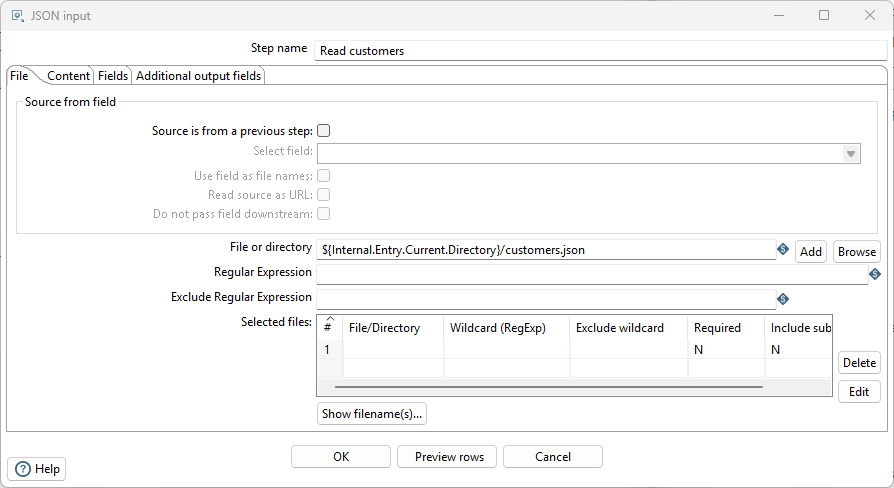

<div align="center">
<figcaption><em>customers.json</em></figcaption>
</div>
</figure>

5. Open the **Fields** tab and fill the **Fields** grid, one row per field. **Path** uses JSONPath, relative to the array of customer objects:

| Name          | Path                       | Type   |
| ------------- | -------------------------- | ------ |
| customer_id   | $.customers[*].id          | String |
| customer_name | $.customers[*].name        | String |
| region_code   | $.customers[*].region_code | String |

<figure>

![JSON input dialog, Fields tab: customer_id, customer_name and region_code mapped from $.customers[*] paths, all String](../_assets/images/1788277506117.png)

<div align="center">
<figcaption><em>Fields - customers.json</em></figcaption>
</div>
</figure>

6. Select **Preview rows** — 20 customers. The nested JSON is now
   just another stream of rows, identical in kind to the CSV stream.
<div align="center">
<figure>


<figcaption><em>Preview - customers.json</em></figcaption>
</figure>
</div>

## Read the product catalog

1. On the **Design** tab, open the **Input** folder and drag another **Text file input** onto the canvas. Double-click it and set **Step name** to `Read products`.
2. Point it at:

```text
C:\Workshop\pdi-2hr\03-make-it-yours\03-enrich-and-join\products.csv
```
<figure>

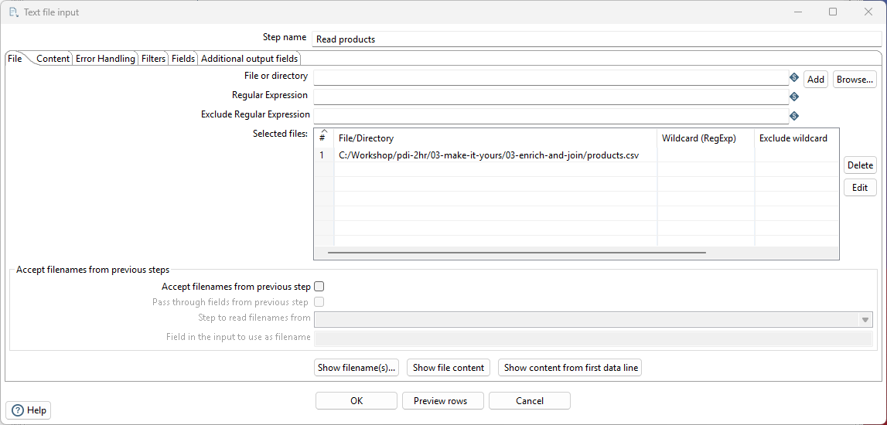

<div align="center">
<figcaption><em>products.csv</em></figcaption>
</div>
</figure>

3. Open the **Content** tab and set: 
   -   **Separator:** comma
   -   **Header:** selected - Number of header lines 1
   -   **Format:** mixed
   -   **Encoding:** UTF8
<figure>

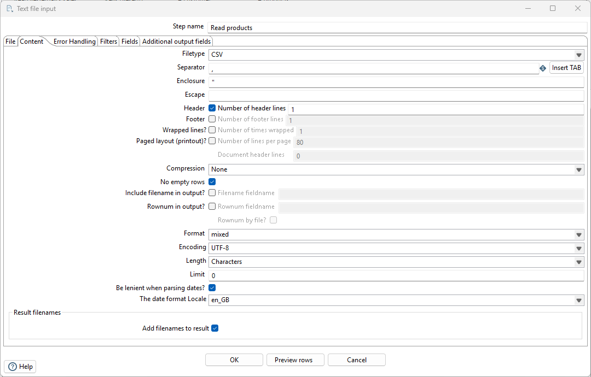

<div align="center">
<figcaption><em>Content - products.csv</em></figcaption>
</div>
</figure>

4. Open the **Fields** tab and select **Get Fields**.
<figure>

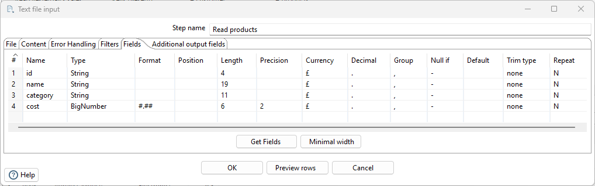

<div align="center">
<figcaption><em>Fields - products.csv</em></figcaption>
</div>
</figure>

## Enrich with two lookups

> **Note:**
>
> **Stream lookup** enriches a main stream with fields fetched from a
> second stream. It loads the lookup stream into memory once, then
> matches each main row by key — perfect for small reference sets like
> a customer master or a product catalog. It is *not* a join: one
> match per row, and the whole lookup set must fit in memory.

1. On the **Design** tab, open the **Lookup** folder and drag **Stream lookup** onto the canvas.
2. Create a hop from **Valid rows** (your Lab 2 TRUE branch) to **Stream lookup**: hold `Shift` and
   drag from one step to the other. Create a second hop from **Read customers** to **Stream lookup**.
3. Double-click **Stream lookup**: 
   - set **Step name** to `+ customer`
   - set **Lookup step** to `Read customers` 
   - in *keys to look up*, match `customer_id` = `customer_id`
   - in *fields to retrieve*, add `customer_name` and `region_code`

<figure>
<div align="center">

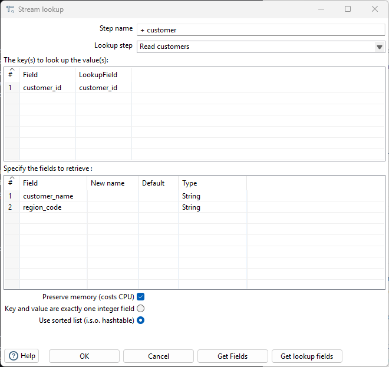

<figcaption><em>Lookup + customers</em></figcaption>
</div>
</figure>

4. Repeat the pattern: 
   - another **Stream lookup** named `+ products`
   - fed by `+ customer` and `Read products`, matching `product_id` = `id`
      retrieving `name` (rename to `product_name`),`category` and `cost`.
<figure>
<div align="center">

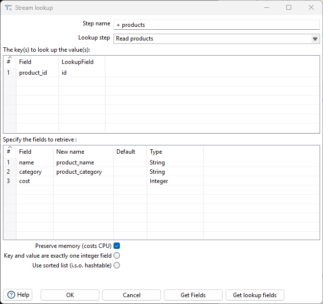

<figcaption><em>Lookup + products</em></figcaption>
</div>
</figure>

> **Under the hood:**
>
> #### A lookup index, built once, used 37 times
> 
> Stream lookup enriches one stream of rows (the sales) with values
> from another (the customers). It works in two phases. First it reads
> the *lookup* stream, the customers, to the end and builds an index in
> memory keyed on the fields you matched on, like a phone book sorted
> by customer id. Then each sales row arrives and is looked up in that
> index: one quick lookup per row, no re-reading of the customer file,
> no query to a database.
>
> Notice what that means for the JSON. By the time the lookup sees it,
> `customers.json` is not JSON any more. The JSON input step turned it
> into rows with named, typed columns, and from that moment it is
> indistinguishable from rows that came out of a CSV. **The file format
> belongs to the input step, not to the pipeline.**
>
> **Why it matters:** joining an export from an API (JSON) to a
> spreadsheet extract (CSV) normally means loading both into a database
> first so they can be queried together. Here the "database" is the
> engine's own memory, for the few seconds the run lasts: no staging
> tables, no round trip, and one canvas that tells the whole story.

## Compute revenue and margin

> **Note:**
>
> **Calculator** step is used to perform arithmetic and basic calculations on your data stream. In this lab, it provides an efficient way to compute the `margin` by subtracting cost from revenue. Because it uses native Java code rather than an interpreted script, it is significantly faster and more performant than the "Modified JavaScript Value" step for simple calculations..

1. On the **Design** tab, open the **Transform** folder and drag **Calculator** onto the canvas.
   Create a hop from **+ products** to **Calculator**.
2. Double-click **Calculator**. Set **Step name** to `Compute margin` and add four calculations (each row can use an earlier row's result):
<figure>

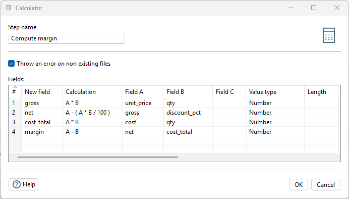

<div align="center">
<figcaption><em>Compute margin</em></figcaption>
</div>
</figure>

| New field | Calculation | Field A | Field B | Type |
| --- | --- | --- | --- | --- |
| gross | A * B | unit_price | qty | Number |
| net | A - ( A * B / 100 ) | gross | discount_pct | Number |
| cost_total | A * B | cost | qty | Number |
| margin | A - B | net | cost_total | Number |

> **Note:** **Field A sets the arithmetic type.** Put the decimal
> field first: `qty * unit_price` (Integer first) silently rounds
> the price to a whole number before multiplying — `unit_price *
> qty` keeps the pennies. If you'd rather write it as one formula,
> the **Formula** step accepts spreadsheet-style expressions like
> `[net]-[cost]*[qty]`.

3. Select **OK**. Select **Compute margin** on the canvas, press `F10` (**Action > Preview**),
   and select **Quick Launch**: every sale now carries the customer,
   region code, product, category — and a margin figure that never
   existed in any source file. Select **Close**.

## Join the region reference (a merge join)
> **Note:**
>
> **Merge join** step combines two data streams into one based on a common key, mirroring the behavior of a SQL Join. Unlike the **Stream lookup**—which loads a reference set into memory—**Merge join** processes data as it flows through the pipeline, making it highly efficient for large datasets. Because it relies on sequential processing, both input streams **must** be sorted by the join key (typically using a **Sort rows** step) before reaching the join. It supports Inner, Left Outer, Right Outer, and Full Outer join types.

Each sale now has a `region_code`, and `regions.csv` says what that
code means — its name and the manager who owns the number. Time for
an actual join.
>
1. On the **Design** tab, open the **Input** folder and drag another **Text file input** onto the canvas. 
   - Double-click it and set **Step name** to `Read regions` 
   - point it at `regions.csv` in this lab's folder, with **Header** selected, 
   - and on the **Fields** tab add three String fields
   - select **Get Fields**: `code`, `region_name` (rename from `name`), `manager_email`.
<figure>

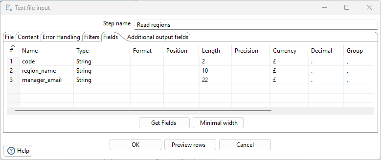

<div align="center">
<figcaption><em>Fields - Read regions</em></figcaption>
</div>
</figure>

2. On the **Design** tab, open the **Transform** folder and drag two **Sort rows** steps onto the canvas:
   * Set **Step name** to `Sort regions`, create a hop from **Read regions** to it, and sort on `code`.
<figure>
<div align="center">


<figcaption><em>Sort rows - code</em></figcaption>
</figure>
</div>

   * Set **Step name** to `Sort by regions`, create a hop from **Compute margin** to it, and sort on `region_code`.
   
<div align="center">
<figure>


<figcaption><em>Sort rows - by regions</em></figcaption>
</figure>
</div>

3. On the **Design** tab, open the **Joins** folder and drag **Merge join** onto the canvas. Create a hop
   from each sort step to **Merge join**. Double-click **Merge join**, set **Step name** to `+ region`, and set:
   * **First step:** `Sort by regions`
   * **Second step:** `Sort regions`
   * **Join type:** `LEFT OUTER`
   * **Keys for 1st step:** `region_code`
   * **Keys for 2nd step:** `code`
<div align="center">
<figure>

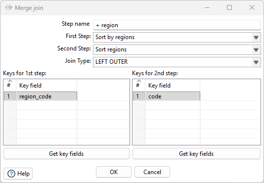

<figcaption><em>Merge Join + region</em></figcaption>
</figure>
</div>

> **Note:** **Why LEFT OUTER?** A sale whose region code has no entry
> in `regions.csv` must still reach the warehouse — with the region
> columns empty — rather than silently vanish. INNER would drop it.
> That choice is the whole difference between "some sales went
> missing" and "some sales need a region added"; make it
> deliberately, every time.

4. Select **OK**. Select **+ region** on the canvas, press `F10` (**Action > Preview**), and select
   **Quick Launch**: every sale now also carries `region_name` and `manager_email`. Select **Close**.

> **Under the hood:**
>
> #### Why the join demands sorted input
>
> A join matches rows from two streams on a shared key and combines
> them, exactly as a SQL join combines two tables. Merge join, the step
> you just used, does it without loading either side into memory. It
> keeps one row from each stream in hand and walks the two streams
> forward together, like merging two sorted lists: compare the keys,
> output a match, move on whichever side is behind. It only ever holds
> the current rows, which is exactly why neither input has to fit in
> memory, and exactly why both must already be in key order. Hand it
> unsorted rows and it does not complain; it walks past matches
> it can no longer see.
>
> That is the trade the two techniques on your canvas represent.
> Stream lookup buys speed by holding one side in memory; Merge join
> buys unlimited size by insisting on order. **Sorting is the price of
> scale**, and PDI makes you pay it openly, with two Sort rows steps,
> rather than hiding a memory cliff behind a friendlier step.
>
> **Why it matters:** this is a relational join (inner, left,
> right or full) done on rows in flight, against sources that were a
> CSV, a JSON export and another CSV a few minutes ago.

## Lookup or join? <!-- no-step -->

Your canvas now has both, side by side, on the same data — so this is
the moment the difference sticks. They look interchangeable in a
screenshot; they are not.

|                   | **Stream lookup**                                                                            | **Merge join**                                                                            |
| ----------------- | -------------------------------------------------------------------------------------------- | ----------------------------------------------------------------------------------------- |
| What it is        | An in-memory hash lookup                                                                     | A true SQL-style join                                                                     |
| Input order       | Any — no sorting needed                                                                      | **Both streams must be sorted on the keys**                                               |
| Memory            | The whole lookup stream is held in RAM                                                       | Streams both sides; neither has to fit                                                    |
| Rows out          | Never more than you put in                                                                   | Can **multiply** rows — one left row × N matches                                          |
| No match          | Row continues, fields null (or your default)                                                 | Depends on join type: dropped (INNER) or kept (OUTER)                                     |
| Join types        | One behavior only                                                                            | INNER, LEFT / RIGHT / FULL OUTER                                                          |
| Reach for it when | The reference set is small and stable — a customer master, a product catalog, a code table   | Either side is large, you need outer semantics, or a key can legitimately match many rows |

Three practical consequences worth carrying home:

* **A lookup can't lose a row; a join can.** That's why an INNER Merge
  join is where sales quietly disappear — and why we chose LEFT OUTER
  above.
* **A lookup can't duplicate a row; a join can.** If a Merge join
  returns more rows than it took in, your "reference" table has
  duplicate keys.
* **Sorting is the join's real cost.** Two Sort rows steps for a
  five-row region file looks like overkill — and it is. That's exactly
  why the customer and product enrichments upstream use lookups
  instead. Pick per case, not per habit.

> **Note:** PDI has more joining steps than just Merge — **Database join** (a
> parameterized query per row), **Merge rows (diff)** for change
> detection, and **Join rows** for a deliberate Cartesian product.
> The Merge Join and the Join rows are the ones you'll reach for most.

**`[ ]`** Preview shows 37 enriched rows.

**`[ ]`**`gross` keeps its pennies (row 1 is 99.98, not 100).

**`[ ]`**`margin` is populated and plausible (mostly positive).

**`[ ]`**`region_name` and `manager_email` are filled on every row.

>

## Dummy Step

> **Note:**
>
> **Dummy** step performs no operations on the data stream; it is a "no-op" (no operation) step. It is primarily used for organizational purposes, such as grouping related logic into distinct sections, providing a clear visual milestone in a long transformation, or creating a junction point where multiple streams meet before being joined or merged..

1. On the **Design** tab, open the **Flow** folder and drag **Dummy (do nothing)** onto the canvas.
   Double-click it and set **Step name** to `Enriched rows`.
2. Create a hop from **+ region** to **Enriched rows**.
3. Save the transformation (`Ctrl+S`).

## Run it
> **Note:**
>
> The **Run Options** dialog decides where and how this run happens: the **Run configuration** (**Pentaho local** runs it on this machine), the **Log level**, and values for any parameters. Running several copies of one step in parallel is a setting of the step, not of the run: right-click the step and select **Change Number of Copies to Start...**.

1. Press `F9` (**Action > Run**, or the ▶ in the canvas toolbar), and select
   **Run** in the **Run Options** dialog.

<figure>

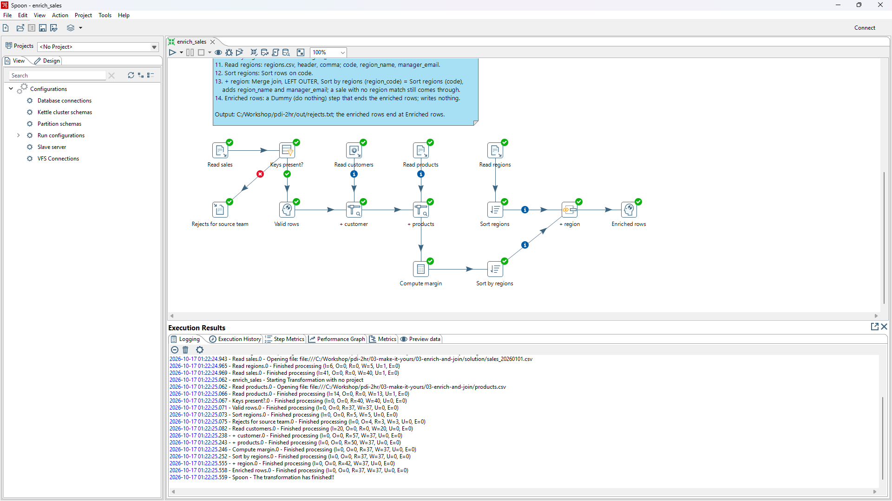

<div align="center">
<figcaption><em>The run finished, every step green</em></figcaption>
</div>
</figure>

2. In **Execution Results**, open the **Step Metrics** tab and watch it
   fill in: 40 rows read, 37 valid, 3 written to the reject file.

<figure>

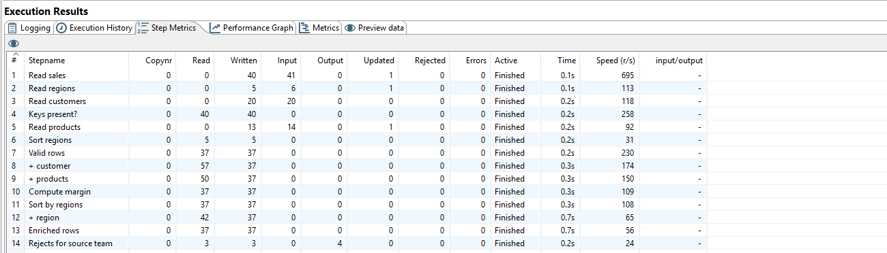

<div align="center">
<figcaption><em>Step Metrics</em></figcaption>
</div>
</figure>

3. Select **Enriched rows** on the canvas and open the **Preview data** tab.

<figure>

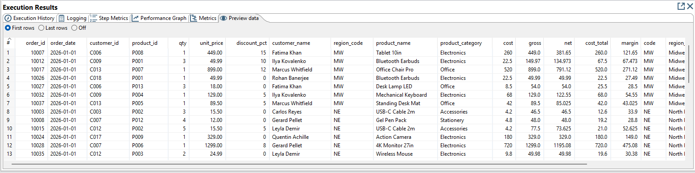

<div align="center">
<figcaption><em>Preview data</em></figcaption>
</div>
</figure>

4. Open `C:\Workshop\pdi-2hr\out\rejects.txt` — there are your three
   bad rows, ready to send back to the source system's owner.
   * [ ] 40 rows read from the sales file.
   * [ ] 3 rows in the reject output.
   * [ ] Run finishes with no errors (every step shows a green check mark).


### Troubleshooting <!-- no-step -->
<details>

<summary>Stream lookup returns nulls for every row</summary>

The key fields must match in type and value. `customer_id` in sales
and `id` in the JSON are both strings like `C001` — if you renamed
fields differently in Lab 2, adjust the key mapping in the lookup
dialog.

</details>

<details>

<summary>JSON input preview is empty</summary>

Check the Path column: it must start `$.customers[*]` — the array is
under the top-level `customers` key, not at the root.

</details>

<details>

<summary>Merge join returns nothing, or drops most rows</summary>

Almost always unsorted input. Merge join walks both streams in step
and assumes each is already ordered by its keys — feed it unsorted
rows and it silently mismatches. Check that both **Sort rows** steps
are hopped in *before* the join, and that each sorts on the field
named in its side of the key mapping (`region_code` on the sales
side, `code` on the regions side).

</details>

<details>

<summary>The output has both region_code and code</summary>

Expected — a join keeps the key column from *each* side, exactly as
`SELECT *` across two tables would. Add a **Select values** step
after the join to drop the duplicate (and to put the final column
list in the order you want).

</details>

---

> **Tip:** Four sources, one canvas, zero staging — two lookups and a
> real outer join. The equivalent in SQL alone means loading all four
> into a database first; in code it means four parsers and a join you
> maintain forever. Next: load the warehouse — with history.

## Lab Files

[customers.json](./files/customers.json)

[products.csv](./files/products.csv)

[regions.csv](./files/regions.csv)

### Solution <!-- no-step -->

The complete transformation — two Stream lookups, the Calculator,
and the LEFT OUTER Merge join onto the region reference. Expects the
data files in the 02 and 03 workshop folders.

[enrich_sales.ktr](./files/enrich_sales.ktr) <button data-launch="spoon" data-path="files/enrich_sales.ktr">Open in Pentaho Data Integration</button> <button data-graph="files/enrich_sales.ktr">View graph</button>
