# One Pipeline, Many Files

> **Warning:**
>
> #### Workshop - One Pipeline, Many Files
>
> Your regions all send daily sales — but the north sends
> comma-separated CSV, the south pipe-delimited text, and the EU
> partner semicolons. The usual answer is one pipeline per feed,
> maintained forever. Pentaho Data Integration's answer is **metadata injection**: one
> *template* pipeline whose configuration is filled in at runtime
> from a control file.
>
> **What you'll do**
>
> * Build a template transformation with a deliberately unconfigured reader.
> * Build an injection transformation that fills the template in at runtime.
> * Drive it from a small job — one run per control-file row.
> * Ingest three differently-shaped files through one pipeline — then add a fourth by editing a CSV, not a pipeline.
>
> **Prerequisites:** [Enrich and Join](../03-enrich-and-join/guide.md).
>
> **Estimated time:** 20 minutes

<figure>

<figcaption class="pcm-video-caption">Walkthrough: coming soon</figcaption>

</figure>

> **Note:** **Get the files first.** Download the three feed files
> and `control.csv` from **Lab Files** below into
> this module's workshop folder:
> `C:\Workshop\pdi-2hr\04-see-it-scale\05-one-pipeline-many-files\`. 
> - Take a look at the 3 store files: different headers and delimiters.
> - Open `control.csv` — one row per feed: the file's full path and its
> separator. That file *is* the configuration; the pipelines you
> build next never change again.

1. Before we build anything, let's also take a look at the store files:

<div align="center">
<figure>
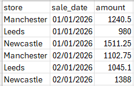
<figcaption>stores_north.csv</figcaption>
</figure>
</div>

<div align="center">
<figure>
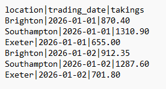
<figcaption>stores_south.txt</figcaption>
</figure>
</div>

<div align="center">
<figure>
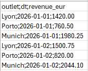
<figcaption>partners_eu.csv</figcaption>
</figure>
</div>

2. So all we need to do is pick up the filename, its associated delimiter and standardize the header - <em>control.csv</em>:
<div align="center">
<figure>
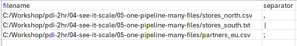
<figcaption>control.csv</figcaption>
</figure>
</div>

<div align="center">
<figure>
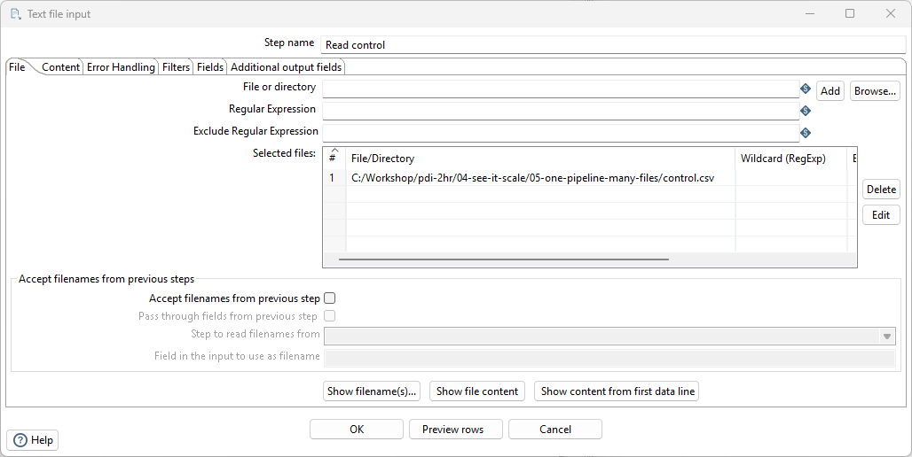
<figcaption>Path to - control.csv</figcaption>
</figure>
</div>

> **Note:** 
>
> **The shape of the solution.** One injection run
> configures the template once — so to process many differently-
> configured feeds, a small **job** runs the injection once per
> control row. Three pieces: the *template* (the reusable pipeline),
> the *injector* (fills the template in and runs it), and the
> *driver job* (loops the injector over control.csv). This is also
> your first look at a job — the orchestration layer Lab 7 talks
> about.

:::: tabs

### 1. The template
> **Note:**
>
> **Template pipeline** acts as a generic, reusable engine for your data. In a metadata injection workflow, the template is designed to handle the transformation logic (e.g., calculations, lookups, and formatting) while remaining "agnostic" to the specific metadata of the source files. Instead of hard-coding details like delimiters, file paths, or field names—which would normally require a separate pipeline for every unique file — the template uses these as placeholders. These values are then injected at runtime from a control source, allowing a single pipeline to process a diverse range of files without any changes to the underlying transformation.

<div align="center">
<figure>
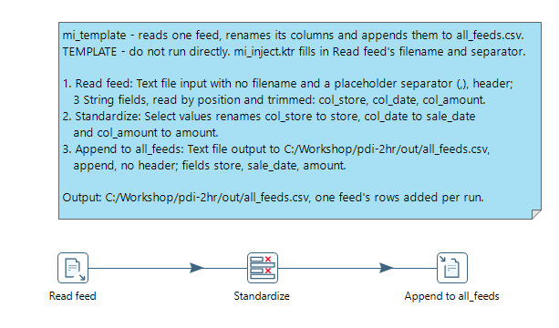
<figcaption>Template - Injects filename and delimiter</figcaption>
</figure>
</div>

1. Select **File > New > Transformation** (`Ctrl+N`). Select **File > Save as** and save it as:

```text
C:\Workshop\pdi-2hr\04-see-it-scale\05-one-pipeline-many-files\mi_template.ktr
```
2. On the **Design** tab, open the **Input** folder and drag **Text file input** onto the canvas. Double-click **Text file input**. Set **Step name** to `Read feed`. 
   - On the **Fields** tab, add three **String** fields by hand: `col_store`,
   `col_date`, `col_amount` (the feeds all share this column
   *order*, whatever the columns are called). 
   - On the **Content** tab, make sure **Header** is selected. Select **No empty rows** — that's
   injected at runtime.
<div align="center">
<figure>
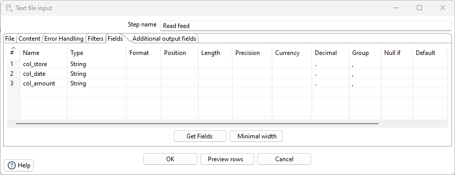
<figcaption>Edit the column headers</figcaption>
</figure>
</div>

> **Note:**
>
> The **Select Values** step is used to standardize and clean the data stream. It allows you to rename fields, change data types (e.g., converting a String to a Number), and remove unnecessary columns. In a metadata injection workflow, this step is critical for ensuring that different source files—each with unique headers and formats—are transformed into a single, unified schema before they hit the core processing logic.

3. On the **Design** tab, open the **Transform** folder and drag **Select values** onto the canvas.
   Create a hop from **Read feed** to **Select values**: hold `Shift` and drag from one step to the other.
   Double-click **Select values**. Set **Step name** to `Standardize`. On the **Select & Alter** tab, rename
   `col_store → store`, `col_date → sale_date`,
   `col_amount → amount`.
<div align="center">
<figure>
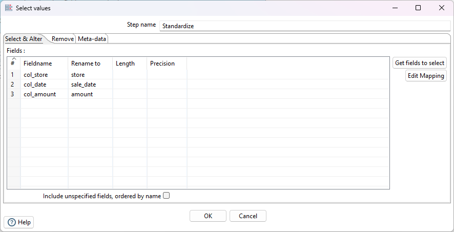
<figcaption>Rename fields</figcaption>
</figure>
</div>

> **Note:**
>
> **Text file output** step is used to write processed data to a plain text file, supporting various formats such as CSV, tab-separated, or fixed-width. In this specific workflow, it serves as the final destination for the transformed data. Because the metadata injection process standardizes the differing fields from the North, South, and EU feeds into a single schema, this one output step can successfully capture data from all sources, providing a unified landing zone for your integrated records.

4. On the **Design** tab, open the **Output** folder and drag **Text file output** onto the canvas.
   Create a hop from **Standardize** to **Text file output**, then double-click **Text file output**.
   - **Filename:** `C:\Workshop\pdi-2hr\out\all_feeds`, extension `csv`.
<div align="center">
<figure>
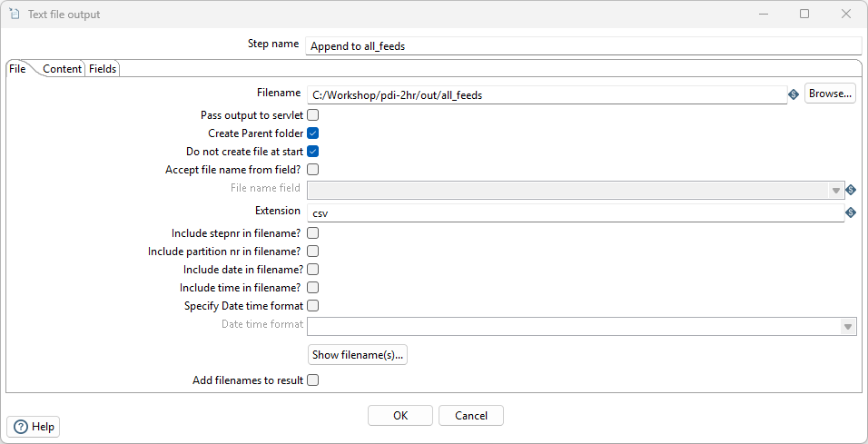
<figcaption>Output path</figcaption>
</figure>
</div>

   - On the **Content** tab, select **Append** and clear **Header**. 
   - **Fields**: add `store`, `sale_date`, `amount`.
<div align="center">
<figure>
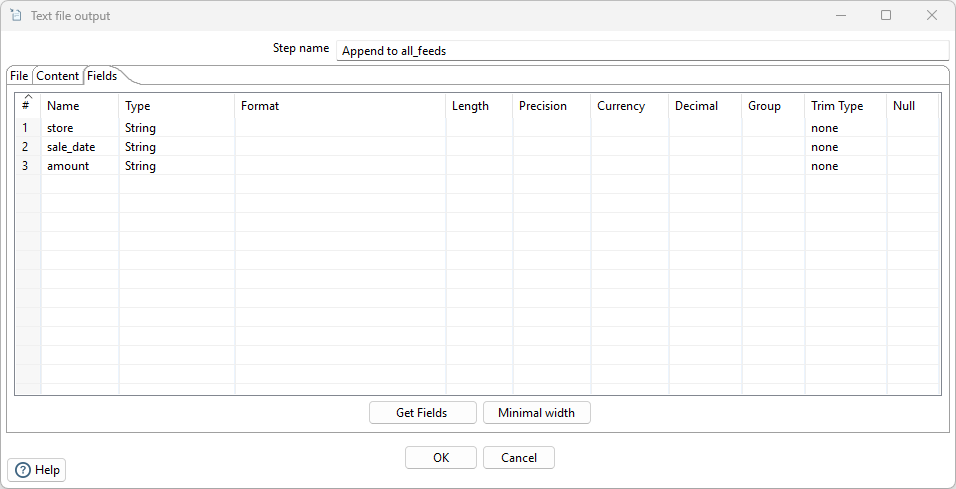
<figcaption>Get fields</figcaption>
</figure>
</div>

5. Save the transformation (`Ctrl+S`). This transformation can't run on its own — as it requires the injected metadata properties.

<a class="pcm-btn" href="#tab-2-the-injector">**Open the next tab: The injector**</a>

### 2. The injector
> **Note:**
>
> **Injector pipeline** serves as the bridge between your configuration data and your transformation logic. It reads the "control" information — such as file paths, delimiters, and field names - from a source (like `control.csv`) and feeds those values into the **Metadata Injection** step. By dynamically supplying these parameters at runtime, the Injector allows the Template pipeline to remain "agnostic," enabling it to process multiple different files without needing a unique transformation for every unique file type.

<div align="center">
<figure>
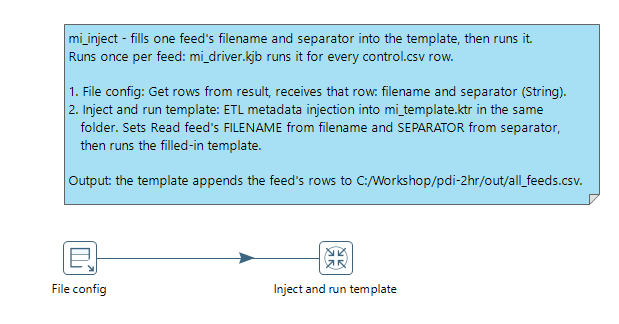
<figcaption>Metadata Injector</figcaption>
</figure>
</div>

1. Select **File > New > Transformation** (`Ctrl+N`). Select **File > Save as** and save it as `mi_inject.ktr` in `C:\Workshop\pdi-2hr\04-see-it-scale\05-one-pipeline-many-files`.
<div align="center">
<figure>
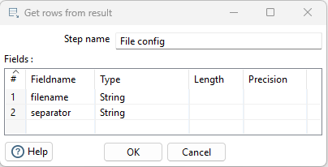
<figcaption>Add data stream fields for filename and separator</figcaption>
</figure>
</div>

> **Note:**
>
> The **Get rows from result** step acts as the bridge between your configuration source and the injection process. In a metadata injection workflow, it captures the rows (containing your file paths, delimiters, and field mappings) from a previous step or transformation and feeds them into the **Metadata Injection** step. This allows the system to dynamically "plug in" the specific requirements for each file at runtime, transforming a static template into a flexible, multi-format processor.

2. On the **Design** tab, open the **Job** folder and drag **Get rows from result** onto the canvas. 
   - Double-click it and set **Step name** to `File config`. 
   - Add its two fields: `filename` and `separator`, both String. 
   When the driver job executes this transformation
   once per control row, *this step is where that row arrives*.

<div align="center">
<figure>
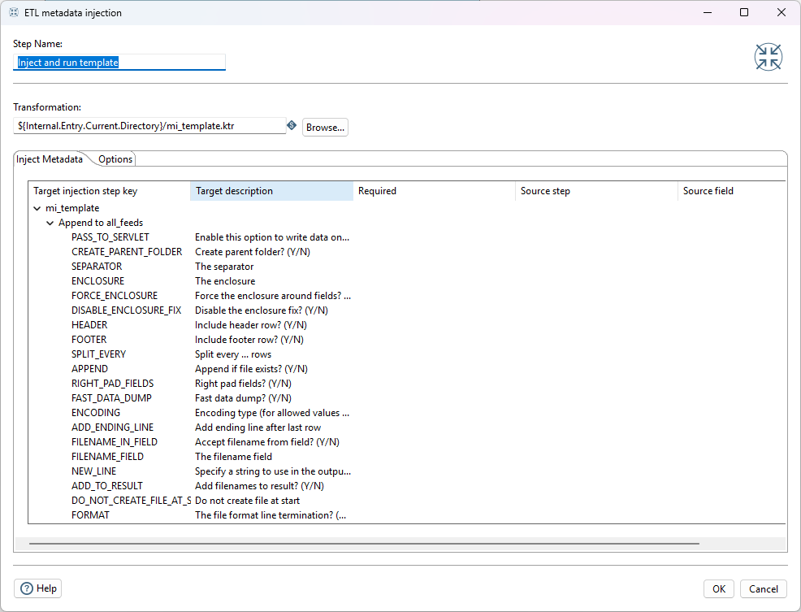
<figcaption>Template metadata properties</figcaption>
</figure>
</div>

> **Note:**
>
> **Metadata Injection** decouples the transformation logic from the source configuration. Instead of hard-coding details like delimiters, field names, or file paths, you create a "template" pipeline that remains agnostic to the specific source. At runtime, the **injection step** pulls these configurations from a control file and "injects" them into the template, allowing a single pipeline to process multiple diverse files dynamically.

3. On the **Design** tab, open the **Flow** folder and drag **ETL metadata injection** onto the canvas.
   Create a hop from **File config** to **ETL metadata injection**. 
   - Double-click it and browse to `mi_template.ktr` —
   the dialog shows every injectable property of every template
   step, as a tree.
4. Wire two injections on the `Read feed` step: **FILENAME** ←
   `File config` / `filename` (it's under the file *list*, so it
   accepts one entry per row), 
<div align="center">
<figure>
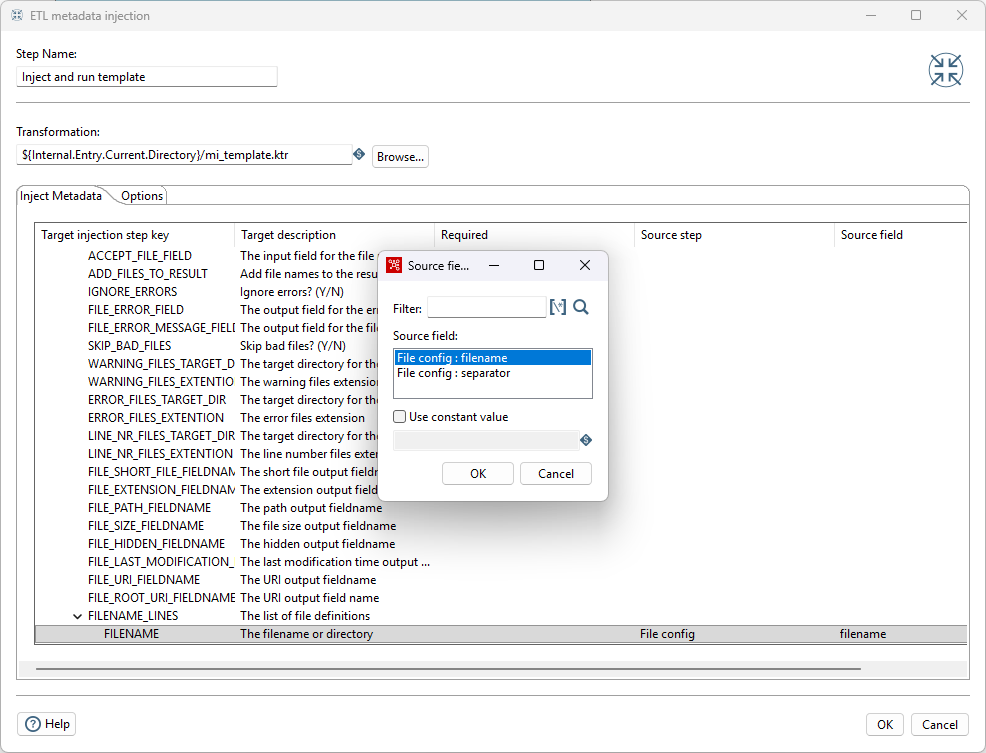
<figcaption>Inject the filename from the File config step</figcaption>
</figure>
</div>

5. and **SEPARATOR** ← `File config` / `separator`. Leave everything else alone.

<div align="center">
<figure>
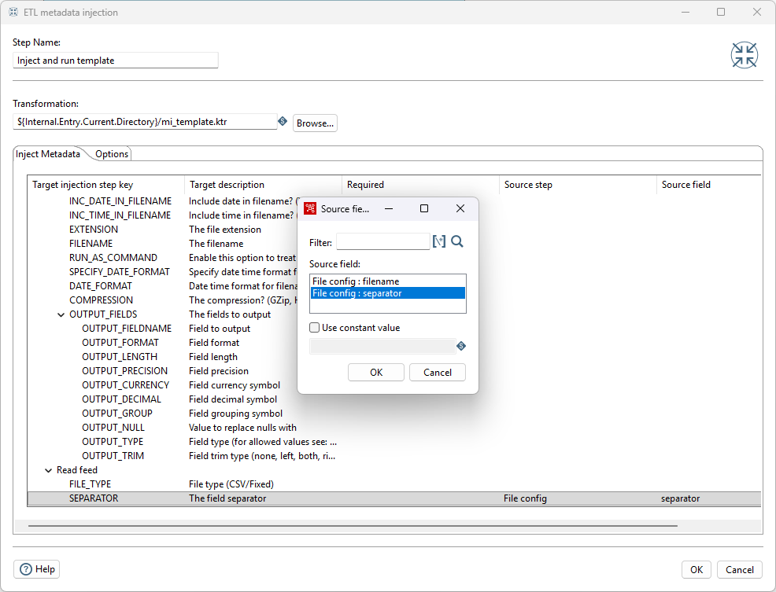
<figcaption>Inject the separator from the File config step</figcaption>
</figure>
</div>

> **Tip:**
>
> If you accidentally select the wrong property, then highlight it and select **Cancel** to remove it.

6. Save the transformation (`Ctrl+S`).

<a class="pcm-btn" href="#tab-3-the-driver-job">**Open the next tab: The driver job**</a>

### 3. The driver job
> **Note:**
>
> **Driver job** acts as the orchestration layer for the entire workflow. It reads the `control.csv` file and iterates through each row, triggering the injection process for every file listed. By looping the injection transformation, the job ensures that every unique file configuration is processed automatically, allowing you to scale from three files to hundreds without ever changing the underlying pipeline.

<div align="center">
<figure>
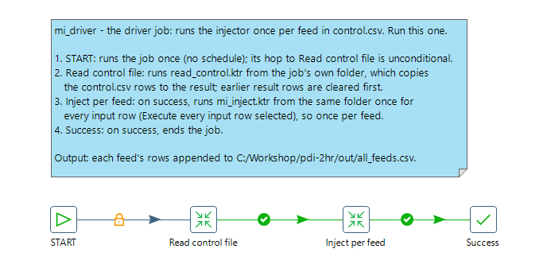
<figcaption>Job - mi_driver.kjb</figcaption>
</figure>
</div>

1. Select **File > New > Job** (`Ctrl+Alt+N`). Select **File > Save as** and save it as `mi_driver.kjb` in
   `C:\Workshop\pdi-2hr\04-see-it-scale\05-one-pipeline-many-files`.
2. On the **Design** tab, open the **General** folder and drag **START**, then two **Transformation** entries, then
   **Success** onto the canvas; hop them into a line.
<div align="center">
<figure>
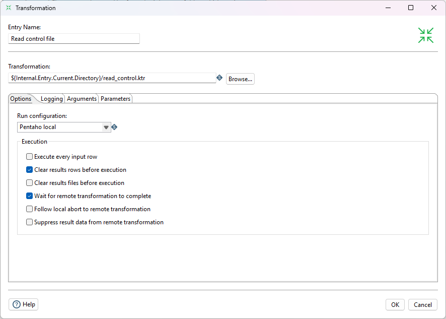
<figcaption>Read the control file</figcaption>
</figure>
</div>

3. First transformation entry → `read_control.ktr`: **Text file input** reading
   `control.csv` (fields `filename`, `separator`) hopped to **Copy
   rows to result** (from *Job*).
<div align="center">
<figure>
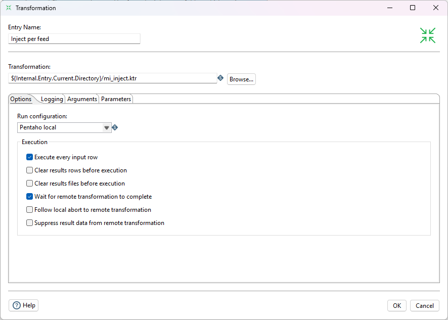
<figcaption>Inject metadata ..</figcaption>
</figure>
</div>

4. Second transformation entry → `mi_inject.ktr`. Open its
   **Options** tab and select **Execute every input row** — each
   control row becomes one execution, delivered to the injector's
   `Get rows from result` step.

> **Under the hood:**
>
> #### Your first job
>
> Everything you have built so far was a transformation: rows flow
> through steps, and all the steps run at once. A **job** is the other
> kind of thing Pentaho Data Integration runs, and it works differently. A job is a list of
> things to do one after another: run this transformation, then that
> one, then send an email if something failed. Its boxes are called
> **entries** rather than steps, and its hops carry no rows; they say
> what happens next. A hop can be unconditional (always carry on),
> follow only on success (green in Spoon), or follow only on failure
> (red). Saved, a job is a `.kjb` file, plain XML like a `.ktr`.
>
> Your driver job is the smallest useful one: START, an entry that runs
> the transformation reading `control.csv`, an entry that runs the
> injector, and Success. Two settings turn it into a loop. **Copy rows
> to result**, the last step of `read_control.ktr`, hands that
> transformation's rows back to the job. **Execute every input row**,
> on the second entry's Options tab, then runs `mi_inject.ktr` once per
> row, with that row delivered to its *Get rows from result* step.
>
> **Why it matters:** transformations move data; jobs decide the
> order, the repetition, and what happens when something goes wrong.
> Every scheduled pipeline you will ever run in Pentaho Data Integration is a job wrapped
> around transformations, which is exactly what Lab 7 is about.

<a class="pcm-btn" href="#tab-4-run-and-extend">**Open the next tab: Run and extend**</a>

### 4. Run and extend
> **Note:**
>
> In this workshop, you moved from a "hard-coded" development model to a **configuration-driven architecture**. By implementing Metadata Injection, you decoupled the transformation logic from the source file specifics. Instead of maintaining multiple transformations for different delimiters and file paths, you created a single, agnostic **Template** that can handle any file defined in your control source.
>
> This architecture ensures that when a new data source is added, you no longer need to modify Pentaho Data Integration code; you update a row in your control file. This is the gold standard for scaling Pentaho Data Integration projects to handle high-volume, varied data feeds.

1. Run the **job**: press `F9` (**Action > Run**), and select **Run** in the **Run Options** dialog. In **Execution Results**, open the **Logging** tab: the injector executes three times, once per control row.
<div align="center">
<figure>
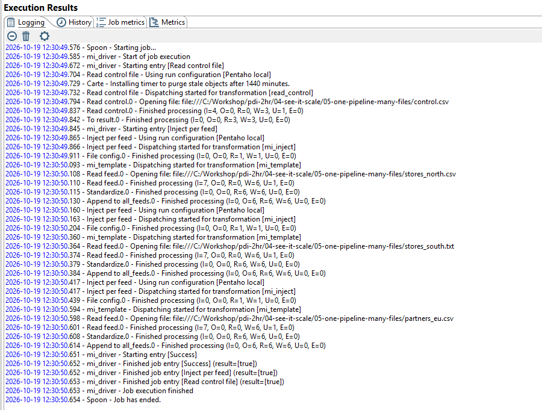
<figcaption>Notice its executed for each record</figcaption>
</figure>
</div>

2. Open `all_feeds.csv`: **18 rows** — north, south, and EU feeds,
   three shapes, one standard output.
<div align="center">
<figure>
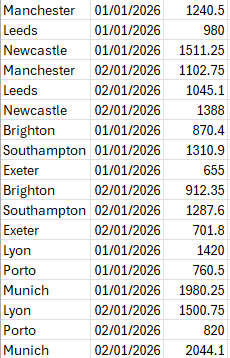
<figcaption>Output - records are appended</figcaption>
</figure>
</div>

Now the punchline:

3. Copy `stores_north.csv` to `stores_scotland.csv`, change the
   store names, and **add one line to `control.csv`** with its path
   and separator.
4. Run the job again: press `F9` (**Action > Run**), and select **Run** in the **Run Options** dialog. Four feeds. You did not open a pipeline.

> **Under the hood:**
>
> #### The template was rewritten in memory, once per feed
>
> Normally a transformation's settings, such as which file to read and
> which character separates its columns, are typed into its dialogs
> and saved in the file. **Metadata injection** means filling those
> settings in at run time instead, from data.
>
> That is what just happened. The **ETL metadata injection** step in
> `mi_inject.ktr` opened `mi_template.ktr` not to run it but to read
> it as a description, wrote the two values you mapped (the filename
> and the separator from the control row) into the template's reader
> step, and then ran that filled-in copy. The file on disk never
> changed; each control row got its own configured copy in memory.
>
> This works because a transformation is just a text file (Lab 1) and
> every setting in it has a name. Anything you can set in a dialog,
> injection can set: not only filenames and separators but whole
> column lists, so one template can take in feeds whose columns
> differ, not merely their delimiters.
>
> **Why it matters:** this is the difference between a tool and a
> platform. Your number of pipelines stops tracking your number of
> feeds; four feeds or four hundred, it stays one template, and the
> control file is something an operations team can own without ever
> opening Spoon, the designer you have been using today.

**`[ ]`** `all_feeds.csv` contains rows from all three (then four) feeds.
**`[ ]`** The new feed required editing only `control.csv`.

::::

---

## Troubleshooting <!-- no-step -->

<details>

<summary>The injection dialog shows no injectable properties</summary>

You've browsed to the wrong file, or saved the template after the
dialog opened — reopen the ETL metadata injection dialog so it
re-reads the template.

</details>

<details>

<summary>The job runs but all_feeds.csv has rows from only one feed</summary>

The second transformation entry isn't iterating — check that **Execute
every input row** is selected on its **Options** tab, and that
`read_control.ktr` ends in **Copy rows to result**.

</details>

<details>

<summary>The EU feed's rows look wrong / arrive as one column</summary>

Its control row must carry `;` as the separator — check the
`separator` column parsed correctly (the comma row needs quoting:
`","`).

</details>

---

> **Tip:** Metadata injection is the difference between "an ETL tool"
> and "an ETL platform": pipelines as *data*, driven by a control
> table your operations team can edit. Teams use this exact pattern
> to onboard hundreds of feeds with one template. Next lab: your
> data goes through it.

## Lab Files

[control.csv](./files/control.csv)

[stores_north.csv](./files/stores_north.csv)

[stores_south.txt](./files/stores_south.txt)

[partners_eu.csv](./files/partners_eu.csv)

### Solution <!-- no-step -->

Complete, working versions of all four pieces — download them into
`C:\Workshop\pdi-2hr\04-see-it-scale\05-one-pipeline-many-files\`
together (they reference each other by
folder) and run the job. Compare with your own build.

[mi_driver.kjb](./files/mi_driver.kjb) <button data-launch="spoon" data-path="files/mi_driver.kjb">Open in Pentaho Data Integration</button> <button data-graph="files/mi_driver.kjb">View graph</button>

[mi_inject.ktr](./files/mi_inject.ktr) <button data-launch="spoon" data-path="files/mi_inject.ktr">Open in Pentaho Data Integration</button> <button data-graph="files/mi_inject.ktr">View graph</button>

[mi_template.ktr](./files/mi_template.ktr) <button data-launch="spoon" data-path="files/mi_template.ktr">Open in Pentaho Data Integration</button> <button data-graph="files/mi_template.ktr">View graph</button>

[read_control.ktr](./files/read_control.ktr) <button data-launch="spoon" data-path="files/read_control.ktr">Open in Pentaho Data Integration</button> <button data-graph="files/read_control.ktr">View graph</button>
